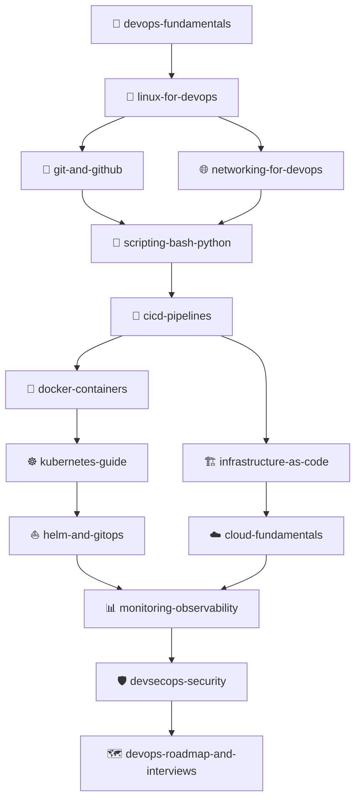

  
  
  
  

## What is this?

One repo, 14 DevOps topics. Every doc has a plain-English explanation with a real-life analogy, Mermaid diagrams, hands-on commands, common mistakes and a recap. GitHub renders the diagrams automatically.

## 🗺️ Learning path

## 📚 Topics

| | Topic | What you will learn |
|---|---|---|
| 🧭 | [devops-fundamentals](devops-fundamentals) | Culture, lifecycle, Agile, deployment strategies, DORA, SRE |
| 🐧 | [linux-for-devops](linux-for-devops) | Filesystem, permissions, systemd, cron, grep/sed/awk, SSH |
| 🌿 | [git-and-github](git-and-github) | Git internals, branching, PRs, GitFlow, trunk-based, GitHub features |
| 🌐 | [networking-for-devops](networking-for-devops) | OSI, TCP/IP, subnets, DNS, TLS, load balancers, troubleshooting |
| 🐍 | [scripting-bash-python](scripting-bash-python) | Bash, Python, boto3, YAML/JSON |
| 🔁 | [cicd-pipelines](cicd-pipelines) | GitHub Actions, Jenkins, GitLab CI, quality gates |
| 🐳 | [docker-containers](docker-containers) | Images, Dockerfile, multi-stage, networking, Compose, security |
| ☸️ | [kubernetes-guide](kubernetes-guide) | Architecture, Pods, Services, storage, HPA, RBAC, kubectl |
| ⛵ | [helm-and-gitops](helm-and-gitops) | Helm, GitOps, Argo CD, Kustomize |
| 🏗️ | [infrastructure-as-code](infrastructure-as-code) | Terraform, Ansible, CloudFormation, Pulumi |
| ☁️ | [cloud-fundamentals](cloud-fundamentals) | Cloud models, AWS core services, VPC, IAM, Azure/GCP, cost |
| 📊 | [monitoring-observability](monitoring-observability) | Prometheus, Grafana, ELK/Loki, tracing, incident response |
| 🛡️ | [devsecops-security](devsecops-security) | Shift-left, secrets, container security, SAST/DAST, supply chain |
| 🗺️ | [devops-roadmap-and-interviews](devops-roadmap-and-interviews) | Roadmap, portfolio projects, interview Q&A, certifications |

---

By [@Akhilgoud01](https://github.com/Akhilgoud01) — ⭐ star if it helped
