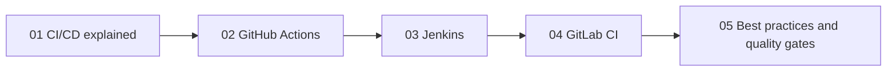
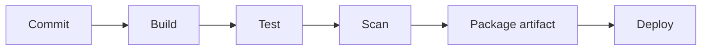

<h1 align="center">🚀 CI/CD Pipelines</h1>

<p align="center"><b>Build, test, and ship code automatically — every single time.</b></p>

<p align="center">
  
  
  
  
</p>

---

## 🎯 Why this repo

Shipping software by hand is slow and risky. A CI/CD pipeline is a robot that checks your code, tests it, packages it, and deploys it. This repo explains the ideas first, then shows real pipelines in the three most popular tools: GitHub Actions, Jenkins, and GitLab CI.

## 🗺️ Learning path



## 📚 Table of contents

| # | Topic | What you will learn |
|---|-------|---------------------|
| 01 | [CI/CD explained](docs/01-ci-cd-explained.md) | CI vs Continuous Delivery vs Continuous Deployment |
| 02 | [GitHub Actions](docs/02-github-actions.md) | Workflows, jobs, secrets, matrix, caching |
| 03 | [Jenkins](docs/03-jenkins.md) | Declarative Jenkinsfile, agents, stages |
| 04 | [GitLab CI](docs/04-gitlab-ci.md) | `.gitlab-ci.yml`, runners, environments |
| 05 | [Best practices](docs/05-pipeline-best-practices-artifacts-and-quality-gates.md) | Artifacts, caching, quality gates, rollbacks |

## ⚡ Quick cheat sheet



```yaml
# Smallest useful GitHub Actions workflow: .github/workflows/ci.yml
name: ci
on: [push, pull_request]
jobs:
  test:
    runs-on: ubuntu-latest
    steps:
      - uses: actions/checkout@v4
      - run: echo "run your tests here"
```

| Term | Meaning |
|------|---------|
| Pipeline | The full automated path from commit to deploy |
| Job | A group of steps that run on one machine |
| Stage | A phase, like build or test |
| Artifact | A file produced by the pipeline (jar, image, zip) |
| Runner / Agent | The machine that runs your jobs |

---

<p align="center">Part of the DevOps Hub by <a href="https://github.com/Akhilgoud01">@Akhilgoud01</a> — ⭐ star if it helped</p>
