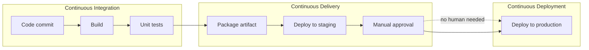
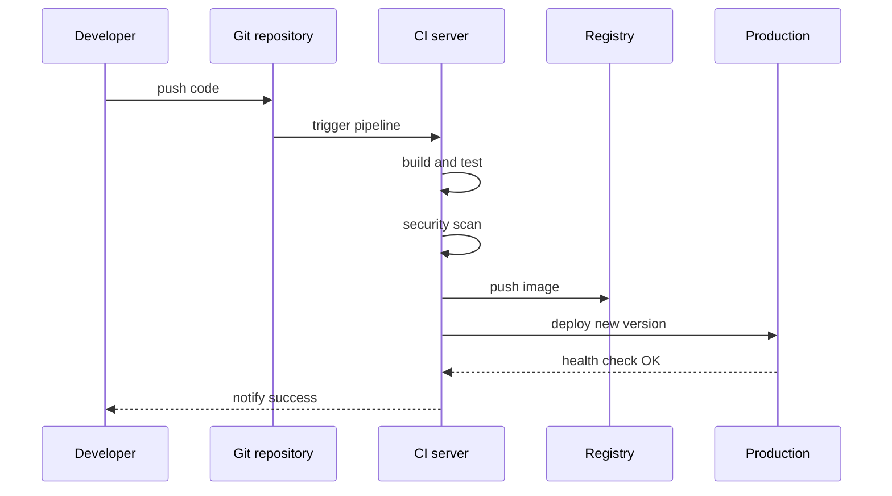

# 🔄 01 · CI/CD Explained

> **In one line:** CI/CD is an automatic path that takes code from a developer's laptop to users, checking quality at every step.

## 🧠 Simple explanation

Think of a car factory line. Parts go in at one end. At each station, a machine checks something: is the part the right size, does the engine start, does the paint look right. If a check fails, the line stops and tells the workers. A finished car comes out the other end.

CI/CD is that line for software. The "parts" are code changes. The "stations" are build, test, and deploy.

The letters mean three different things:

- **CI: Continuous Integration.** Developers merge code often. Each merge is built and tested automatically.
- **CD: Continuous Delivery.** Every good build is ready to release, but a human presses the final button.
- **CD: Continuous Deployment.** Every good build goes to production automatically. No button.



## 🔑 Key concepts

- **Pipeline**: the full automated workflow.
- **Trigger**: what starts it, like a push, a pull request, a schedule, or a manual click.
- **Stage / Job / Step**: a stage is a phase, a job runs on a machine, a step is one command.
- **Artifact**: something the pipeline makes and keeps, like a Docker image.
- **Environment**: where code runs: dev, staging, production.
- **Quality gate**: a check that must pass before moving on.
- **Fail fast**: put cheap, quick checks first so you learn about problems early.
- **Rollback**: going back to the last good version.
- **Deployment strategies**: rolling, blue/green, and canary, which reduce risk.

### CI vs Delivery vs Deployment

| | Continuous Integration | Continuous Delivery | Continuous Deployment |
|---|---|---|---|
| Builds and tests every commit | Yes | Yes | Yes |
| Always release-ready | No | Yes | Yes |
| Production release | Manual process | Manual button | Automatic |
| Needs strong test coverage | Good | Very good | Essential |

## 🛠️ Hands-on

### What a typical pipeline does



### A pipeline written as plain shell (the idea behind every tool)

```bash
#!/usr/bin/env bash
set -euo pipefail

echo "1. Install dependencies"
npm ci

echo "2. Lint"
npm run lint

echo "3. Test"
npm test

echo "4. Build"
npm run build

echo "5. Package"
docker build -t myapp:"$(git rev-parse --short HEAD)" .
```

Every CI tool does this. It adds triggers, clean machines, secrets, logs, and notifications on top.

### Simple branching rule that works with CI

```text
feature/login  ->  pull request  ->  CI runs  ->  review  ->  merge to main  ->  CD deploys
```

### The benefits in numbers you can track

- **Lead time**: how long from commit to production.
- **Deployment frequency**: how often you ship.
- **Change failure rate**: how many deploys cause problems.
- **Time to restore**: how fast you fix a failure.

These four are known as DORA metrics.

## ⚠️ Common mistakes

- **Slow pipelines.** If it takes an hour, people stop using it. Aim for under 10 minutes for the main check.
- **Flaky tests.** Tests that randomly fail destroy trust. Fix or remove them.
- **Different steps locally and in CI.** Keep one script or Makefile both can use.
- **Deploying to production without a rollback plan.**
- **Skipping CI "just this once".** It becomes a habit.
- **Secrets in the repo.** Use the tool's secret store.

## ✅ Quick recap

- CI = merge often and test automatically.
- Continuous Delivery = always ready, human approves.
- Continuous Deployment = fully automatic to production.
- Keep pipelines fast, reliable, and fail early.

➡️ **Next:** [02 · GitHub Actions](02-github-actions.md)
