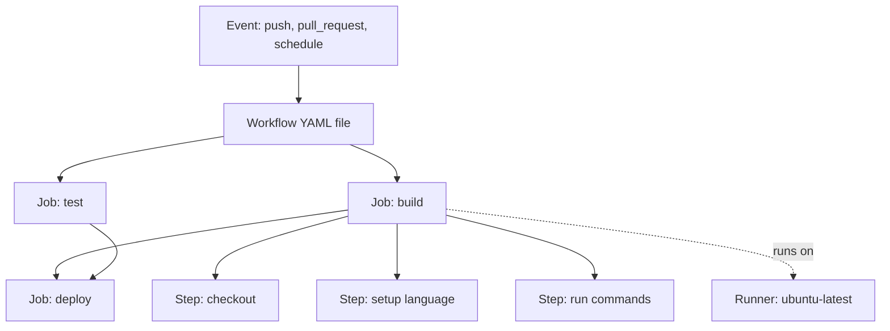

# 🐙 02 · GitHub Actions

> **In one line:** GitHub Actions runs automated workflows, written in YAML, right inside your GitHub repository.

## 🧠 Simple explanation

Imagine a to-do note stuck on your repo: "When someone pushes code, rent a clean computer, install the tools, run the tests, then throw the computer away." GitHub Actions follows that note. The note is a YAML file in `.github/workflows/`.



## 🔑 Key concepts

- **Workflow**: one YAML file in `.github/workflows/`.
- **Event (`on`)**: what triggers it: `push`, `pull_request`, `schedule`, `workflow_dispatch` (manual).
- **Job**: a set of steps on one runner. Jobs run in parallel unless you add `needs`.
- **Step**: either `run:` (a shell command) or `uses:` (a reusable action).
- **Action**: a reusable building block, like `actions/checkout@v4`.
- **Runner**: the machine. `ubuntu-latest` is GitHub-hosted. You can also run your own (self-hosted).
- **Secrets**: encrypted values, used as `${{ secrets.NAME }}`.
- **Matrix**: run the same job with many versions or systems.
- **Cache**: save downloads (like `node_modules`) between runs.
- **Environment**: named target such as `production`, with approval rules and secrets.

## 🛠️ Hands-on

### Your first workflow

Create `.github/workflows/ci.yml`:

```yaml
name: CI

on:
  push:
    branches: [main]
  pull_request:

jobs:
  test:
    runs-on: ubuntu-latest
    steps:
      - uses: actions/checkout@v4

      - name: Say hello
        run: echo "Hello from $GITHUB_REPOSITORY"
```

### Matrix, caching, and artifacts

```yaml
name: Node CI

on: [push, pull_request]

permissions:
  contents: read              # least privilege

jobs:
  test:
    runs-on: ubuntu-latest
    strategy:
      fail-fast: false
      matrix:
        node: [18, 20, 22]    # three jobs, one per version
    steps:
      - uses: actions/checkout@v4

      - uses: actions/setup-node@v4
        with:
          node-version: ${{ matrix.node }}
          cache: npm           # built-in dependency cache

      - run: npm ci
      - run: npm test

      - name: Upload coverage
        if: matrix.node == 22
        uses: actions/upload-artifact@v4
        with:
          name: coverage
          path: coverage/
```

### Secrets and variables

Add secrets in **Settings → Secrets and variables → Actions**. Use them like this:

```yaml
      - name: Deploy
        env:
          API_TOKEN: ${{ secrets.API_TOKEN }}     # secret
          REGION: ${{ vars.AWS_REGION }}          # non-secret variable
        run: ./deploy.sh
```

### Full example: test, build image, deploy

```yaml
name: Build and Deploy

on:
  push:
    branches: [main]
  workflow_dispatch:

permissions:
  contents: read
  packages: write

env:
  IMAGE: ghcr.io/${{ github.repository }}

jobs:
  test:
    runs-on: ubuntu-latest
    steps:
      - uses: actions/checkout@v4
      - uses: actions/setup-python@v5
        with:
          python-version: "3.12"
          cache: pip
      - run: pip install -r requirements.txt
      - run: pytest

  build:
    needs: test                        # waits for test
    runs-on: ubuntu-latest
    steps:
      - uses: actions/checkout@v4
      - uses: docker/login-action@v3
        with:
          registry: ghcr.io
          username: ${{ github.actor }}
          password: ${{ secrets.GITHUB_TOKEN }}
      - uses: docker/build-push-action@v6
        with:
          context: .
          push: true
          tags: |
            ${{ env.IMAGE }}:${{ github.sha }}
            ${{ env.IMAGE }}:latest

  deploy:
    needs: build
    runs-on: ubuntu-latest
    environment: production            # can require manual approval
    steps:
      - name: Deploy over SSH
        env:
          HOST: ${{ secrets.SERVER_HOST }}
        run: echo "Deploying ${{ github.sha }} to $HOST"
```

### Useful expressions and contexts

```yaml
if: github.ref == 'refs/heads/main'          # only on main
if: github.event_name == 'pull_request'
if: failure()                                 # run only if a prior step failed
if: always()                                  # run no matter what
run: echo "Commit ${{ github.sha }} by ${{ github.actor }}"
```

### Reusable workflow

```yaml
# .github/workflows/reusable-test.yml
on:
  workflow_call:
    inputs:
      node-version:
        type: string
        default: "20"
jobs:
  test:
    runs-on: ubuntu-latest
    steps:
      - uses: actions/checkout@v4
      - uses: actions/setup-node@v4
        with: { node-version: "${{ inputs.node-version }}" }
      - run: npm ci && npm test
```

```yaml
# caller
jobs:
  call:
    uses: ./.github/workflows/reusable-test.yml
    with:
      node-version: "22"
```

## ⚠️ Common mistakes

- **Wrong folder.** Workflows must live in `.github/workflows/`.
- **YAML indentation errors.** Validate with `yamllint` or the editor's Actions extension.
- **Using `@main` or `@latest` for actions.** Pin to a version tag or, even better, a commit SHA.
- **Too wide permissions.** Set `permissions:` explicitly to the minimum.
- **Printing secrets.** Secrets are masked in logs, but do not `echo` them or transform them.
- **Untrusted pull requests with secrets.** Be careful with `pull_request_target`.
- **Forgetting `needs`.** Jobs run in parallel by default.

## ✅ Quick recap

- Workflows are YAML files in `.github/workflows/`.
- Events trigger workflows, workflows hold jobs, jobs hold steps.
- Use matrix, cache, and `needs` to be fast and organized.
- Keep secrets in the secret store and permissions minimal.

➡️ **Next:** [03 · Jenkins](03-jenkins.md)
