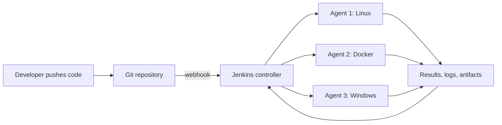

# 🧑‍✈️ 03 · Jenkins

> **In one line:** Jenkins is a self-hosted automation server where you define pipelines as code in a `Jenkinsfile`.

## 🧠 Simple explanation

Jenkins is like a foreman in a workshop. The foreman (the **controller**) does not do heavy work. He reads the plan (the `Jenkinsfile`), then hands tasks to workers (the **agents**). Each worker runs a stage, such as build or test, and reports back.

Jenkins is older than GitHub Actions and very flexible, with a huge plugin library. You run and maintain it yourself.



## 🔑 Key concepts

- **Controller (formerly master)**: the brain. Schedules jobs, stores config, shows the UI.
- **Agent (node)**: a machine or container that actually runs the work.
- **Jenkinsfile**: a text file in your repo that describes the pipeline.
- **Declarative pipeline**: structured, simpler syntax starting with `pipeline { }`. Recommended.
- **Scripted pipeline**: free-form Groovy starting with `node { }`. More power, more mess.
- **Stage**: a named phase, like Build or Test.
- **Step**: one action inside a stage, such as `sh 'make'`.
- **Credentials**: secrets stored in Jenkins and used by ID.
- **Plugin**: add-on for tools like Docker, Git, Kubernetes, Slack.
- **Multibranch pipeline**: creates a pipeline per branch automatically.
- **Shared library**: reusable pipeline code shared across repos.

## 🛠️ Hands-on

### Run Jenkins quickly with Docker

```bash
docker run -d --name jenkins \
  -p 8080:8080 -p 50000:50000 \
  -v jenkins_home:/var/jenkins_home \
  jenkins/jenkins:lts-jdk17

# get the first admin password
docker exec jenkins cat /var/jenkins_home/secrets/initialAdminPassword
```

Open `http://localhost:8080`, paste the password, and install the suggested plugins.

### Basic declarative Jenkinsfile

Put this file named `Jenkinsfile` in the root of your repo:

```groovy
pipeline {
    agent any

    options {
        timeout(time: 20, unit: 'MINUTES')
        timestamps()
        buildDiscarder(logRotator(numToKeepStr: '20'))
    }

    environment {
        APP_NAME = 'myapp'
    }

    stages {
        stage('Checkout') {
            steps {
                checkout scm
            }
        }
        stage('Build') {
            steps {
                sh 'npm ci'
                sh 'npm run build'
            }
        }
        stage('Test') {
            steps {
                sh 'npm test'
            }
            post {
                always {
                    junit 'reports/**/*.xml'
                }
            }
        }
        stage('Deploy') {
            when { branch 'main' }
            steps {
                input message: 'Deploy to production?'
                sh './deploy.sh'
            }
        }
    }

    post {
        success { echo 'Pipeline succeeded' }
        failure { echo 'Pipeline failed' }
        always  { cleanWs() }
    }
}
```

### Agents: docker and labels

```groovy
pipeline {
    agent none                       // choose per stage

    stages {
        stage('Test in container') {
            agent {
                docker { image 'node:20-alpine' }
            }
            steps {
                sh 'node --version && npm ci && npm test'
            }
        }
        stage('Build on a labelled agent') {
            agent { label 'linux-build' }
            steps {
                sh 'make build'
            }
        }
    }
}
```

### Credentials

```groovy
stage('Push image') {
    steps {
        withCredentials([usernamePassword(
            credentialsId: 'dockerhub-creds',
            usernameVariable: 'DOCKER_USER',
            passwordVariable: 'DOCKER_PASS')]) {
            sh '''
              echo "$DOCKER_PASS" | docker login -u "$DOCKER_USER" --password-stdin
              docker push myorg/myapp:${BUILD_NUMBER}
            '''
        }
    }
}
```

Add credentials in **Manage Jenkins → Credentials**.

### Parallel stages

```groovy
stage('Checks') {
    parallel {
        stage('Unit tests') { steps { sh 'npm run test:unit' } }
        stage('Lint')       { steps { sh 'npm run lint' } }
    }
}
```

### Triggers

```groovy
triggers {
    pollSCM('H/5 * * * *')     // every 5 minutes (a webhook is better)
    cron('H 2 * * *')          // nightly
}
```

### Common built-in variables

| Variable | Meaning |
|----------|---------|
| `BUILD_NUMBER` | the run number |
| `JOB_NAME` | name of the job |
| `BRANCH_NAME` | branch (multibranch) |
| `WORKSPACE` | folder where the job runs |
| `GIT_COMMIT` | commit SHA |

## ⚠️ Common mistakes

- **Running builds on the controller.** Use agents. Set controller executors to 0.
- **Putting secrets in the Jenkinsfile.** Use the Credentials store.
- **Never updating plugins or Jenkins.** Old versions have known security issues.
- **No backup of `JENKINS_HOME`.** Back it up, or use Jenkins Configuration as Code.
- **Click-configured jobs.** Prefer a Jenkinsfile in Git so changes are reviewed.
- **Using `agent any` everywhere** without thinking about which tools exist on the agent.

## ✅ Quick recap

- Controller schedules, agents work.
- Use declarative `Jenkinsfile` stored in your repo.
- Stages organize work, `post` handles results, `when` adds conditions.
- Store secrets in Credentials and keep Jenkins updated.

➡️ **Next:** [04 · GitLab CI](04-gitlab-ci.md)
