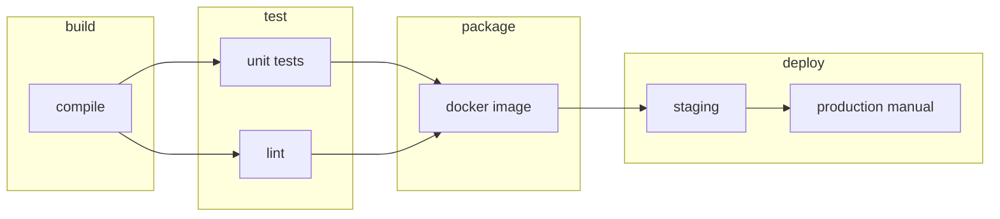

# 🦊 04 · GitLab CI

> **In one line:** GitLab CI reads a `.gitlab-ci.yml` file in your repo and runs its jobs on runners, stage by stage.

## 🧠 Simple explanation

Picture a relay race. Each team (a **stage**) must finish before the next one starts. Inside a team, several runners (**jobs**) can run side by side. If any runner drops the baton, the race stops.

GitLab CI works the same way: stages run in order, jobs inside one stage run in parallel.



## 🔑 Key concepts

- **`.gitlab-ci.yml`**: the pipeline file at the repo root.
- **Pipeline**: one run of everything.
- **Stage**: a phase. Default order: `.pre`, `build`, `test`, `deploy`, `.post`.
- **Job**: a unit of work with a `script:`.
- **Runner**: the agent that runs jobs. Shared (from GitLab) or your own.
- **Executor**: how a runner works: `shell`, `docker`, `kubernetes`.
- **Image**: Docker image the job runs in.
- **Variables**: settings and secrets. Masked and protected variables live in **Settings → CI/CD → Variables**.
- **Artifacts**: files a job saves and passes on.
- **Cache**: speeds up repeated downloads.
- **`rules`**: decide when a job runs.
- **`needs`**: lets a job start early, skipping the strict stage order (builds a DAG).
- **Environment**: a deploy target tracked by GitLab.

## 🛠️ Hands-on

### Minimal pipeline

Create `.gitlab-ci.yml` in the repo root:

```yaml
stages:
  - build
  - test
  - deploy

build-job:
  stage: build
  image: node:20-alpine
  script:
    - npm ci
    - npm run build
  artifacts:
    paths:
      - dist/
    expire_in: 1 week

test-job:
  stage: test
  image: node:20-alpine
  script:
    - npm ci
    - npm test
```

### Cache, variables, and rules

```yaml
variables:
  NODE_ENV: "production"

default:
  image: node:20-alpine
  cache:
    key:
      files:
        - package-lock.json
    paths:
      - node_modules/

test:
  stage: test
  script:
    - npm ci
    - npm test
  rules:
    - if: $CI_PIPELINE_SOURCE == "merge_request_event"
    - if: $CI_COMMIT_BRANCH == $CI_DEFAULT_BRANCH

deploy-prod:
  stage: deploy
  script:
    - ./deploy.sh
  environment:
    name: production
    url: https://example.com
  rules:
    - if: $CI_COMMIT_BRANCH == $CI_DEFAULT_BRANCH
      when: manual                     # human clicks the button
```

### Build and push a Docker image

```yaml
build-image:
  stage: build
  image: docker:27
  services:
    - docker:27-dind
  variables:
    DOCKER_TLS_CERTDIR: "/certs"
  before_script:
    - echo "$CI_REGISTRY_PASSWORD" | docker login -u "$CI_REGISTRY_USER" --password-stdin "$CI_REGISTRY"
  script:
    - docker build -t "$CI_REGISTRY_IMAGE:$CI_COMMIT_SHORT_SHA" .
    - docker push "$CI_REGISTRY_IMAGE:$CI_COMMIT_SHORT_SHA"
```

### Faster pipelines with `needs`

```yaml
lint:
  stage: test
  script: npm run lint

unit:
  stage: test
  script: npm test

package:
  stage: deploy
  needs: ["unit"]          # starts as soon as unit passes, ignores lint timing
  script: ./package.sh
```

### Reuse with `extends` and `include`

```yaml
.deploy-template:
  image: alpine:3.20
  before_script:
    - apk add --no-cache curl
  script:
    - ./deploy.sh "$TARGET"

deploy-staging:
  extends: .deploy-template
  variables:
    TARGET: staging
  environment: staging

include:
  - template: Security/SAST.gitlab-ci.yml     # built-in security scan
```

### Register your own runner

```bash
# install gitlab-runner, then:
sudo gitlab-runner register \
  --url https://gitlab.com \
  --token <RUNNER_TOKEN> \
  --executor docker \
  --docker-image alpine:3.20
```

### Useful predefined variables

| Variable | Meaning |
|----------|---------|
| `CI_COMMIT_SHA` | full commit hash |
| `CI_COMMIT_BRANCH` | branch name |
| `CI_PIPELINE_SOURCE` | what triggered the pipeline |
| `CI_REGISTRY_IMAGE` | project's container registry path |
| `CI_DEFAULT_BRANCH` | usually `main` |

## ⚠️ Common mistakes

- **Unmasked secrets.** Mark secret variables as **Masked** and **Protected**.
- **No `rules`, so jobs run on every branch.** Wastes minutes.
- **Huge caches.** Cache only what helps, key it by lockfile.
- **Confusing cache and artifacts.** Cache is for speed. Artifacts are for passing results.
- **Forgetting `expire_in`.** Artifacts then pile up and use storage.
- **Using `latest` image tags.** Pin versions for repeatable builds.

## ✅ Quick recap

- `.gitlab-ci.yml` defines stages and jobs.
- Runners execute jobs, often in Docker.
- `rules`, `needs`, `cache`, and `artifacts` make pipelines smart and fast.
- Use `extends` and `include` to avoid copy-paste.

➡️ **Next:** [05 · Pipeline best practices](05-pipeline-best-practices-artifacts-and-quality-gates.md)
