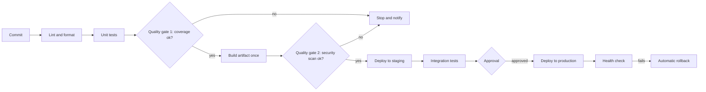

# 🏅 05 · Pipeline Best Practices, Artifacts and Quality Gates

> **In one line:** A great pipeline is fast, repeatable, secure, and stops bad code with clear quality gates.

## 🧠 Simple explanation

Airport security has several checkpoints: ticket, ID, baggage scan. You cannot reach the plane until you pass each one. A **quality gate** is a checkpoint in your pipeline. The code cannot move forward until tests pass, coverage is high enough, and no serious vulnerability is found.

An **artifact** is the sealed package that goes through those gates. You build it once and promote the same package from dev to staging to production. That way you test exactly what you ship.



## 🔑 Key concepts

- **Build once, deploy many.** Never rebuild for each environment. Change only configuration.
- **Immutable artifact**: never modified after creation. Tag it with the commit SHA, not just `latest`.
- **Versioning**: use semantic versions (`1.4.2`) or commit SHAs so you can trace every release.
- **Quality gate**: a pass/fail rule, such as "coverage ≥ 80%" or "no critical vulnerabilities".
- **Shift left**: run checks as early as possible, because bugs get costlier later.
- **Pipeline as code**: pipeline files live in Git and go through review.
- **Secrets management**: secrets come from a vault or the CI secret store, never from code.
- **Idempotent deploys**: deploying twice gives the same result.
- **Deployment strategies**:
  - *Rolling*: replace old copies gradually.
  - *Blue/green*: run two environments and switch traffic.
  - *Canary*: send a small share of users to the new version first.
- **Rollback**: a fast, tested way back.

## 🛠️ Hands-on

### Quality gates in GitHub Actions

```yaml
name: quality
on: [pull_request]

jobs:
  checks:
    runs-on: ubuntu-latest
    steps:
      - uses: actions/checkout@v4
      - uses: actions/setup-python@v5
        with: { python-version: "3.12", cache: pip }
      - run: pip install -r requirements.txt pytest pytest-cov ruff

      - name: Lint
        run: ruff check .

      - name: Tests with coverage gate
        run: pytest --cov=app --cov-fail-under=80    # fails below 80%

      - name: Dependency vulnerability scan
        run: pip install pip-audit && pip-audit -r requirements.txt
```

Then in GitHub: **Settings → Branches → Branch protection rules → Require status checks to pass**. Now the gate cannot be bypassed.

### Container image scan gate

```bash
# fail the pipeline on HIGH or CRITICAL findings
trivy image --exit-code 1 --severity HIGH,CRITICAL myapp:"$GIT_SHA"
```

### Tag artifacts well

```bash
SHA=$(git rev-parse --short HEAD)
docker build -t registry.example.com/myapp:"$SHA" .
docker tag   registry.example.com/myapp:"$SHA" registry.example.com/myapp:1.4.2
docker push  registry.example.com/myapp:"$SHA"
docker push  registry.example.com/myapp:1.4.2
```

### Speed tips

```yaml
# 1) Cache dependencies
- uses: actions/setup-node@v4
  with: { node-version: 20, cache: npm }

# 2) Run independent jobs in parallel (no 'needs' between them)
# 3) Cancel old runs when a new commit arrives
concurrency:
  group: ci-${{ github.ref }}
  cancel-in-progress: true

# 4) Only run what changed
on:
  push:
    paths:
      - "src/**"
      - "package-lock.json"
```

### Safe deployment with health check and rollback

```bash
#!/usr/bin/env bash
set -euo pipefail

NEW="$1"; OLD="$(kubectl get deploy web -o jsonpath='{.spec.template.spec.containers[0].image}')"

kubectl set image deploy/web web="$NEW"
if ! kubectl rollout status deploy/web --timeout=120s; then
  echo "Deploy failed, rolling back to $OLD"
  kubectl rollout undo deploy/web
  exit 1
fi
```

### Pipeline checklist

| Area | Good practice |
|------|---------------|
| Speed | Main check under 10 minutes, use cache and parallel jobs |
| Reliability | No flaky tests, pinned tool versions |
| Security | Least-privilege tokens, secret scanning, image scanning |
| Traceability | Every artifact tagged with commit SHA |
| Safety | Approvals for production, health checks, rollback |
| Visibility | Notifications to chat, clear logs, DORA metrics |

### Notify the team

```yaml
      - name: Notify on failure
        if: failure()
        run: |
          curl -fsS -X POST -H 'Content-Type: application/json' \
            -d '{"text":"Pipeline failed on ${{ github.ref_name }}"}' \
            "${{ secrets.SLACK_WEBHOOK_URL }}"
```

## ⚠️ Common mistakes

- **Rebuilding per environment.** You then test one thing and ship another.
- **Only using the `latest` tag.** You cannot tell what is running or roll back.
- **Quality gates that people can skip.** Enforce them with branch protection.
- **Gates that are too strict on day one.** Start with a realistic bar, raise it slowly.
- **Ignoring pipeline security.** CI has powerful credentials. Protect them and pin third-party actions.
- **No ownership of failures.** A broken main branch pipeline must be fixed first.

## ✅ Quick recap

- Build once, tag by commit, promote the same artifact.
- Put cheap checks first and enforce quality gates with branch protection.
- Scan code, dependencies, and images automatically.
- Always have health checks and a rollback path.

🎉 **You finished this repo.** Next, learn what your pipeline builds: see the **docker-containers** repo.
