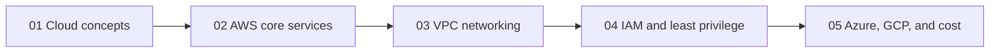

<h1 align="center">☁️ Cloud Fundamentals</h1>

<p align="center"><b>Understand the cloud, AWS core services, networking, IAM, and cost, in plain English.</b></p>

<p align="center">
  
  
  
</p>

## 💡 Why this repo

Almost every DevOps job runs on a cloud. This repo explains what the cloud is, who is responsible for what, and how the key AWS building blocks fit together. It ends with the same ideas mapped to Azure and GCP, plus ways to save money.

## 🗺️ Learning path



## 📚 Table of contents

| # | Doc | What you will learn |
|---|-----|---------------------|
| 01 | [Cloud concepts](docs/01-cloud-concepts-iaas-paas-saas-shared-responsibility.md) | IaaS, PaaS, SaaS, shared responsibility |
| 02 | [AWS core services](docs/02-aws-core-services.md) | EC2, S3, VPC, IAM, RDS, Lambda, ELB, Route 53 |
| 03 | [VPC networking deep dive](docs/03-aws-vpc-networking-deep-dive.md) | Subnets, routes, gateways, security groups |
| 04 | [IAM and least privilege](docs/04-iam-and-least-privilege.md) | Users, roles, policies, safe access |
| 05 | [Azure, GCP, and cost](docs/05-azure-and-gcp-equivalents-and-cost-optimization.md) | Service mapping and saving money |

## ⚡ Quick cheat sheet

```bash
aws configure
aws sts get-caller-identity
aws ec2 describe-instances --query 'Reservations[].Instances[].[InstanceId,State.Name]' --output table
aws s3 ls
aws s3 cp file.txt s3://my-bucket/
aws iam list-roles --max-items 5
```

---
Part of the DevOps Hub by [@Akhilgoud01](https://github.com/Akhilgoud01) — ⭐ star if it helped
