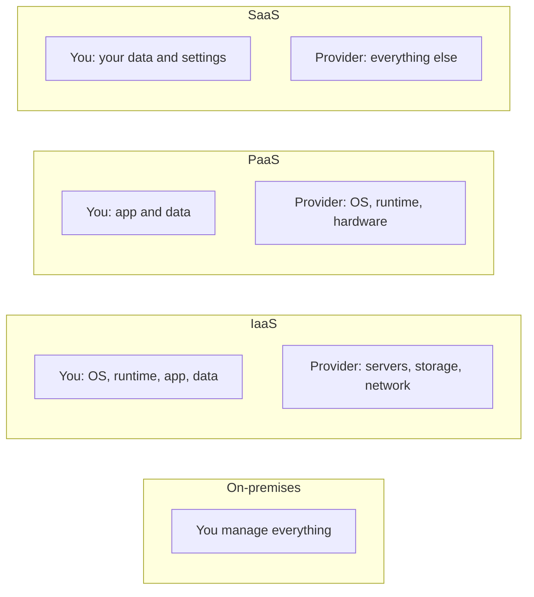
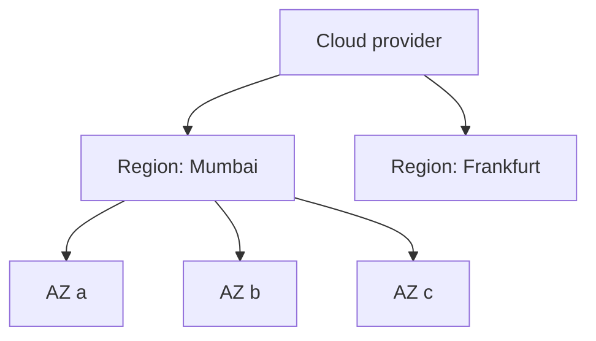
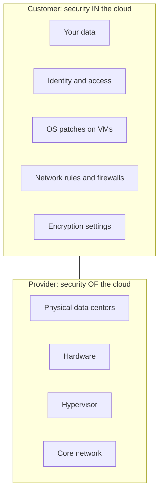

# ☁️ Cloud Concepts: IaaS, PaaS, SaaS, and Shared Responsibility

> In one line: The cloud means renting computing power over the internet, and you choose how much of the work you manage yourself.

## 🧠 Simple explanation

Think about getting a pizza.

- **On-premises**: you make everything at home. You buy the oven, flour, cheese.
- **IaaS**: you rent a kitchen. You bring the ingredients and cook.
- **PaaS**: you get a ready oven with a recipe tool. You add toppings.
- **SaaS**: you order a finished pizza and just eat it.

The more the provider does, the less control you have, and the less work you do.



## 🔑 Key concepts

| Model | You manage | Provider manages | Example |
|-------|-----------|------------------|---------|
| IaaS | OS, runtime, app, data | Hardware, network, virtualization | AWS EC2, Azure VMs, GCP Compute Engine |
| PaaS | App, data | OS, runtime, scaling | AWS Elastic Beanstalk, Azure App Service, Google App Engine |
| SaaS | Your data, users | The whole application | Gmail, Slack, Salesforce |
| FaaS (serverless functions) | Your function code | Servers, scaling | AWS Lambda, Azure Functions |

### Deployment models

- **Public cloud**: shared provider data centers (AWS, Azure, GCP).
- **Private cloud**: cloud technology used only by one company, often in its own data center.
- **Hybrid cloud**: public plus private connected together.
- **Multi-cloud**: using more than one public provider.

### Global structure (AWS words)

- **Region**: a geographic area, such as `ap-south-1` (Mumbai).
- **Availability Zone (AZ)**: one or more separate data centers inside a region. Spread your app across at least two AZs for high availability.
- **Edge location**: a small site used by the CDN (CloudFront) to be near users.



### Shared responsibility model

The provider secures the cloud itself. You secure what you put in it.



### Why companies use the cloud

- **Pay as you go**: no big upfront hardware cost.
- **Elasticity**: add or remove capacity in minutes.
- **Global reach**: deploy near your users.
- **Managed services**: let the provider run databases, queues, and more.

## 🛠️ Hands-on

Try these safely with the AWS Free Tier. Always set a budget alert first.

```bash
# who am I?
aws sts get-caller-identity

# list regions you can use
aws ec2 describe-regions --query 'Regions[].RegionName' --output text

# list AZs in your current region
aws ec2 describe-availability-zones \
  --query 'AvailabilityZones[].[ZoneName,State]' --output table
```

Create a simple budget alert (replace the email):

```bash
aws budgets create-budget --account-id "$(aws sts get-caller-identity --query Account --output text)" \
  --budget '{"BudgetName":"monthly-5usd","BudgetLimit":{"Amount":"5","Unit":"USD"},"TimeUnit":"MONTHLY","BudgetType":"COST"}' \
  --notifications-with-subscribers '[{"Notification":{"NotificationType":"ACTUAL","ComparisonOperator":"GREATER_THAN","Threshold":80,"ThresholdType":"PERCENTAGE"},"Subscribers":[{"SubscriptionType":"EMAIL","Address":"you@example.com"}]}]'
```

Choosing a model, a quick guide:

| If you need... | Choose |
|----------------|--------|
| Full control of the OS | IaaS |
| Just run my code, no server work | PaaS or serverless |
| A finished tool for my team | SaaS |

## ⚠️ Common mistakes

- **Thinking "the cloud is secure by default."** Misconfigured storage buckets and open ports are the top causes of leaks.
- **Running everything in one AZ.** An AZ failure takes you down.
- **Using the root account for daily work.** Create separate users or roles and turn on MFA for root.
- **Ignoring costs until the bill arrives.** Set budgets from day one.
- **Lifting and shifting without changes.** Cloud-native design usually gives better cost and reliability.

## ✅ Quick recap

- IaaS gives VMs, PaaS gives a platform, SaaS gives a finished app.
- Regions contain AZs. Use more than one AZ.
- Shared responsibility: provider secures the cloud, you secure what you put in it.
- Set MFA and budgets on day one.

➡️ Next: [02 - AWS core services](02-aws-core-services.md)
