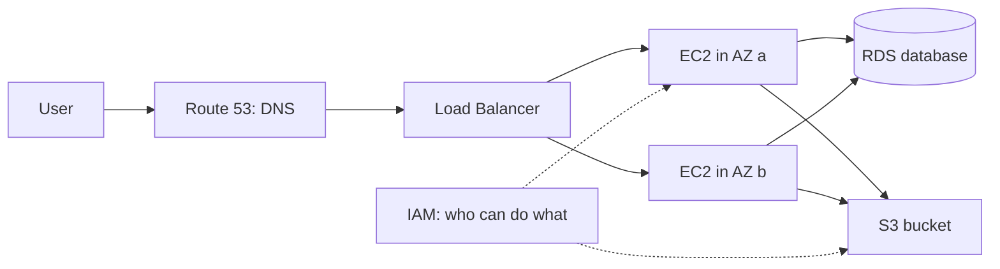
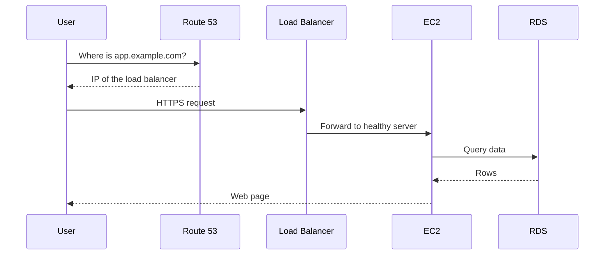
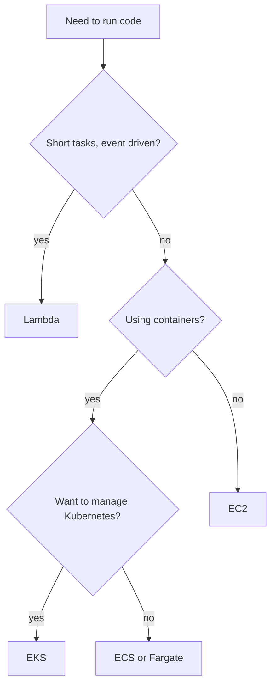

# 🧱 AWS Core Services

> In one line: A small set of AWS services (compute, storage, network, database, identity, DNS) covers most real-world apps.

## 🧠 Simple explanation

Think of AWS as a giant hardware store with thousands of items. You do not need all of them. A typical web app needs only a few: a server to run code, a disk for files, a database, a network with a front door, a lock system for access, and a phone book for the domain name.



## 🔑 Key concepts

| Service | What it is | Simple analogy |
|---------|-----------|----------------|
| **EC2** | Virtual servers | A rented computer |
| **S3** | Object storage for files | An unlimited cloud folder |
| **VPC** | Your private network | Your own fenced property |
| **IAM** | Users, roles, permissions | Keys and door badges |
| **RDS** | Managed relational database (MySQL, PostgreSQL, etc.) | A database with a caretaker |
| **Lambda** | Run code without servers, pay per run | A taxi: pay only for the ride |
| **ELB** | Load balancer to spread traffic | A receptionist sending visitors to free desks |
| **Route 53** | DNS and domain names | The phone book |
| **CloudWatch** | Metrics, logs, alarms | The security cameras and dashboard |
| **EBS** | Disk attached to an EC2 | A hard drive |
| **Auto Scaling** | Adds or removes EC2 automatically | A manager hiring extra staff at rush hour |

### EC2 notes
- **AMI**: the image used to start a server.
- **Instance type**: size, such as `t3.micro` (small) or `m5.large` (medium).
- **Pricing**: On-Demand, Reserved/Savings Plans, Spot (cheap but can be taken back).

### S3 notes
- Data lives in **buckets** as **objects**. Names are globally unique.
- **Storage classes**: Standard, Infrequent Access, Glacier (archive). Cheaper when you read less.
- S3 buckets are **private by default**. Keep "Block Public Access" on unless you truly need public files.

### RDS notes
- Turn on **Multi-AZ** for automatic failover.
- Turn on **automated backups**.
- Keep the database in a **private subnet**.

### ELB types
- **ALB** (Application): HTTP and HTTPS, smart routing by path or host.
- **NLB** (Network): very fast TCP/UDP.

## 🛠️ Hands-on

### 1. Store a file in S3

```bash
aws s3 mb s3://my-demo-bucket-12345
echo "hello cloud" > hello.txt
aws s3 cp hello.txt s3://my-demo-bucket-12345/
aws s3 ls s3://my-demo-bucket-12345/
aws s3 presign s3://my-demo-bucket-12345/hello.txt --expires-in 300
```

### 2. Start and stop an EC2 instance

```bash
AMI=$(aws ssm get-parameter \
  --name /aws/service/ami-amazon-linux-latest/al2023-ami-kernel-default-x86_64 \
  --query 'Parameter.Value' --output text)

aws ec2 run-instances --image-id "$AMI" --instance-type t3.micro \
  --tag-specifications 'ResourceType=instance,Tags=[{Key=Name,Value=demo}]' \
  --count 1

aws ec2 describe-instances --filters Name=tag:Name,Values=demo \
  --query 'Reservations[].Instances[].[InstanceId,State.Name]' --output table

aws ec2 terminate-instances --instance-ids i-0123456789abcdef0   # use your real ID
```

### 3. A tiny Lambda function

`lambda_function.py`:

```python
def lambda_handler(event, context):
    name = event.get("name", "world")
    return {"statusCode": 200, "body": f"Hello, {name}!"}
```

```bash
zip fn.zip lambda_function.py
aws lambda create-function --function-name hello \
  --runtime python3.12 --handler lambda_function.lambda_handler \
  --zip-file fileb://fn.zip \
  --role arn:aws:iam::123456789012:role/lambda-basic-role   # use your role ARN

aws lambda invoke --function-name hello \
  --payload '{"name":"DevOps"}' --cli-binary-format raw-in-base64-out out.json
cat out.json
```

### 4. A request flow in time order



### 5. Which compute service?



## ⚠️ Common mistakes

- **Making an S3 bucket public by accident.** Leave Block Public Access on.
- **Putting a database in a public subnet.** Use private subnets.
- **Forgetting to stop or terminate test servers.** You keep paying. Also release unused Elastic IPs and delete unattached EBS volumes.
- **Using one big server for everything.** Use load balancing and Auto Scaling.
- **Opening port 22 to `0.0.0.0/0`.** Use Session Manager or limit to your IP.

## ✅ Quick recap

- EC2 for servers, S3 for files, RDS for databases, Lambda for functions.
- ELB spreads traffic, Route 53 handles names, IAM controls access.
- Use two AZs and keep databases private.
- Always clean up what you create.

➡️ Next: [03 - VPC networking deep dive](03-aws-vpc-networking-deep-dive.md)
