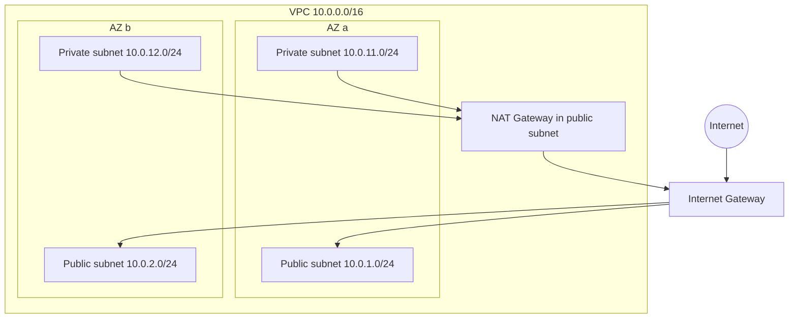
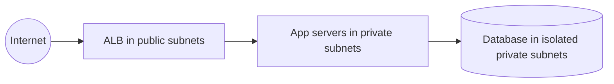
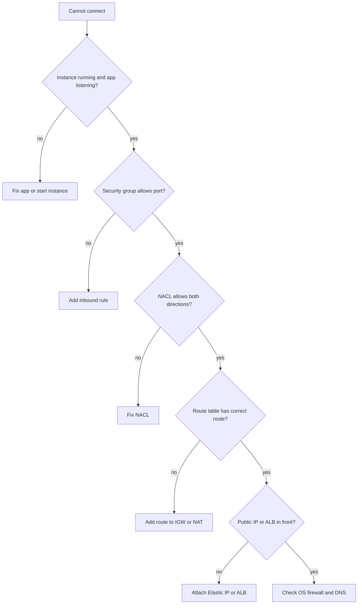

# 🌐 AWS VPC Networking Deep Dive

> In one line: A VPC is your own private network inside AWS, and subnets, route tables, and gateways decide who can talk to whom.

## 🧠 Simple explanation

Imagine a gated housing community (the VPC). Inside are streets (subnets). Some streets face the main road and have a front gate (public subnets). Others are inner streets with no direct road access (private subnets). Route tables are the road signs. Security guards at each house (security groups) check every visitor.



## 🔑 Key concepts

- **CIDR block**: the IP range, for example `10.0.0.0/16` gives about 65,000 addresses.
- **Subnet**: a slice of the VPC that lives in one AZ.
- **Public subnet**: its route table sends `0.0.0.0/0` to an **Internet Gateway (IGW)**.
- **Private subnet**: no direct route to the IGW. It may use a **NAT Gateway** to reach the internet outward only.
- **Route table**: rules that say where traffic goes.
- **Internet Gateway**: the door between the VPC and the internet.
- **NAT Gateway**: lets private servers download updates, but blocks inbound connections from outside.
- **Security Group (SG)**: a *stateful* firewall on a resource. Allow rules only.
- **Network ACL (NACL)**: a *stateless* firewall on a subnet. Allow and deny rules.
- **VPC Peering / Transit Gateway**: connect VPCs together.
- **VPC Endpoint**: private path to AWS services (like S3) without using the internet.

| Point | Security Group | NACL |
|-------|----------------|------|
| Level | Instance / network interface | Subnet |
| State | Stateful (replies auto allowed) | Stateless (need both ways) |
| Rules | Allow only | Allow and deny |
| Default | Deny all inbound | Allow all |

### Typical 3-tier design



Security group chaining makes this safe: the app SG only accepts traffic **from the ALB SG**, and the DB SG only accepts traffic **from the app SG**.

## 🛠️ Hands-on

### Build a VPC with the CLI

```bash
VPC=$(aws ec2 create-vpc --cidr-block 10.0.0.0/16 \
  --tag-specifications 'ResourceType=vpc,Tags=[{Key=Name,Value=demo-vpc}]' \
  --query 'Vpc.VpcId' --output text)

PUB=$(aws ec2 create-subnet --vpc-id "$VPC" --cidr-block 10.0.1.0/24 \
  --availability-zone ap-south-1a --query 'Subnet.SubnetId' --output text)

PRIV=$(aws ec2 create-subnet --vpc-id "$VPC" --cidr-block 10.0.11.0/24 \
  --availability-zone ap-south-1a --query 'Subnet.SubnetId' --output text)

IGW=$(aws ec2 create-internet-gateway --query 'InternetGateway.InternetGatewayId' --output text)
aws ec2 attach-internet-gateway --internet-gateway-id "$IGW" --vpc-id "$VPC"

RT=$(aws ec2 create-route-table --vpc-id "$VPC" --query 'RouteTable.RouteTableId' --output text)
aws ec2 create-route --route-table-id "$RT" --destination-cidr-block 0.0.0.0/0 --gateway-id "$IGW"
aws ec2 associate-route-table --route-table-id "$RT" --subnet-id "$PUB"
```

The public subnet is public only because its route table points to the IGW.

### Security group chaining

```bash
ALB_SG=$(aws ec2 create-security-group --group-name alb-sg --description alb \
  --vpc-id "$VPC" --query GroupId --output text)
APP_SG=$(aws ec2 create-security-group --group-name app-sg --description app \
  --vpc-id "$VPC" --query GroupId --output text)

aws ec2 authorize-security-group-ingress --group-id "$ALB_SG" \
  --protocol tcp --port 443 --cidr 0.0.0.0/0

aws ec2 authorize-security-group-ingress --group-id "$APP_SG" \
  --protocol tcp --port 8080 --source-group "$ALB_SG"
```

### The same in Terraform

```hcl
module "vpc" {
  source  = "terraform-aws-modules/vpc/aws"
  version = "~> 5.0"

  name = "demo"
  cidr = "10.0.0.0/16"

  azs             = ["ap-south-1a", "ap-south-1b"]
  public_subnets  = ["10.0.1.0/24", "10.0.2.0/24"]
  private_subnets = ["10.0.11.0/24", "10.0.12.0/24"]

  enable_nat_gateway = true
  single_nat_gateway = true   # cheaper for dev; use one per AZ for prod
}
```

### Troubleshooting checklist

When a server cannot be reached, walk this list in order:



Helpful tool: **VPC Reachability Analyzer** can test the path between two resources.

## ⚠️ Common mistakes

- **CIDR ranges that overlap** with another VPC or office network. You cannot peer them later.
- **Too small a CIDR.** Plan for growth. `/16` for the VPC and `/24` for subnets is common.
- **NAT Gateway cost surprise.** It charges per hour and per GB. Use VPC endpoints for S3 and DynamoDB to cut costs.
- **Thinking "private subnet" means secure by itself.** You still need security groups and least privilege.
- **Opening a database port to the whole internet.**

## ✅ Quick recap

- VPC = your private network. Subnets live in one AZ each.
- Public subnet = route to an IGW. Private subnet = no direct route.
- NAT gives private servers outbound-only internet.
- Chain security groups rather than using wide IP ranges.

➡️ Next: [04 - IAM and least privilege](04-iam-and-least-privilege.md)
