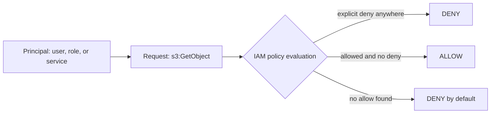
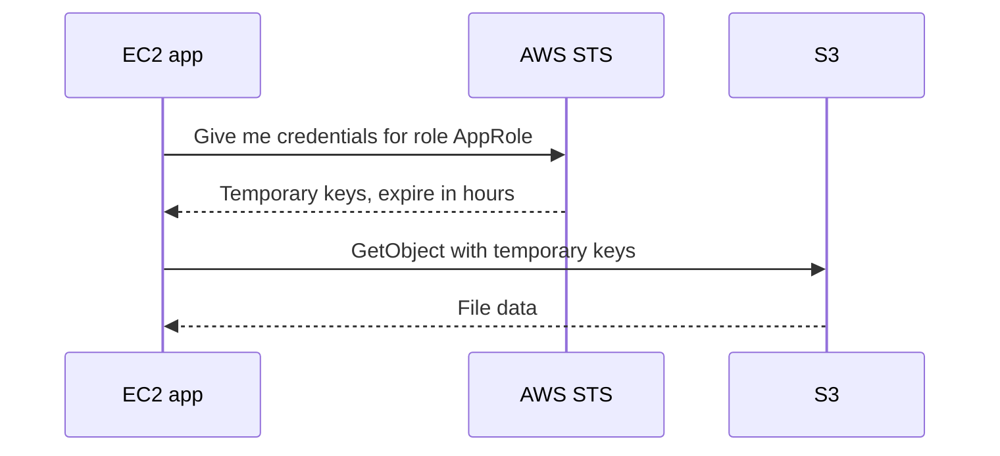
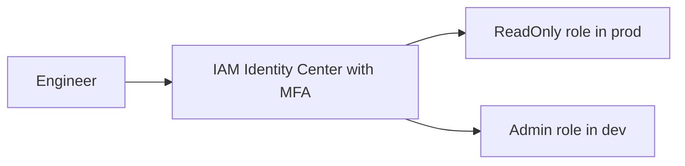

# 🔐 IAM and Least Privilege

> In one line: IAM decides who can do what on which AWS resource, and least privilege means giving only the permissions needed, nothing extra.

## 🧠 Simple explanation

At an office, a cleaner gets a key to the rooms they clean, not the safe. A manager gets more keys. Nobody gets a master key unless they really need it. IAM is the key system for AWS. Least privilege is the rule "give the smallest set of keys that still lets the person do the job".



## 🔑 Key concepts

- **Root user**: the account owner. Has full power. Lock it with MFA and do not use it daily.
- **IAM user**: a person or app with long-term credentials. Prefer SSO or roles for people.
- **IAM group**: a set of users sharing the same policies.
- **IAM role**: an identity with no password that anyone (or any service) can *assume* to get temporary credentials. Best practice.
- **Policy**: a JSON document that allows or denies actions.
- **Principal**: who is making the request.
- **Action**: what they try to do (`s3:GetObject`).
- **Resource**: what they try to do it to (an ARN).
- **Condition**: extra rules (time, IP, MFA present, tags).
- **Trust policy**: says *who may assume* a role.
- **Permission boundary / SCP**: guardrails that cap the maximum permissions.

Evaluation rules to remember:

1. Everything is denied by default.
2. An explicit **Allow** can open access.
3. An explicit **Deny** always wins.

### Policy structure

```json
{
  "Version": "2012-10-17",
  "Statement": [
    {
      "Sid": "ReadReportsBucket",
      "Effect": "Allow",
      "Action": ["s3:GetObject", "s3:ListBucket"],
      "Resource": [
        "arn:aws:s3:::company-reports",
        "arn:aws:s3:::company-reports/*"
      ]
    }
  ]
}
```

### Roles in action



An EC2 instance gets its role through an **instance profile**. No access keys are stored on the server.

## 🛠️ Hands-on

### 1. Turn on MFA and protect root
In the console: **Security credentials** for root, add an MFA device, delete any root access keys.

### 2. Create a least-privilege role for an app

Trust policy `trust.json` (lets EC2 assume the role):

```json
{
  "Version": "2012-10-17",
  "Statement": [
    {
      "Effect": "Allow",
      "Principal": { "Service": "ec2.amazonaws.com" },
      "Action": "sts:AssumeRole"
    }
  ]
}
```

Permission policy `s3-read.json` (read one bucket only):

```json
{
  "Version": "2012-10-17",
  "Statement": [
    {
      "Effect": "Allow",
      "Action": ["s3:GetObject"],
      "Resource": "arn:aws:s3:::company-reports/*"
    }
  ]
}
```

```bash
aws iam create-role --role-name app-reader --assume-role-policy-document file://trust.json
aws iam put-role-policy --role-name app-reader --policy-name s3-read \
  --policy-document file://s3-read.json
aws iam create-instance-profile --instance-profile-name app-reader
aws iam add-role-to-instance-profile --instance-profile-name app-reader --role-name app-reader
```

### 3. Test a policy without risk

```bash
aws iam simulate-principal-policy \
  --policy-source-arn arn:aws:iam::123456789012:role/app-reader \
  --action-names s3:GetObject s3:DeleteObject \
  --resource-arns arn:aws:s3:::company-reports/q1.pdf
```

Expected: `GetObject` allowed, `DeleteObject` denied.

### 4. Find what a role really uses

```bash
aws iam generate-service-last-accessed-details \
  --arn arn:aws:iam::123456789012:role/app-reader
```

IAM Access Analyzer can also generate a tighter policy from CloudTrail activity and warn about public or cross-account access.

### 5. Human access done well



### 6. Least privilege steps that work in practice

1. Start with **no** permissions.
2. Add only the actions and resources needed.
3. Watch CloudTrail and Access Analyzer for what was really used.
4. Remove unused permissions every few months.
5. Use conditions, such as `aws:MultiFactorAuthPresent`, for risky actions.
6. Use separate AWS accounts for dev and prod, joined with AWS Organizations.

## ⚠️ Common mistakes

- **Using `"Action": "*"` and `"Resource": "*"`.** That is full admin. Avoid except for break-glass.
- **Access keys in code or in Git.** Use roles. If a key leaks, rotate it at once.
- **Giving `AdministratorAccess` to developers "to make it work".** Grant specific services.
- **Forgetting to remove users who left.** Use SSO so access ends when their account is disabled.
- **Skipping MFA.** Passwords alone are weak.

## ✅ Quick recap

- Default deny. Explicit deny always wins.
- Prefer roles and temporary credentials over long-term keys.
- Scope actions and resources tightly, and review usage often.
- MFA everywhere, and no daily root use.

➡️ Next: [05 - Azure, GCP, and cost optimization](05-azure-and-gcp-equivalents-and-cost-optimization.md)
