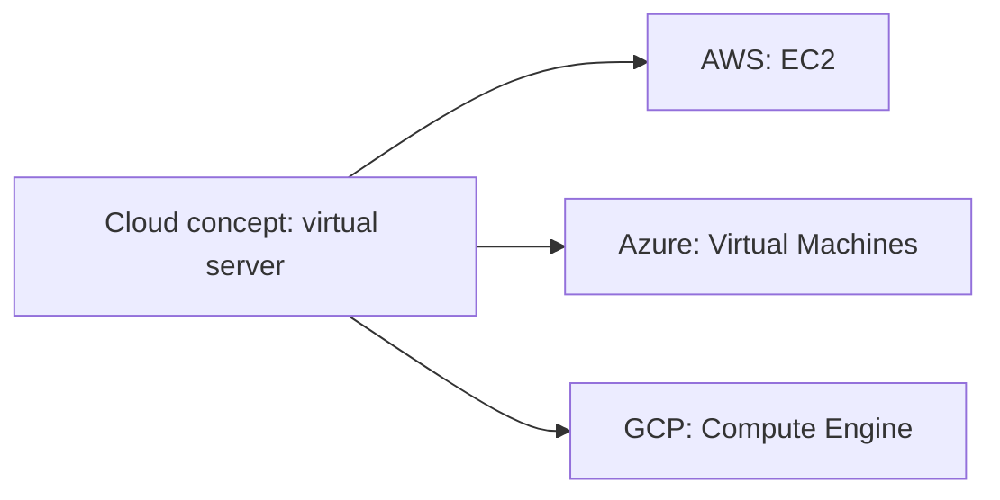
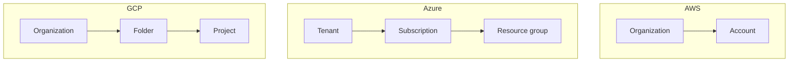
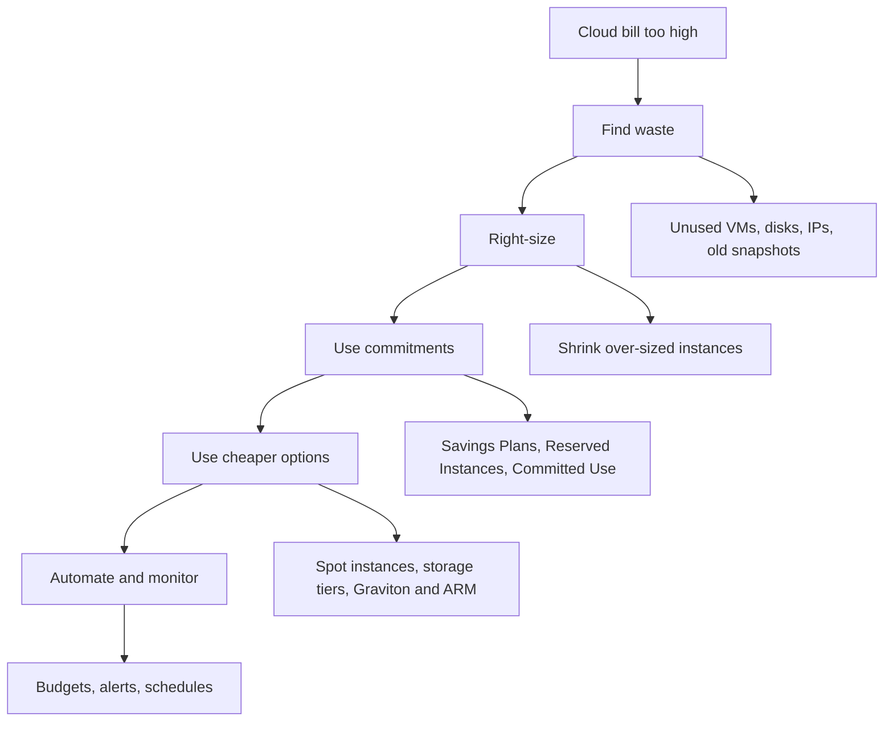

# 💰 Azure and GCP Equivalents, and Cost Optimization

> In one line: The big three clouds offer almost the same building blocks under different names, and the cheapest cloud is the one you watch closely.

## 🧠 Simple explanation

Learning a second cloud is like learning to drive a different car brand. The pedals are in the same place, but the buttons have new labels. Once you know AWS, you mostly need a translation table.

Cost control is like a household budget. You track spending, switch off lights you do not use, and buy in bulk when you know you will need it.



## 🔑 Key concepts

### Service mapping

| Need | AWS | Azure | GCP |
|------|-----|-------|-----|
| Virtual machines | EC2 | Virtual Machines | Compute Engine |
| Object storage | S3 | Blob Storage | Cloud Storage |
| Private network | VPC | Virtual Network (VNet) | VPC |
| Identity and access | IAM | Microsoft Entra ID and Azure RBAC | Cloud IAM |
| Managed SQL database | RDS | Azure SQL / Database for PostgreSQL | Cloud SQL |
| Serverless functions | Lambda | Azure Functions | Cloud Functions / Cloud Run functions |
| Managed Kubernetes | EKS | AKS | GKE |
| Container service | ECS / Fargate | Container Apps / ACI | Cloud Run |
| Load balancer | ELB (ALB, NLB) | Load Balancer / Application Gateway | Cloud Load Balancing |
| DNS | Route 53 | Azure DNS | Cloud DNS |
| Monitoring | CloudWatch | Azure Monitor | Cloud Monitoring |
| Secrets | Secrets Manager | Key Vault | Secret Manager |
| IaC native | CloudFormation | Bicep / ARM | Deployment Manager (Terraform is common) |
| CLI | `aws` | `az` | `gcloud` |

### Grouping resources

- **AWS**: accounts under an Organization.
- **Azure**: resources go in *resource groups* inside *subscriptions*.
- **GCP**: resources go in *projects* inside folders and an organization.



### The same task in three CLIs

```bash
# AWS: list virtual machines
aws ec2 describe-instances --output table

# Azure: list virtual machines
az vm list --output table

# GCP: list virtual machines
gcloud compute instances list
```

## 🛠️ Hands-on: cost optimization

### 1. See and set limits first

```bash
# AWS: cost for the month so far, grouped by service
aws ce get-cost-and-usage \
  --time-period Start=2026-10-01,End=2026-10-31 \
  --granularity MONTHLY --metrics UnblendedCost \
  --group-by Type=DIMENSION,Key=SERVICE
```

Set budget alerts in all three clouds (AWS Budgets, Azure Cost Management budgets, GCP Billing budgets).

### 2. Tag everything

Tags let you answer "who spends what?".

```hcl
provider "aws" {
  region = "ap-south-1"
  default_tags {
    tags = {
      Team  = "platform"
      Env   = "dev"
      Owner = "akhil"
    }
  }
}
```

### 3. The cost-saving checklist



| Technique | What to do | Typical effect |
|-----------|-----------|----------------|
| Delete waste | Remove idle servers, unattached disks, old snapshots, unused load balancers | Immediate savings |
| Right-size | Use CloudWatch CPU and memory data, then pick a smaller type | Medium |
| Schedule | Stop dev and test servers at night and weekends | Large for non-prod |
| Commitments | AWS Savings Plans or Reserved Instances, Azure Reservations, GCP Committed Use | Big discount for steady load |
| Spot / Preemptible | Use for batch jobs and stateless workers | Large, but can be interrupted |
| Storage tiers | Move old data to S3 Infrequent Access or Glacier using lifecycle rules | Medium |
| ARM CPUs | Graviton (AWS), Ampere (Azure), Tau T2A (GCP) | 10 to 40 percent better price/performance, when software supports it |
| Cut data transfer | Use CDN, VPC endpoints, keep traffic in one region | Often hidden but large |
| Autoscale | Scale down when traffic drops | Medium |

Stop non-production EC2 on a schedule (simple example with CLI):

```bash
# stop all running instances tagged Env=dev
aws ec2 stop-instances --instance-ids $(aws ec2 describe-instances \
  --filters Name=tag:Env,Values=dev Name=instance-state-name,Values=running \
  --query 'Reservations[].Instances[].InstanceId' --output text)
```

Add an S3 lifecycle rule:

```bash
aws s3api put-bucket-lifecycle-configuration --bucket my-demo-bucket-12345 \
  --lifecycle-configuration '{
    "Rules": [{
      "ID": "archive-old-logs",
      "Status": "Enabled",
      "Filter": {"Prefix": "logs/"},
      "Transitions": [{"Days": 30, "StorageClass": "STANDARD_IA"},
                      {"Days": 90, "StorageClass": "GLACIER"}],
      "Expiration": {"Days": 365}
    }]
  }'
```

### 4. FinOps habits

1. **Visibility**: dashboards per team using tags.
2. **Ownership**: every resource has an owner.
3. **Review**: a short monthly cost review.
4. **Automation**: schedules, autoscaling, and cleanup scripts.

## ⚠️ Common mistakes

- **Forgetting free-tier limits end** after the first 12 months for some services, and some are only "always free" up to a limit.
- **Leaving NAT gateways, load balancers, and idle databases running** in test accounts.
- **Buying long commitments before measuring** real usage.
- **No tags.** You cannot cut what you cannot see.
- **Copying service names between clouds blindly.** Features and limits differ, so read each provider's docs.
- **Ignoring data transfer fees.** Moving data out of a cloud or across regions costs money.

## ✅ Quick recap

- Learn one cloud well. Map concepts to the others using the table.
- Tag, budget, and alert from the start.
- Delete waste, right-size, schedule, then commit to savings plans.
- Cost control is a habit, not a one-time task.

🎉 You finished this repo. Go back to the [README](../README.md).
