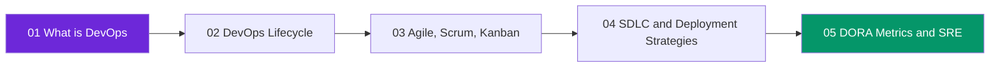

<h1 align="center">🚀 DevOps Fundamentals</h1>

<b>Understand what DevOps really is, before you touch a single tool.</b>

  
  
  
  

---

## 💡 Why this repo

Many people jump straight into Docker, Kubernetes, and Terraform. But DevOps is first an **idea**: build, ship, and run software together, quickly and safely. Tools come second. This repo explains that idea in simple English, with diagrams, so every later topic makes sense.

## 🗺️ Learning path

## 📚 Table of contents

| # | Doc | What you will learn |
|---|-----|---------------------|
| 01 | [What is DevOps](docs/01-what-is-devops.md) | History, culture, and the "wall of confusion" |
| 02 | [DevOps Lifecycle](docs/02-devops-lifecycle.md) | The infinity loop: plan, code, build, test, release, deploy, operate, monitor |
| 03 | [Agile, Scrum, Kanban](docs/03-agile-scrum-kanban.md) | How teams plan and deliver work in small steps |
| 04 | [SDLC and Deployment Strategies](docs/04-sdlc-and-deployment-strategies.md) | Blue-green, canary, and rolling releases |
| 05 | [DORA Metrics and SRE Basics](docs/05-dora-metrics-and-sre-basics.md) | How to measure DevOps: SLI, SLO, SLA, error budgets |

## 🧾 Quick cheat sheet

| Term | Meaning in one line |
|------|---------------------|
| DevOps | Developers and operations share ownership of building and running software |
| CI | Merge code often; every merge is built and tested automatically |
| CD | Every good build can be released (delivery) or is released (deployment) automatically |
| IaC | Infrastructure described in code files |
| SLI / SLO / SLA | What you measure / your goal / your promise to customers |
| Error budget | How much unreliability you are allowed before you slow down releases |

---

Part of the DevOps Hub by <a href="https://github.com/Akhilgoud01">@Akhilgoud01</a> — ⭐ star if it helped

