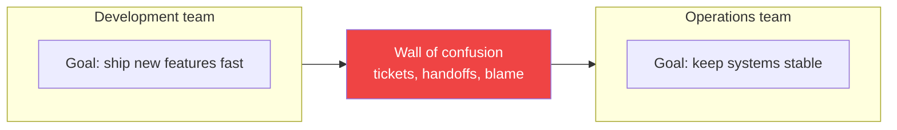
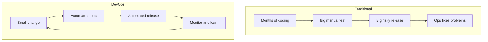

# 🤝 What is DevOps?

> **In one line:** DevOps is a way of working where the people who build software and the people who run it work as one team, using automation to ship small changes quickly and safely.

## 🧠 Simple explanation

Imagine a restaurant. The **chefs** (developers) want to try new dishes all the time. The **waiters and managers** (operations) want the restaurant to run smoothly with no surprises. If the chefs throw new dishes over a wall into the dining room without telling anyone, the waiters get angry customers. If the waiters block every new dish, customers get bored.

DevOps removes the wall. Chefs and waiters plan the menu together, test dishes together, and fix problems together. Everyone cares about one goal: **happy customers**.

DevOps is not a job title, a tool, or a team you hire. It is a **culture** supported by **practices** and **tools**.

## 🧱 The wall of confusion

Before DevOps, teams were often split and had different goals.



Because developers were rewarded for **change** and operations were rewarded for **stability**, they pulled in opposite directions. Releases were rare, big, and risky.

## 🕰️ A short history

| Year | Event |
|------|-------|
| 2001 | The Agile Manifesto is published. Developers start working in short cycles. |
| 2007 to 2008 | Patrick Debois and others discuss "agile infrastructure". |
| 2009 | At the Velocity conference, a talk called "10+ Deploys per Day" shows Dev and Ops cooperating. The first DevOpsDays event follows in Belgium. |
| 2010s | Cloud, containers, and CI/CD tools make automation easy and cheap. |
| Today | Platform engineering, DevSecOps, and GitOps build on the same ideas. |

## 🔑 Key concepts

- **CALMS** is a simple model for DevOps:
  - **C**ulture: trust and shared responsibility.
  - **A**utomation: do not repeat manual work.
  - **L**ean: small batches, remove waste.
  - **M**easurement: use data, not opinions.
  - **S**haring: share knowledge and tools.
- **The Three Ways** (from *The Phoenix Project* and *The DevOps Handbook*):
  1. **Flow**: make work move from idea to customer quickly.
  2. **Feedback**: learn fast when something goes wrong.
  3. **Continuous learning**: experiment and improve all the time.
- **You build it, you run it**: the team that writes the code also helps support it in production.
- **Shift left**: find problems earlier (in code and tests, not in production).

## 🔄 Old way vs DevOps way



| Topic | Traditional | DevOps |
|-------|-------------|--------|
| Release size | Big | Small |
| Release frequency | Months | Daily or hourly |
| Testing | Manual, at the end | Automated, all the time |
| Failures | Blame someone | Learn from it |
| Servers | Hand-built | Defined in code |

## 🛠️ Hands-on

You do not need a tool to start. Try this thought exercise, then a tiny real step.

1. Write down how your last change reached users. How many handoffs were there?
2. Find one manual step that you repeat. Automate it with a script.

```bash
#!/usr/bin/env bash
# deploy-check.sh - a tiny automation example: check a site is up after a release
set -euo pipefail

URL="${1:-https://example.com}"
STATUS=$(curl -s -o /dev/null -w "%{http_code}" "$URL")

if [ "$STATUS" -eq 200 ]; then
  echo "OK: $URL returned $STATUS"
else
  echo "FAIL: $URL returned $STATUS" >&2
  exit 1
fi
```

```bash
chmod +x deploy-check.sh
./deploy-check.sh https://example.com
```

This small script is already DevOps thinking: a human check became a repeatable, automatic check.

## ⚠️ Common mistakes

- **Thinking DevOps is a tool.** Buying Jenkins does not give you DevOps.
- **Renaming the ops team to "DevOps team".** That just creates a new silo.
- **Automating a bad process.** Fix the process first, then automate it.
- **Skipping culture.** Without trust and shared goals, tools will not help.
- **Not measuring.** If you do not measure, you cannot tell if you are improving.

## ✅ Quick recap

- DevOps joins development and operations around shared goals.
- It removes the wall of confusion using culture, automation, and measurement.
- Small, frequent changes are safer than big, rare ones.
- CALMS and the Three Ways are good mental models.

➡️ Next: [02 - DevOps Lifecycle](02-devops-lifecycle.md)
