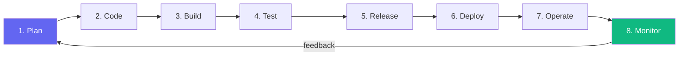
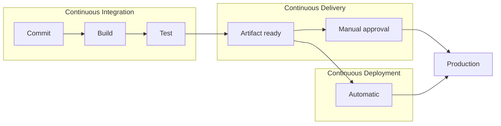

# ♾️ The DevOps Lifecycle

> **In one line:** The DevOps lifecycle is an endless loop of eight stages, from planning a feature to monitoring it in production, and then planning the next improvement.

## 🧠 Simple explanation

Think of a bakery that never closes. They **plan** a new bread, **bake** a test batch, **taste** it, **sell** it, and **watch** what customers say. Then they use that feedback to plan the next bread. The work never ends. It just keeps getting better.

Software works the same way. The famous "infinity loop" shows that there is no finish line.

## ♾️ The loop



Left half (Dev): plan, code, build, test. Right half (Ops): release, deploy, operate, monitor. DevOps connects them.

## 🔑 The eight stages

| Stage | What happens | Typical tools |
|-------|--------------|---------------|
| **Plan** | Decide what to build; write user stories and tasks | Jira, GitHub Issues, Trello |
| **Code** | Write code and review it | Git, GitHub, GitLab, VS Code |
| **Build** | Turn code into a runnable package | Maven, npm, Docker, Gradle |
| **Test** | Run automated tests and scans | JUnit, pytest, Selenium, SonarQube |
| **Release** | Approve and version a build that is ready | GitHub Releases, Nexus, Artifactory |
| **Deploy** | Put the release on servers | Kubernetes, Ansible, ArgoCD |
| **Operate** | Run and scale the system | Terraform, Kubernetes, cloud platforms |
| **Monitor** | Watch health and gather feedback | Prometheus, Grafana, ELK, Datadog |

## 🔁 CI, CD, and CD

These short names cause confusion. Here they are on one line:



- **Continuous Integration (CI):** Developers merge code often. Each merge triggers an automatic build and tests.
- **Continuous Delivery:** Every passing build is *ready* to release. A human presses the button.
- **Continuous Deployment:** Every passing build goes to production *automatically*.

## 🛠️ Hands-on

A tiny pipeline that touches several stages, written for GitHub Actions. Save it as `.github/workflows/ci.yml`.

```yaml
name: CI

on:
  push:
    branches: [main]
  pull_request:

jobs:
  build-and-test:
    runs-on: ubuntu-latest
    steps:
      - name: Get the code          # Code stage
        uses: actions/checkout@v4

      - name: Set up Node
        uses: actions/setup-node@v4
        with:
          node-version: 20

      - name: Install and build     # Build stage
        run: |
          npm ci
          npm run build --if-present

      - name: Run tests             # Test stage
        run: npm test --if-present
```

Now every push builds and tests your code automatically. That is the left half of the loop, running without you.

## 🧭 A sample story through the loop

1. **Plan:** Customers ask for a dark mode. A ticket is created.
2. **Code:** A developer creates a branch and opens a pull request.
3. **Build and Test:** The pipeline builds the app and runs tests.
4. **Release and Deploy:** After review, the change is released to 5 percent of users.
5. **Operate and Monitor:** Dashboards show no errors, so the release grows to 100 percent.
6. **Plan:** Feedback shows users want a "system default" option. The loop continues.

## ⚠️ Common mistakes

- **Treating it as a straight line.** The loop never ends. Monitoring must feed planning.
- **Forgetting the right half.** Teams automate build and test but deploy by hand.
- **Skipping monitoring.** You cannot improve what you cannot see.
- **Mixing up delivery and deployment.** Delivery needs a human approval. Deployment does not.
- **Huge pipelines on day one.** Start with build and test. Add more later.

## ✅ Quick recap

- The lifecycle has eight stages and loops forever.
- CI merges and tests often; Continuous Delivery keeps code releasable; Continuous Deployment releases automatically.
- Monitoring results feed the next plan.
- Start small and automate one stage at a time.

⬅️ Previous: [01 - What is DevOps](01-what-is-devops.md) | ➡️ Next: [03 - Agile, Scrum, Kanban](03-agile-scrum-kanban.md)
