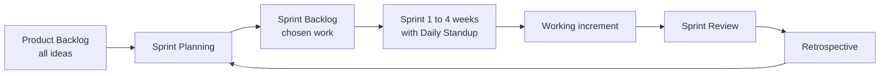
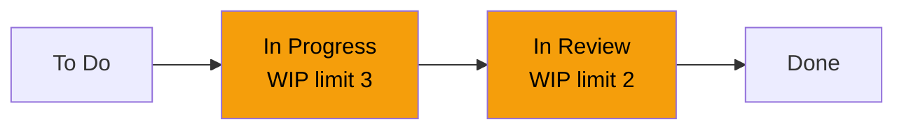

# 🏃 Agile, Scrum, and Kanban

> **In one line:** Agile is a way to build software in small steps and learn from feedback; Scrum and Kanban are two popular ways to organize that work.

## 🧠 Simple explanation

Imagine you are painting a house. The old way: plan every detail for six months, paint everything, then show the owner. If they hate the color, you start over.

The Agile way: paint one room, show the owner, ask what they think, then paint the next room. If they dislike the color, you only lost one room.

Agile means **short cycles, early feedback, and willingness to change**.

## 📜 The Agile Manifesto (2001) in plain words

The authors said they value:

| More value | Less value |
|------------|-----------|
| People and conversations | Processes and tools |
| Working software | Heavy documentation |
| Working with the customer | Fighting over contracts |
| Responding to change | Following a fixed plan |

"Less value" does not mean "no value". It means the left side matters more.

## 🔁 Scrum

Scrum organizes work in fixed-length cycles called **sprints** (usually 1 to 4 weeks).



**Roles**

- **Product Owner:** decides what is most valuable to build.
- **Scrum Master:** helps the team follow the process and removes blockers.
- **Developers:** the people doing the work (build, test, and often operate).

**Events**

- **Sprint Planning:** choose what to do this sprint.
- **Daily Standup (15 minutes):** what I did, what I will do, what blocks me.
- **Sprint Review:** show the working result to stakeholders.
- **Retrospective:** talk about how to work better next time.

**Artifacts**: Product Backlog, Sprint Backlog, and the Increment.

## 📋 Kanban

Kanban is a visual board. Work items (cards) move across columns. The key rule is a **WIP limit** (work in progress limit): do not start too many things at once.



Why limit work? Finishing one task is better than starting five. Limits expose bottlenecks: if "In Review" is always full, you need more reviewers.

## ⚖️ Scrum vs Kanban

| Feature | Scrum | Kanban |
|---------|-------|--------|
| Cycle | Fixed sprints | Continuous flow |
| Roles | Product Owner, Scrum Master, Developers | No required roles |
| Changes mid-cycle | Avoided inside a sprint | Allowed any time |
| Key measure | Velocity (work per sprint) | Lead time and cycle time |
| Good for | Product development with planned goals | Support, operations, mixed requests |

Many DevOps and operations teams like Kanban because incoming work (incidents, requests) is unpredictable. Many product teams like Scrum. Some mix both ("Scrumban").

## 🔑 Key concepts

- **User story:** "As a [user], I want [goal], so that [benefit]."
- **Backlog:** the ordered to-do list for the product.
- **Definition of Done:** an agreed checklist that says when a task is truly finished (coded, tested, reviewed, deployed).
- **Story points:** a rough size estimate of effort, not hours.
- **Lead time:** from request to delivery. **Cycle time:** from start of work to delivery.

## 🛠️ Hands-on

Create a simple Kanban board with GitHub Projects and the `gh` CLI.

```bash
# 1. Create an issue for each task
gh issue create --title "Add login page" --body "As a user I want to log in so that I can see my data." --label "feature"
gh issue create --title "Set up CI pipeline" --body "Build and test on every push." --label "devops"

# 2. List the open issues
gh issue list

# 3. Create a project board (Kanban style) for your account
gh project create --owner "@me" --title "My Kanban"
```

In the GitHub web UI, open your project, choose the **Board** layout, and set columns `Todo`, `In Progress`, `In Review`, `Done`. Move cards as you work.

A good user story template to copy:

```markdown
### Story
As a <type of user>, I want <goal>, so that <benefit>.

### Acceptance criteria
- [ ] Given ..., when ..., then ...
- [ ] Tests added
- [ ] Documentation updated
```

## ⚠️ Common mistakes

- **"Agile" with no feedback.** Short sprints are pointless if no one looks at the result.
- **Daily standup as a status report for the boss.** It is for the team to coordinate.
- **No WIP limits in Kanban.** Then it is only a to-do list.
- **Skipping retrospectives.** That is where improvement happens.
- **Using story points to compare people.** They are for planning only.

## ✅ Quick recap

- Agile means small steps, fast feedback, and flexibility.
- Scrum uses fixed sprints and defined roles.
- Kanban uses a visual board and WIP limits for continuous flow.
- Pick the one that fits your type of work, or mix them.

⬅️ Previous: [02 - DevOps Lifecycle](02-devops-lifecycle.md) | ➡️ Next: [04 - SDLC and Deployment Strategies](04-sdlc-and-deployment-strategies.md)
