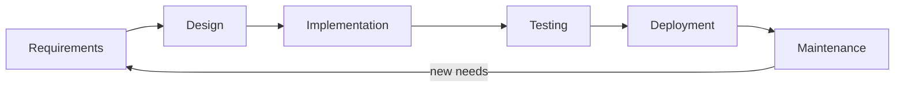
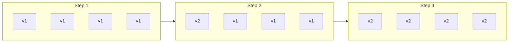
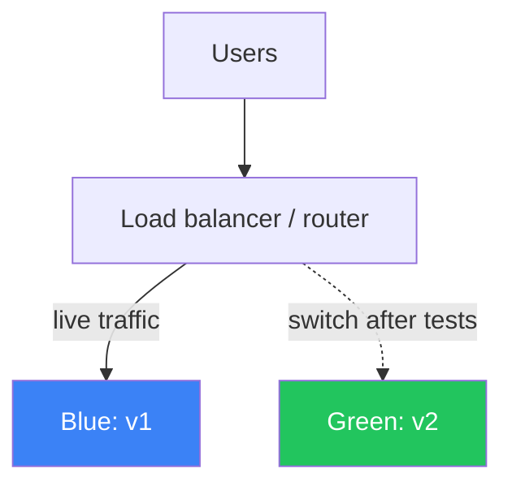
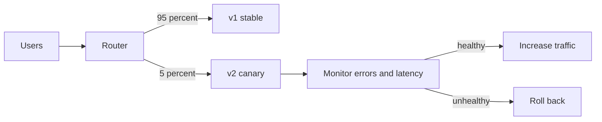

# 🚢 SDLC and Deployment Strategies

> **In one line:** The SDLC is the set of steps software goes through from idea to retirement, and a deployment strategy is the plan for how a new version reaches users without breaking things.

## 🧠 Simple explanation

Building software is like building a bridge: you gather requirements, design, build, inspect, open it, and maintain it. That is the **SDLC** (Software Development Life Cycle).

Opening the bridge is the risky moment. You can close all lanes and switch traffic at once, or move cars over a few at a time and watch. Those are **deployment strategies**.

## 🧩 SDLC phases



| Phase | Question it answers |
|-------|---------------------|
| Requirements | What problem are we solving? |
| Design | How will we build it? |
| Implementation | Write the code |
| Testing | Does it work and is it safe? |
| Deployment | How do users get it? |
| Maintenance | How do we fix and improve it? |

### SDLC models in short

- **Waterfall:** each phase finishes before the next starts. Simple, but slow to adapt.
- **Agile:** repeat all phases in short cycles. Most modern teams use this.
- **DevOps:** Agile plus automation of build, test, and deploy, and shared ownership of running the software.

## 🎯 Deployment strategies

### 1. Recreate (big bang)

Stop the old version, start the new version. Simple, but there is **downtime**.

### 2. Rolling update

Replace servers one by one (or in small groups). No downtime, but old and new versions run together for a while.



### 3. Blue-green

You keep **two identical environments**. Blue runs the current version. You deploy the new version to Green, test it, then switch the router to Green. Rollback is instant: switch back to Blue.



Cost: you pay for double the infrastructure during the switch.

### 4. Canary

Send a **small percentage** of users (say 5 percent) to the new version. Watch errors and speed. If healthy, grow to 25, 50, 100 percent. If not, send everyone back to the old version.



### 5. Feature flags and dark launches

Ship code **turned off**. Turn the feature on for chosen users at runtime. Deploying code and releasing a feature become two separate decisions.

## ⚖️ Comparison

| Strategy | Downtime | Rollback speed | Extra cost | Risk |
|----------|----------|----------------|------------|------|
| Recreate | Yes | Slow | None | High |
| Rolling | No | Medium | Low | Medium |
| Blue-green | No | Very fast | High (2x) | Low |
| Canary | No | Fast | Low to medium | Very low |

## 🛠️ Hands-on

A rolling update with Kubernetes (the default strategy for Deployments). Save as `deployment.yaml`.

```yaml
apiVersion: apps/v1
kind: Deployment
metadata:
  name: web
spec:
  replicas: 4
  strategy:
    type: RollingUpdate
    rollingUpdate:
      maxUnavailable: 1   # at most 1 pod down at a time
      maxSurge: 1         # at most 1 extra pod during the update
  selector:
    matchLabels:
      app: web
  template:
    metadata:
      labels:
        app: web
    spec:
      containers:
        - name: web
          image: nginx:1.25
          ports:
            - containerPort: 80
```

```bash
kubectl apply -f deployment.yaml
kubectl set image deployment/web web=nginx:1.27   # start a rolling update
kubectl rollout status deployment/web             # watch progress
kubectl rollout undo deployment/web               # roll back if needed
```

For blue-green, many teams run two Deployments (`web-blue`, `web-green`) and switch a Service selector:

```bash
kubectl patch service web -p '{"spec":{"selector":{"app":"web","version":"green"}}}'
```

## ⚠️ Common mistakes

- **No rollback plan.** Always know how to undo a release before you start.
- **Database changes that break the old version.** Make schema changes backward compatible (add first, remove later).
- **Canary without monitoring.** If you cannot see errors, a canary is just a slow release.
- **Forgetting sticky sessions or caches** when switching blue-green.
- **Testing only the happy path** before switching traffic.

## ✅ Quick recap

- The SDLC describes the life of software from idea to maintenance.
- Rolling, blue-green, and canary all avoid downtime in different ways.
- Blue-green gives the fastest rollback; canary gives the lowest risk.
- Always pair a strategy with monitoring and a rollback plan.

⬅️ Previous: [03 - Agile, Scrum, Kanban](03-agile-scrum-kanban.md) | ➡️ Next: [05 - DORA Metrics and SRE Basics](05-dora-metrics-and-sre-basics.md)
