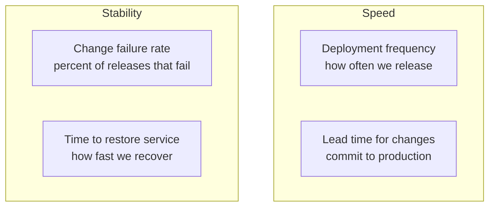
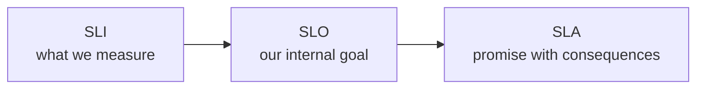
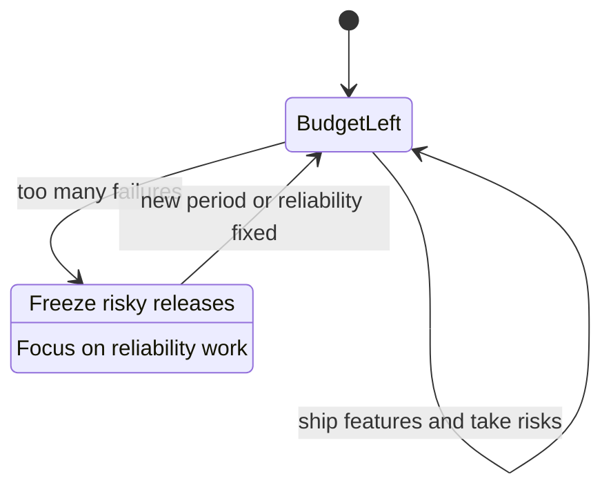

# 📊 DORA Metrics and SRE Basics

> **In one line:** DORA metrics measure how well a team delivers software, and SRE gives you simple tools (SLI, SLO, error budgets) to balance speed with reliability.

## 🧠 Simple explanation

A car has a speedometer and a fuel gauge. Without them you would not know if you are going too fast or about to run out of fuel. DevOps teams need gauges too.

- **DORA metrics** are the speedometer: how fast and how stable are our releases?
- **SRE** (Site Reliability Engineering) is the fuel plan: how reliable must we be, and how much risk can we take?

## 📈 The four DORA metrics

DORA (DevOps Research and Assessment) studied thousands of teams and found four measures that predict good performance.



| Metric | Question | Good direction |
|--------|----------|----------------|
| Deployment frequency | How often do we deploy to production? | Higher |
| Lead time for changes | How long from code commit to running in production? | Lower |
| Change failure rate | What percent of deployments cause a failure that needs a fix? | Lower |
| Time to restore service (MTTR) | How long to recover from a failure? | Lower |

Key finding: **speed and stability go together**. Elite teams deploy often *and* have fewer failures, because small changes are easier to test and fix.

> Use these as team health signals. Do not use them to rank or punish individuals.

## 🎯 SLI, SLO, SLA



- **SLI (Service Level Indicator):** a number that shows how the service behaves. Example: percent of requests that succeed.
- **SLO (Service Level Objective):** the target for that number. Example: 99.9 percent of requests succeed over 30 days.
- **SLA (Service Level Agreement):** a contract with customers, often with refunds if broken. Example: "99.5 percent uptime or you get a credit."

Rule of thumb: the SLA should be **looser** than the SLO, so you have a warning before you break a promise.

### What 99.x percent really means (per 30 days)

| Availability | Allowed downtime |
|--------------|------------------|
| 99% | about 7.2 hours |
| 99.9% | about 43 minutes |
| 99.99% | about 4.3 minutes |

## 💰 Error budgets

If your SLO is 99.9 percent, you are allowed 0.1 percent failure. That 0.1 percent is your **error budget**.



- Budget left: release quickly and experiment.
- Budget spent: slow down, fix reliability, then continue.

This turns an argument ("ship faster!" versus "be careful!") into a shared, data-based rule.

## 🔑 Other SRE ideas

- **Toil:** boring, manual, repeatable work that grows with the service. SRE tries to automate it away.
- **Blameless postmortem:** after an incident, write what happened and how to prevent it, without blaming people.
- **Golden signals:** latency, traffic, errors, saturation.
- **MTTD / MTTR:** mean time to detect and mean time to recover. Both should shrink over time.

## 🛠️ Hands-on

Calculate an SLI and an error budget with a few lines of shell.

```bash
#!/usr/bin/env bash
# Simple availability SLI from numbers
TOTAL=1000000        # total requests this month
FAILED=700           # failed requests

SLI=$(awk -v t="$TOTAL" -v f="$FAILED" 'BEGIN { printf "%.3f", (t-f)/t*100 }')
echo "Availability SLI: ${SLI}%"

SLO=99.9
BUDGET=$(awk -v t="$TOTAL" -v s="$SLO" 'BEGIN { printf "%d", t*(100-s)/100 }')
echo "Error budget (allowed failures): $BUDGET"
echo "Budget used: $FAILED of $BUDGET"
```

A Prometheus query for the same SLI (success ratio over 30 days), assuming a metric `http_requests_total` with a `status` label:

```promql
sum(rate(http_requests_total{status!~"5.."}[30d]))
/
sum(rate(http_requests_total[30d]))
```

## ⚠️ Common mistakes

- **Choosing 100 percent as an SLO.** It is impossible and kills all change.
- **Too many SLIs.** Start with two or three that users actually feel (availability, latency).
- **Measuring what is easy, not what matters.** CPU usage is not what customers see; failed requests are.
- **Using DORA to compare teams.** Teams have different contexts.
- **No action when the budget is spent.** An SLO without consequences is just a number.

## ✅ Quick recap

- DORA: deployment frequency, lead time, change failure rate, time to restore.
- SLI is the measurement, SLO is the goal, SLA is the contract.
- The error budget allows controlled risk and ends the speed versus safety argument.
- Learn from incidents with blameless postmortems.

🎉 You finished DevOps Fundamentals. Next, explore [linux-for-devops](../../linux-for-devops/README.md).

⬅️ Previous: [04 - SDLC and Deployment Strategies](04-sdlc-and-deployment-strategies.md)
