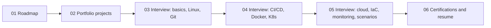

<h1 align="center">🧭 DevOps Roadmap & Interviews</h1>

<p align="center"><b>A clear path from beginner to job-ready, with projects, interview answers, and resume tips.</b></p>

<p align="center">
  
  
  
  
</p>

---

## 🎯 Why this repo

DevOps has many tools, and it is easy to feel lost. This repo gives you an order to learn things, portfolio projects that prove your skills, and simple model answers to common interview questions. Use it together with the other repos in the DevOps Hub.

## 🗺️ Learning path



## 📚 Table of contents

| # | Topic | What you will learn |
|---|-------|---------------------|
| 01 | [DevOps roadmap](docs/01-devops-roadmap-beginner-to-pro.md) | What to learn, in what order |
| 02 | [Projects to build](docs/02-projects-to-build-for-portfolio.md) | 8 hands-on projects |
| 03 | [Interview: fundamentals, Linux, Git](docs/03-interview-questions-fundamentals-and-linux-git.md) | Questions with short answers |
| 04 | [Interview: CI/CD, Docker, Kubernetes](docs/04-interview-questions-cicd-docker-k8s.md) | Questions with short answers |
| 05 | [Interview: cloud, IaC, monitoring, scenarios](docs/05-interview-questions-cloud-iac-monitoring-scenarios.md) | Questions and scenario thinking |
| 06 | [Certifications and resume](docs/06-certifications-and-resume-tips.md) | Credentials and how to present yourself |

## ⚡ Quick cheat sheet

```text
Learn in this order:
Linux -> Networking -> Git -> Scripting -> CI/CD -> Docker -> Cloud
      -> Terraform/Ansible -> Kubernetes -> Monitoring -> Security -> GitOps

Interview answer shape:  Definition -> Why it matters -> Example -> Trade-off
Scenario answer shape:   Clarify -> Check basics -> Narrow down -> Fix -> Prevent
```

---

<p align="center">Part of the DevOps Hub by <a href="https://github.com/Akhilgoud01">@Akhilgoud01</a> — ⭐ star if it helped</p>
