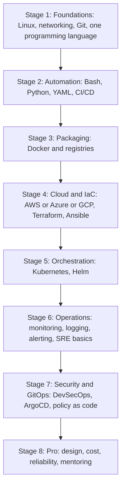
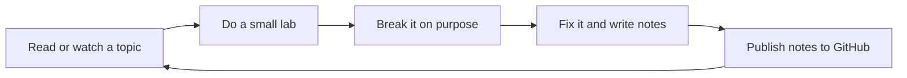

# 🧭 01 · DevOps Roadmap: Beginner to Pro

> **In one line:** Learn the base skills first (Linux, networking, Git, scripting), then automate (CI/CD, containers, IaC), then run at scale (Kubernetes, monitoring, security).

## 🧠 Simple explanation

Learning DevOps is like learning to cook for a restaurant. First you learn knife skills and heat control (Linux, networking). Then recipes (scripting, Git). Then you set up a kitchen line (CI/CD, containers). Finally you run a busy dining room with many tables (Kubernetes, monitoring, security). Skipping the basics makes the advanced parts confusing.

You do **not** need to master every tool. Learn one tool per category well. The ideas transfer.



## 🔑 Key concepts

### Stage by stage

| Stage | Learn | Suggested time* | Proof you learned it |
|-------|-------|-----------------|----------------------|
| 1 Foundations | Linux commands, permissions, TCP/IP, DNS, HTTP, Git | 4-6 weeks | Set up a Linux server and host a site |
| 2 Automation | Bash, Python, JSON/YAML, GitHub Actions | 4-6 weeks | Pipeline that tests code on every push |
| 3 Packaging | Docker, Compose, registries | 3-4 weeks | Dockerized multi-service app |
| 4 Cloud and IaC | One cloud, VPC, IAM, Terraform, Ansible | 6-8 weeks | Whole environment built by code |
| 5 Orchestration | Kubernetes, Helm | 6-8 weeks | App on a cluster with rolling updates |
| 6 Operations | Prometheus, Grafana, logs, alerts | 3-4 weeks | Dashboard and alert for an app |
| 7 Security and GitOps | Scanning, secrets, ArgoCD | 4-6 weeks | Pipeline with scans and GitOps deploy |
| 8 Pro | Architecture, reliability, cost | Ongoing | Design docs, incident write-ups |

*Time is a rough guide for part-time study. Everyone is different.

### Core skills versus tools

| Skill | Pick one to start |
|-------|-------------------|
| Operating system | Ubuntu or Debian |
| Language | Python (and Bash) |
| CI/CD | GitHub Actions |
| Containers | Docker |
| Cloud | AWS |
| IaC | Terraform |
| Config management | Ansible |
| Orchestration | Kubernetes |
| Monitoring | Prometheus and Grafana |
| GitOps | ArgoCD |

### Soft skills that matter

- Clear writing (docs, pull requests, runbooks)
- Calm troubleshooting under pressure
- Working with developers, not against them
- Learning how the business uses the system

## 🛠️ Hands-on

### Your weekly learning loop



### A starter lab setup

```bash
# Use a free local environment
sudo apt update && sudo apt install -y git curl docker.io
git config --global user.name "Your Name"
git config --global user.email "you@example.com"

# Practice repo for notes and labs
mkdir devops-journey && cd devops-journey
git init
echo "# My DevOps Journey" > README.md
git add . && git commit -m "start journey"
```

### Free ways to practice

- A local VM (VirtualBox, Multipass) for Linux practice
- `kind` or `minikube` for local Kubernetes
- Cloud free tiers (watch limits and set budget alerts!)
- Public labs such as KillerCoda and Play with Docker

### Weekly checklist

```text
[ ] 1 concept read
[ ] 2 labs done
[ ] 1 thing broken and fixed
[ ] Notes committed to GitHub
```

## ⚠️ Common mistakes

- **Tool hopping.** Learning 20 tools shallowly. Go deep on one per category.
- **Only watching videos.** You learn by typing commands and fixing errors.
- **Skipping Linux and networking.** Everything else sits on top of them.
- **Jumping to Kubernetes first.** Learn Docker and cloud basics before it.
- **Leaving cloud resources running.** Set budget alerts and destroy labs.
- **Not building public proof.** Hiring managers want to see real work.

## ✅ Quick recap

- Foundations first, then automation, packaging, cloud, orchestration, operations, security.
- Learn one tool per category deeply.
- Practice weekly, break things, and write notes.
- Show your work on GitHub.

➡️ **Next:** [02 · Projects to build for your portfolio](02-projects-to-build-for-portfolio.md)
