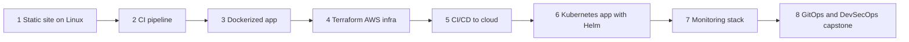
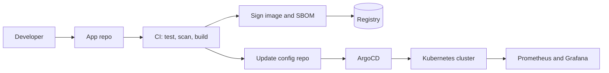

# 🏗️ 02 · Projects to Build for Your Portfolio

> **In one line:** Eight hands-on projects, from easy to advanced, that prove you can build, ship, and run real systems.

## 🧠 Simple explanation

A resume says "I know Docker." A project **shows** it. Each project below has a goal, a tech stack, and steps. Put each one in its own GitHub repo with a clear README, an architecture diagram, and screenshots. Reviewers often look at your README for 30 seconds, so make it count.



## 🔑 Key concepts

### What every project repo should contain

- A **README** with: problem, architecture diagram, tech stack, how to run, what you learned
- A **diagram** (Mermaid works on GitHub)
- **Everything as code** (no manual clicking that cannot be repeated)
- A `.gitignore` and **no secrets**
- A short **"cost and cleanup"** note for cloud projects

### Project summary

| # | Project | Main skills | Difficulty |
|---|---------|-------------|------------|
| 1 | Linux web server | Linux, Nginx, SSH, firewall | Easy |
| 2 | CI pipeline | Git, GitHub Actions, testing | Easy |
| 3 | Dockerized app | Docker, Compose | Easy-Medium |
| 4 | AWS infra with Terraform | Terraform, VPC, EC2 | Medium |
| 5 | CI/CD to the cloud | Pipeline, registry, deploy | Medium |
| 6 | Kubernetes with Helm | K8s, Helm, ingress | Medium-Hard |
| 7 | Monitoring and alerting | Prometheus, Grafana | Medium |
| 8 | GitOps + DevSecOps capstone | ArgoCD, Trivy, signing | Hard |

## 🛠️ Hands-on

### Project 1: Host a site on a hardened Linux server

**Stack:** Ubuntu VM, Nginx, UFW, SSH keys

1. Create a VM (cloud free tier or local).
2. Disable password login and root SSH, use keys only.
3. Install Nginx and serve a simple site.
4. Enable the firewall: allow only 22, 80, 443.
5. Add HTTPS with Let's Encrypt (`certbot`) if you have a domain.

```bash
sudo ufw allow OpenSSH && sudo ufw allow 'Nginx Full' && sudo ufw enable
sudo apt install -y nginx
```

### Project 2: CI pipeline for a small app

**Stack:** GitHub Actions, any language with tests

1. Create a small app (for example a Python Flask API) with unit tests.
2. Add a workflow that runs lint and tests on each pull request.
3. Add a status badge and branch protection that requires the check.

```yaml
on: [pull_request]
jobs:
  test:
    runs-on: ubuntu-latest
    steps:
      - uses: actions/checkout@v4
      - uses: actions/setup-python@v5
        with: { python-version: "3.12" }
      - run: pip install -r requirements.txt && pytest
```

### Project 3: Dockerize a multi-service app

**Stack:** Docker, Compose, Postgres, Redis

1. Write a multi-stage Dockerfile (small, non-root).
2. Use Compose for app + database + cache with a volume.
3. Add health checks and `.dockerignore`.
4. Scan the image with Trivy and show the result in the README.

### Project 4: Build AWS infrastructure with Terraform

**Stack:** Terraform, AWS (VPC, subnets, EC2, security groups), S3 remote state

1. Write a module for a VPC with public and private subnets.
2. Launch an EC2 instance in the public subnet with a user-data script.
3. Store state in S3 with locking.
4. `terraform plan` on pull requests, `apply` on merge.
5. Add a `terraform destroy` note to avoid costs.

### Project 5: CI/CD that deploys to the cloud

**Stack:** GitHub Actions, Docker, container registry, AWS (EC2 or ECS) or any host

1. On push to `main`: test, build image, push to registry.
2. Deploy the new version automatically.
3. Use OIDC instead of stored cloud keys.
4. Add a manual approval step for production using an environment.
5. Add a rollback instruction.

### Project 6: Kubernetes app with Helm

**Stack:** kind or a managed cluster, Helm, Ingress, ConfigMap, Secret

1. Write Deployment, Service, and Ingress for your app.
2. Package as a Helm chart with a `values.yaml` for dev and prod.
3. Add liveness and readiness probes and resource limits.
4. Add an HPA and demonstrate scaling with a load test.
5. Show a rolling update and a rollback.

### Project 7: Monitoring and alerting

**Stack:** Prometheus, Grafana, Alertmanager, node exporter

1. Run the stack with Docker Compose or Helm.
2. Expose metrics from your app (for example `/metrics`).
3. Build a Grafana dashboard for the four golden signals: latency, traffic, errors, saturation.
4. Create an alert for high error rate that sends to Slack or email.
5. Write a short runbook for that alert.

### Project 8: Capstone: GitOps with DevSecOps

**Stack:** GitHub Actions, Trivy, Cosign, ArgoCD, Kubernetes, Terraform



1. Provision the cluster with Terraform.
2. CI tests, scans (Trivy, Semgrep), builds, signs, and pushes the image.
3. CI updates the image tag in a separate config repo.
4. ArgoCD syncs the cluster from the config repo.
5. Add monitoring and one alert.
6. Document the full flow with this diagram in the README.

### README template for each project

```markdown
# Project name
One-line goal.

## Architecture
(Mermaid diagram)

## Tech stack
List of tools and why you chose them.

## How to run
Exact commands.

## What I learned / challenges
Honest notes on problems you fixed.

## Cost and cleanup
How to destroy resources.
```

## ⚠️ Common mistakes

- **Copying a tutorial exactly.** Change something: another app, another tool, another cloud.
- **No README or diagram.** If people cannot understand it quickly, they will skip it.
- **Secrets in the repo.** Reviewers check, and tools flag it.
- **Manual steps nobody can repeat.**
- **Forgetting to destroy cloud resources** and getting a bill.
- **Too many half-finished projects.** Finish a few well.

## ✅ Quick recap

- Build projects in order, easy to hard.
- Everything as code, with a README, diagram, and cleanup steps.
- Show real choices and honest lessons learned.
- Finish a few excellent projects rather than many shallow ones.

➡️ **Next:** [03 · Interview questions: fundamentals, Linux, Git](03-interview-questions-fundamentals-and-linux-git.md)
