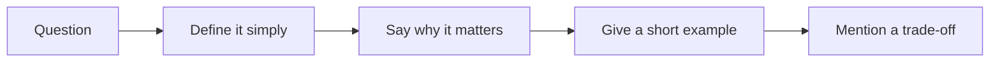

# 🎤 03 · Interview Questions: Fundamentals, Linux and Git

> **In one line:** Common beginner-to-intermediate questions with short model answers you can say out loud in your own words.

## 🧠 Simple explanation

Interviewers do not want memorized definitions. They want to hear that you understand **why** something exists and can use it. A good answer has four parts: **what it is, why it matters, a quick example, and a trade-off**. Practice speaking answers aloud.



## 🔑 Key concepts

Short model answers are below. Rewrite them in your own words.

### Part A: DevOps fundamentals

**1. What is DevOps?**
A culture and set of practices that bring development and operations together to deliver software faster and more reliably. It uses automation, shared ownership, and fast feedback. It is not a job title or a single tool.

**2. What is the DevOps lifecycle?**
Plan, code, build, test, release, deploy, operate, monitor, and then feedback goes back to plan. It is a loop, not a line.

**3. CI vs continuous delivery vs continuous deployment?**
- **CI**: merge code often and test automatically.
- **Continuous delivery**: every change is always ready to release, with a manual approval.
- **Continuous deployment**: every passing change goes to production automatically.

**4. What is Infrastructure as Code and why use it?**
Managing servers and networks with files instead of clicking in a console. It is repeatable, reviewable, versioned, and easy to rebuild.

**5. Name deployment strategies.**
Rolling (replace gradually), blue-green (two environments, switch traffic), canary (send a small share of users first), recreate (stop old, start new, causes downtime).

**6. What are the DORA metrics?**
Deployment frequency, lead time for changes, change failure rate, and time to restore service. They measure delivery speed and stability.

**7. What are SLI, SLO, and SLA?**
SLI is a measurement (for example, success rate). SLO is the target (99.9%). SLA is a contract with consequences if missed.

**8. What is an error budget?**
The amount of unreliability allowed by the SLO. If you have used it up, slow down features and focus on reliability.

**9. What is "shift left"?**
Doing testing and security earlier in the lifecycle, where fixes are cheaper.

### Part B: Linux

**10. How do you check what is using disk space?**
`df -h` shows filesystem usage. `du -sh * | sort -h` shows which folders are large. `lsof +L1` finds deleted files still held open.

**11. Explain Linux file permissions.**
Each file has read (4), write (2), and execute (1) for owner, group, and others. `chmod 754 file` means owner rwx, group r-x, others r--.

**12. What is the difference between a process and a service?**
A process is a running program. A service is a long-running background process managed by `systemd` (start, stop, restart, start on boot).

**13. How do you find and kill a process?**
`ps aux | grep name` or `pgrep name`, then `kill PID`. Use `kill -9 PID` only if it does not stop normally.

**14. What is a zombie process?**
A finished process whose parent has not yet read its exit status. It uses no CPU but holds a process table entry.

**15. How do you check memory and CPU quickly?**
`top` or `htop`, `free -h`, `vmstat 1`, `uptime` (load average).

**16. A server is slow. What do you check first?**
Load (`uptime`), CPU and memory (`top`), disk space and I/O (`df -h`, `iostat`), network (`ss -tulpn`), and logs (`journalctl -xe`).

**17. Hard link vs soft link?**
A hard link is another name for the same data (same inode). A soft (symbolic) link is a shortcut that points to a path and breaks if the target is removed.

**18. What does `chmod +x`, `chown`, and `sudo` do?**
Make a file executable, change owner, and run a command with elevated rights.

**19. How do you schedule a job?**
`cron` with `crontab -e`, for example `0 2 * * * /opt/backup.sh` runs at 2:00 every day. Systemd timers are a modern alternative.

**20. What is `grep`, `awk`, and `sed` used for?**
`grep` searches text, `awk` processes columns, `sed` edits streams of text.

### Part C: Git

**21. What is the difference between Git and GitHub?**
Git is the version control tool on your computer. GitHub is a hosting service for Git repositories with extra features such as pull requests and Actions.

**22. Explain the three areas in Git.**
Working directory (your files), staging area (changes picked for the next commit), and repository (saved history).

**23. `git merge` vs `git rebase`?**
Merge joins branches and keeps full history with a merge commit. Rebase replays your commits on top of another branch for a straight history. Never rebase commits that others already use.

**24. `git fetch` vs `git pull`?**
Fetch downloads changes but does not change your files. Pull is fetch plus merge (or rebase).

**25. How do you undo things?**
- Unstage: `git restore --staged file`
- Discard file changes: `git restore file`
- Undo a pushed commit safely: `git revert <sha>`
- Move branch back (local only): `git reset --hard <sha>`

**26. How do you resolve a merge conflict?**
Open the file, choose the correct lines between `<<<<<<<` and `>>>>>>>`, remove markers, `git add`, then `git commit` (or `git rebase --continue`).

**27. What is a pull request?**
A request to merge a branch, with a place for review, comments, and automated checks.

**28. What is `git stash`?**
Temporarily saves uncommitted changes so you can switch tasks, then bring them back with `git stash pop`.

**29. What is trunk-based development?**
Everyone merges small changes to `main` often, using short-lived branches and feature flags. It works well with CI/CD.

**30. How do you remove a secret you committed?**
First **revoke the secret**. Then remove it from history with `git filter-repo` or BFG and force push. Others must re-clone.

## 🛠️ Hands-on

Practice these until they are automatic:

```bash
# Linux
df -h; free -h; uptime
ps aux --sort=-%mem | head
ss -tulpn
journalctl -u nginx --since "1 hour ago"
find /var/log -type f -size +100M

# Git
git log --oneline --graph --all
git diff --staged
git reset --soft HEAD~1
git cherry-pick <sha>
git bisect start   # find which commit introduced a bug
```

### Mock interview drill

1. Pick 5 random questions above.
2. Answer each out loud in 60 seconds using the four-part shape.
3. Record yourself or ask a friend to listen.
4. Fix the weakest answer and repeat.

## ⚠️ Common mistakes

- **Reciting definitions** without examples.
- **Saying "I don't know" and stopping.** Say how you would find out: "I would check the docs, then test in a lab."
- **Claiming skills you do not have.** Follow-up questions expose this quickly.
- **Using `reset --hard` or force push** without explaining the risk.
- **Talking only about tools.** Explain the problem a tool solves.

## ✅ Quick recap

- Answer shape: define, why, example, trade-off.
- Know the lifecycle, CI/CD terms, DORA, and SLO basics.
- Be comfortable with Linux troubleshooting and everyday Git, including undoing mistakes.
- Practice out loud.

➡️ **Next:** [04 · Interview questions: CI/CD, Docker, Kubernetes](04-interview-questions-cicd-docker-k8s.md)
