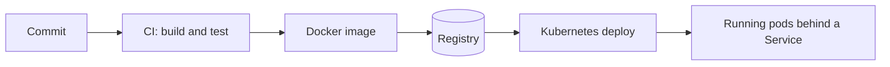
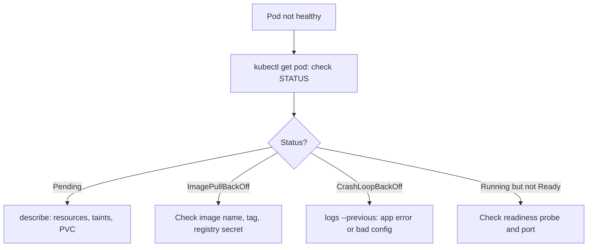

# 🎤 04 · Interview Questions: CI/CD, Docker and Kubernetes

> **In one line:** The questions interviewers love to ask about pipelines, containers, and clusters, each with a short model answer.

## 🧠 Simple explanation

For these topics, interviewers want to know if you have actually built and fixed things. Use real examples from your projects: "In my pipeline I cached dependencies, which cut build time." Keep answers short, then be ready to go deeper.



Most questions below touch one box of this flow.

## 🔑 Key concepts

### Part A: CI/CD

**1. What happens in a typical pipeline?**
Checkout code, install dependencies, lint, unit test, build, scan, package, push artifact or image, deploy to staging, run tests, then promote to production.

**2. How do you speed up a slow pipeline?**
Cache dependencies, run jobs in parallel, run only affected tests, use smaller base images, reuse Docker layers, and use faster runners.

**3. How do you handle secrets in CI/CD?**
Use the platform's secret store, scope secrets to environments, never print them, prefer short-lived credentials with OIDC, and scan repos for leaks.

**4. What is a Jenkinsfile?**
A pipeline defined as code in the repo. Declarative syntax uses `pipeline { agent, stages, steps }`.

**5. GitHub Actions vs Jenkins?**
Actions is hosted, YAML-based, and tightly integrated with GitHub. Jenkins is self-hosted and very flexible with many plugins, but you maintain it.

**6. What is an artifact?**
The output of a build, such as a JAR, a package, or a container image, stored so the exact same file can be deployed later.

**7. What is a quality gate?**
A pass/fail rule in the pipeline, such as test coverage above 80% or no critical vulnerabilities.

**8. How do you roll back a bad release?**
Redeploy the last good artifact (immutable versions make this easy), or switch traffic back in blue-green, or use `kubectl rollout undo` / `helm rollback`.

**9. What is a matrix build?**
Running the same job across combinations, like Node 18 and 20 on Linux and Windows.

**10. How do you keep production deploys safe?**
Approvals on protected environments, automated tests, canary or progressive rollout, health checks, fast rollback, and monitoring after deploy.

### Part B: Docker

**11. Container vs VM?**
A container shares the host kernel and isolates a process. A VM runs a full guest OS on a hypervisor. Containers are lighter and faster, VMs are more strongly isolated.

**12. Image vs container?**
An image is a read-only template. A container is a running instance of an image with a writable layer.

**13. What are image layers?**
Each Dockerfile instruction creates a layer. Layers are cached and shared, so unchanged steps are not rebuilt.

**14. `CMD` vs `ENTRYPOINT`?**
`ENTRYPOINT` is the fixed command. `CMD` gives default arguments that can be overridden. Together: `ENTRYPOINT ["python"]` and `CMD ["app.py"]`.

**15. `COPY` vs `ADD`?**
`COPY` copies files. `ADD` also extracts archives and fetches URLs. Prefer `COPY` for clarity.

**16. What is a multi-stage build?**
Using several `FROM` stages: build in a big image, copy only the result into a small final image. It makes images smaller and safer.

**17. How do you persist data?**
Use volumes (managed by Docker) or bind mounts. Data in the container filesystem is lost when the container is removed.

**18. How do containers talk to each other?**
On the same user-defined network they reach each other by name via built-in DNS. Compose creates such a network automatically.

**19. How do you make images smaller and safer?**
Use slim or distroless bases, multi-stage builds, `.dockerignore`, a non-root user, pinned versions, and scan with Trivy.

**20. A container keeps restarting. What do you do?**
`docker ps -a` for status, `docker logs <name>` for errors, `docker inspect` for exit code and config, then run it interactively to debug.

### Part C: Kubernetes

**21. What is Kubernetes?**
An orchestrator that runs containers across many machines and handles scheduling, scaling, self-healing, and rollouts.

**22. Main components?**
Control plane: API server, etcd (state store), scheduler, controller manager. Nodes: kubelet, container runtime, kube-proxy.

**23. Pod vs Deployment?**
A Pod is the smallest unit, one or more containers sharing network and storage. A Deployment manages replicas of Pods, rolling updates, and rollbacks.

**24. Service types?**
`ClusterIP` (internal only), `NodePort` (opens a port on every node), `LoadBalancer` (cloud load balancer). `Ingress` routes HTTP(S) by host and path.

**25. ConfigMap vs Secret?**
ConfigMap holds non-sensitive config. Secret holds sensitive data, but it is only base64 encoded by default, so enable encryption at rest and tight RBAC.

**26. Liveness vs readiness probe?**
Liveness answers "is it stuck?" and restarts the container. Readiness answers "can it take traffic?" and removes the Pod from the Service if not.

**27. How does autoscaling work?**
HPA changes the number of Pods based on metrics like CPU. Cluster Autoscaler adds or removes nodes.

**28. A Pod is in `CrashLoopBackOff`. What do you do?**
`kubectl describe pod` for events, `kubectl logs <pod> --previous` for the last crash, check config, env vars, probes, and resource limits.

**29. A Pod is `Pending`. Why?**
Usually not enough resources, no node matches selectors or taints, or a PersistentVolumeClaim cannot bind. `kubectl describe pod` shows the reason.

**30. How do you do a rolling update and rollback?**
Change the image in the Deployment. Watch with `kubectl rollout status`. Undo with `kubectl rollout undo deployment/<name>`.

**31. What is RBAC?**
Role-based access control: Roles list allowed actions, RoleBindings give them to users or service accounts, scoped to a namespace (or cluster-wide with ClusterRole).

**32. What is Helm?**
A package manager for Kubernetes. Charts bundle templates and `values.yaml` so one chart can deploy to many environments.

## 🛠️ Hands-on

### Commands to know by heart

```bash
# Docker
docker build -t app:1.0 . && docker run -d -p 8080:80 app:1.0
docker logs -f <name>; docker exec -it <name> sh
docker system df; docker image prune -a

# Kubernetes
kubectl get pods -A -o wide
kubectl describe pod <pod>
kubectl logs <pod> --previous
kubectl exec -it <pod> -- sh
kubectl rollout status deploy/<name>
kubectl rollout undo deploy/<name>
kubectl top pods
kubectl get events --sort-by=.lastTimestamp
```

### Debug flow for a failing pod



## ⚠️ Common mistakes

- **Not knowing the difference between related terms** (image vs container, liveness vs readiness).
- **Saying "I'd restart it" for everything.** Show a method: observe, narrow, fix, prevent.
- **Using `latest` tags** and forgetting immutability.
- **Forgetting resource requests and limits** in Kubernetes answers.
- **Ignoring security** (root containers, secrets in images).
- **Memorizing commands without knowing what they do.**

## ✅ Quick recap

- Pipelines: fast, cached, gated, with safe deploys and quick rollback.
- Docker: image vs container, layers, multi-stage, volumes, networks.
- Kubernetes: components, Pod/Deployment/Service, probes, scaling, debugging statuses.
- Always back answers with a real example.

➡️ **Next:** [05 · Interview questions: cloud, IaC, monitoring, scenarios](05-interview-questions-cloud-iac-monitoring-scenarios.md)
