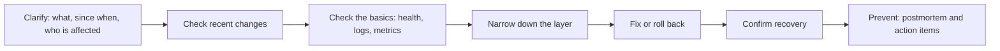

# 🎤 05 · Interview Questions: Cloud, IaC, Monitoring and Scenarios

> **In one line:** Questions on cloud, Terraform, Ansible, and observability, plus scenario questions that test how you think under pressure.

## 🧠 Simple explanation

Scenario questions ("the site is down, what do you do?") have no single right answer. The interviewer watches your **process**. A calm, structured approach beats guessing. Use this loop:



## 🔑 Key concepts

### Part A: Cloud (AWS-focused, ideas apply everywhere)

**1. IaaS, PaaS, SaaS?**
IaaS gives raw infrastructure (EC2). PaaS gives a platform to run code (Elastic Beanstalk, App Service). SaaS is a finished app (Gmail). You manage less as you move toward SaaS.

**2. What is the shared responsibility model?**
The cloud provider secures the cloud itself (hardware, data centers). You secure what you put in it (data, access, configuration).

**3. What is a VPC?**
Your private network in the cloud, with subnets, route tables, gateways, and security rules.

**4. Public vs private subnet?**
A public subnet has a route to an internet gateway. A private subnet does not. Private resources reach the internet outbound through a NAT gateway.

**5. Security group vs network ACL?**
Security groups are stateful and attach to instances. NACLs are stateless and attach to subnets, with allow and deny rules.

**6. IAM user, role, and policy?**
A user is a person or app with long-term credentials. A role is assumed temporarily and has no password. A policy is a JSON document that lists what is allowed. Prefer roles and least privilege.

**7. Which storage would you use?**
S3 for objects, EBS for a disk attached to one instance, EFS for shared file storage, RDS for managed relational databases.

**8. How do you make an app highly available?**
Spread across multiple Availability Zones behind a load balancer, use auto scaling, and use a multi-AZ database.

**9. How do you reduce cloud cost?**
Right-size instances, use autoscaling, delete unused resources, use reserved or savings plans for steady load, spot for flexible jobs, set budgets and alerts, and use tags.

### Part B: Infrastructure as Code

**10. Why Terraform?**
Declarative, works across many providers, shows a plan before changes, and keeps state to track real resources.

**11. What is Terraform state and why protect it?**
A file mapping your code to real resources. It can contain sensitive values. Store it remotely (for example S3) with encryption and locking.

**12. `plan` vs `apply`?**
`plan` previews changes. `apply` makes them. Always review the plan.

**13. What is drift and how do you handle it?**
Drift is when real infrastructure differs from code (for example a manual change). Detect with `terraform plan`, then either update the code or re-apply.

**14. What are modules?**
Reusable bundles of Terraform code with inputs and outputs.

**15. Terraform vs Ansible?**
Terraform provisions infrastructure (create servers, networks). Ansible configures what runs on them (install packages, deploy apps). They are often used together.

**16. What is idempotency?**
Running the same operation many times gives the same result. Good automation is idempotent.

**17. How do you manage multiple environments?**
Separate state per environment using folders, workspaces, or separate repos, with shared modules and different variable files.

### Part C: Monitoring and observability

**18. Monitoring vs observability?**
Monitoring watches known problems with dashboards and alerts. Observability lets you ask new questions about unknown problems using metrics, logs, and traces.

**19. What are the three pillars?**
Metrics (numbers over time), logs (events), traces (a request's path across services).

**20. What are the four golden signals?**
Latency, traffic, errors, and saturation.

**21. How does Prometheus work?**
It **pulls** metrics from targets over HTTP at set intervals, stores them as time series, and is queried with PromQL. Alertmanager sends alerts.

**22. What makes a good alert?**
It is actionable, urgent, tied to user impact, and has a runbook. Avoid alerting on every CPU spike.

**23. What is an SLO and how do you use it for alerting?**
A target like 99.9% success. Alert when you are burning the error budget too fast.

**24. What is a postmortem?**
A blameless write-up of an incident: timeline, impact, root cause, what went well, and action items to prevent repeats.

### Part D: Scenarios

**S1. The website is down. What do you do?**
1. Confirm and scope: is it everyone, one region, one endpoint?
2. Check recent deploys or config changes. Roll back if a change is suspect.
3. Check from outside in: DNS, load balancer health, app pods or servers, database.
4. Read logs and dashboards for errors and saturation.
5. Fix or roll back, confirm recovery, communicate status.
6. Write a postmortem with preventive actions.

**S2. A deployment caused errors in production.**
Roll back first, investigate second. Then improve: add a test for the bug, use canary releases, and add an alert on the error rate after deploy.

**S3. The disk on a server is 100% full.**
`df -h` to find the filesystem, `du -xh / --max-depth=2 | sort -h` to find large folders, check logs, old Docker data (`docker system df`), and deleted-but-open files (`lsof +L1`). Free space safely, then add log rotation and a disk usage alert.

**S4. A pipeline became very slow.**
Look at stage timings, add caching, parallelize, check runner capacity, and cut unnecessary steps.

**S5. Someone committed an AWS key to GitHub.**
Revoke and rotate the key immediately, check CloudTrail for misuse, remove it from history, add secret scanning and pre-commit hooks, and move to roles or OIDC.

**S6. Design CI/CD for a small team's web app.**
Pull request runs lint, tests, and scans. Merge to `main` builds and signs an image, deploys to staging automatically, runs smoke tests, then production after approval with canary and quick rollback. Add monitoring and alerts.

**S7. Traffic doubles during a sale. How do you prepare?**
Load test first, enable autoscaling for app and nodes, add caching and a CDN, check database limits and connection pools, set alerts, and have a rollback plan.

## 🛠️ Hands-on

### Quick triage commands

```bash
# Outside in
curl -I https://example.com
dig +short example.com
# Server
uptime; free -h; df -h
journalctl -u myapp --since "30 min ago" | tail -50
ss -tulpn
# Kubernetes
kubectl get pods -A | grep -v Running
kubectl get events -A --sort-by=.lastTimestamp | tail
# Terraform
terraform plan
terraform state list
```

### Practice a scenario

1. Pick a scenario above.
2. Draw the system on paper (users, load balancer, app, database).
3. Walk through the loop from the top of this doc out loud.
4. Name one thing you would automate to prevent it next time.

## ⚠️ Common mistakes

- **Jumping to a fix without checking** what changed or what the impact is.
- **Forgetting to communicate.** In real incidents, status updates matter.
- **Blaming people** in postmortems instead of fixing the process.
- **Not mentioning prevention** (tests, alerts, automation).
- **Saying "I would Google it" and nothing else.** Show your first three steps.
- **Treating one tool as the only answer.** Mention trade-offs.

## ✅ Quick recap

- Know cloud basics: VPC, subnets, IAM, storage, high availability, cost.
- Terraform: state, plan/apply, modules, drift. Ansible configures, Terraform provisions.
- Observability: metrics, logs, traces, golden signals, actionable alerts, SLOs.
- Scenarios: clarify, check changes, narrow down, fix or roll back, confirm, prevent.

➡️ **Next:** [06 · Certifications and resume tips](06-certifications-and-resume-tips.md)
