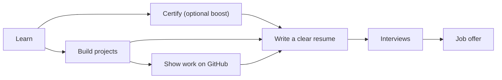
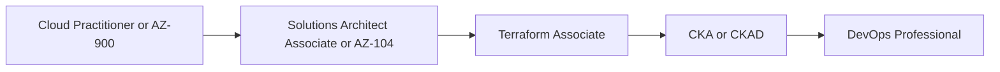

# 📜 06 · Certifications and Resume Tips

> **In one line:** Certifications help you get noticed and organize your learning, but projects and clear communication get you hired.

## 🧠 Simple explanation

A certification is like a driving test certificate. It says you know the rules. A project is like a driving record. It shows you can actually drive. Employers like both, but especially when the resume tells a clear story: **what you built, with which tools, and what result it had**.



## 🔑 Key concepts

### Popular certifications

Exam names, prices, and versions change. Always check the official site before you plan.

| Area | Certification | Good for |
|------|---------------|----------|
| Cloud basics | AWS Certified Cloud Practitioner, Microsoft AZ-900 | Absolute beginners |
| AWS | AWS Certified Solutions Architect Associate, AWS Certified DevOps Engineer Professional | Most common for AWS roles |
| Azure | Microsoft AZ-104 (Administrator), AZ-400 (DevOps Engineer Expert) | Azure roles |
| Google Cloud | Associate Cloud Engineer, Professional Cloud DevOps Engineer | GCP roles |
| Kubernetes | CKA (Administrator), CKAD (Developer), CKS (Security) from CNCF and Linux Foundation | Kubernetes skills, hands-on exams |
| IaC | HashiCorp Terraform Associate | Terraform |
| Linux | RHCSA, LFCS | Linux administration |
| Security | AWS Security Specialty, CompTIA Security+ | Security knowledge |

### A sensible order



### Do you need certifications?

- **Helpful** if you have little work experience, are changing careers, or applying where HR filters by keywords.
- **Less important** than projects for most engineering teams.
- **Hands-on exams** (CKA, CKAD) carry extra weight because you must solve real tasks.

### Resume essentials

- **One page** if you have under about 5 years of experience.
- **Top section:** name, city, email, GitHub, LinkedIn.
- **Skills** grouped by category (not a giant wall of words).
- **Projects** with measurable results.
- **Experience** with action verbs and numbers.
- Keep it **honest**. Only list what you can discuss in depth.

## 🛠️ Hands-on

### Bullet formula: Action + What + How + Result

Weak:

```text
- Worked on CI/CD pipelines
```

Better (replace with your own true numbers):

```text
- Built a GitHub Actions pipeline that tests, scans, and deploys a Dockerized API,
  cutting manual release steps from 10 to 1.
- Provisioned a VPC, subnets, and EC2 with Terraform and S3 remote state, making
  the environment rebuildable in under 15 minutes.
- Added Prometheus and Grafana dashboards with an error-rate alert to Slack.
```

If you do not have a measurable result, describe the outcome plainly. Never invent numbers.

### A simple resume layout

```text
NAME
City | email | github.com/<you> | linkedin.com/in/<you>

SUMMARY (2 lines)
DevOps-focused engineer who builds automated, secure delivery pipelines...

SKILLS
Cloud: AWS (EC2, S3, VPC, IAM)    IaC: Terraform, Ansible
CI/CD: GitHub Actions, Jenkins    Containers: Docker, Kubernetes, Helm
Monitoring: Prometheus, Grafana   Scripting: Bash, Python

PROJECTS
Project name (link) - tech stack
 - bullet with result
 - bullet with result

EXPERIENCE / EDUCATION / CERTIFICATIONS
```

### GitHub profile checklist

```text
[ ] Profile README with a short intro and links
[ ] 3 to 6 pinned repositories
[ ] Each pinned repo has README, diagram, run steps
[ ] Clean commit messages
[ ] No secrets in any repo
```

### LinkedIn and job search tips

- Use a clear headline: "DevOps Engineer | AWS | Terraform | Kubernetes".
- Apply with a tailored resume. Mirror important keywords from the job post, but only for skills you truly have.
- Write short notes about what you learn (blog or GitHub). It shows communication skill.
- Contribute small fixes to open-source docs or tools.

### Before an interview

```text
[ ] Re-read the job description and list required tools
[ ] Prepare 3 project stories: problem, what you did, result, lesson
[ ] Practice answers from docs 03, 04, and 05 out loud
[ ] Prepare 3 questions to ask them (on-call, deploy process, team size)
```

## ⚠️ Common mistakes

- **Listing every tool you have touched once.** Skill walls look weak.
- **Collecting certifications without projects.**
- **Dumping exam answers (braindumps).** It is unethical and exams are built to catch it, and you will fail the interview.
- **Inventing experience or numbers.** It is easy to detect in an interview.
- **Long, dense resumes.** Recruiters skim.
- **Broken GitHub links** or empty repos on the resume.
- **No questions for the interviewer.**

## ✅ Quick recap

- Certifications are a boost. Projects are proof.
- A good order: cloud basics, associate-level cloud, Terraform, Kubernetes.
- Resume bullets: action, what, how, result, all honest.
- Keep your GitHub tidy and your project stories ready.

🎉 **You finished this repo.** Back to the [README](../README.md), or explore the other repos in the [DevOps Hub](https://github.com/Akhilgoud01).
