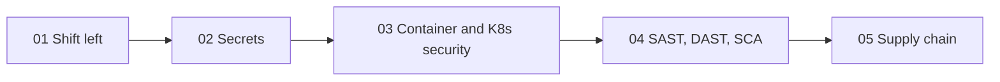

<h1 align="center">🛡️ DevSecOps & Security</h1>

<p align="center"><b>Build security into every step of the pipeline, not onto the end of it.</b></p>

<p align="center">
  
  
  
  
</p>

---

## 🎯 Why this repo

Fast delivery is dangerous if it is not safe. DevSecOps means security is everyone's job and happens automatically inside the pipeline. This repo explains the ideas in plain English: shifting security left, handling secrets, locking down containers and Kubernetes, scanning code and dependencies, and protecting your software supply chain.

## 🗺️ Learning path



## 📚 Table of contents

| # | Topic | What you will learn |
|---|-------|---------------------|
| 01 | [Shift left and DevSecOps](docs/01-shift-left-and-devsecops.md) | Why and how to add security early |
| 02 | [Secrets management](docs/02-secrets-management-vault-and-cloud-secrets.md) | Vault, cloud secret stores, no secrets in Git |
| 03 | [Container and Kubernetes security](docs/03-container-and-kubernetes-security.md) | Trivy, pod security, network policies |
| 04 | [SAST, DAST and SCA](docs/04-sast-dast-sca-in-pipelines.md) | Scanners in CI, OWASP Top 10 |
| 05 | [Supply chain security](docs/05-supply-chain-security-sbom-and-signing.md) | SBOM, signing, provenance |

## ⚡ Quick cheat sheet

```bash
trivy image nginx:1.27                      # scan an image for CVEs
trivy fs .                                  # scan a project folder
gitleaks detect --source .                  # find secrets in Git history
syft myapp:1.0 -o spdx-json > sbom.json     # make an SBOM
cosign sign --key cosign.key myrepo/app:1.0 # sign an image
kubectl auth can-i list secrets --as=system:serviceaccount:dev:app   # test RBAC
vault kv put secret/app db_pass=s3cr3t      # store a secret in Vault
```

---

<p align="center">Part of the DevOps Hub by <a href="https://github.com/Akhilgoud01">@Akhilgoud01</a> — ⭐ star if it helped</p>
