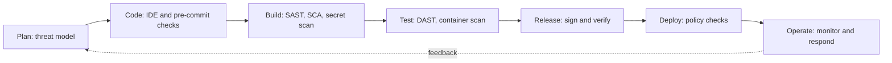
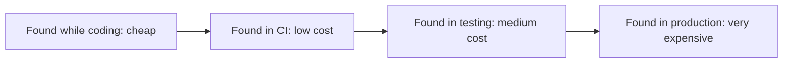
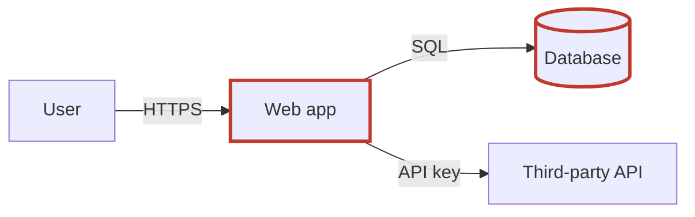

# ⬅️ 01 · Shift Left and DevSecOps

> **In one line:** DevSecOps moves security checks to the earliest steps of development so problems are cheap to fix, instead of finding them just before (or after) release.

## 🧠 Simple explanation

Imagine building a house. Checking the wiring while the walls are open is easy and cheap. Finding bad wiring after the paint is dry means breaking walls. **Shift left** means "check early," because on a timeline of plan → code → build → test → deploy, the left side is the start.

Old way: a security team reviews the app at the very end and says "no." DevSecOps way: developers get quick, automatic feedback in their editor, pull request, and pipeline, and security is a shared responsibility.



### Cost of fixing a bug



## 🔑 Key concepts

- **Shift left**: do security work earlier in the lifecycle.
- **DevSecOps**: Dev + Sec + Ops working as one team with automated security.
- **Threat modeling**: asking "what can go wrong?" before building. A common method is **STRIDE** (Spoofing, Tampering, Repudiation, Information disclosure, Denial of service, Elevation of privilege).
- **Least privilege**: give every person and service only the access it needs.
- **Defense in depth**: many layers of protection, so one failure is not a disaster.
- **CIA triad**: Confidentiality, Integrity, Availability, the three goals of security.
- **Vulnerability / CVE**: a known weakness with a public ID such as `CVE-2021-44228`.
- **Security gate**: a pipeline step that fails the build when risk is too high.
- **Shift right**: also watch security in production (monitoring, alerts, incident response).

### The security tools by stage

| Stage | Check | Example tools |
|-------|-------|---------------|
| Code | Secrets, lint | gitleaks, pre-commit |
| Build | SAST, SCA | SonarQube, Semgrep, Snyk, Dependabot |
| Package | Image scan, SBOM | Trivy, Grype, Syft |
| Test | DAST | OWASP ZAP |
| Deploy | Policy as code | OPA Gatekeeper, Kyverno |
| Run | Runtime detection | Falco |

## 🛠️ Hands-on

### Stop secrets before they are committed

Install the `pre-commit` tool, then add `.pre-commit-config.yaml`:

```yaml
repos:
  - repo: https://github.com/gitleaks/gitleaks
    rev: v8.18.4
    hooks:
      - id: gitleaks
```

```bash
pip install pre-commit
pre-commit install                    # run on every git commit
pre-commit run --all-files            # test it now
```

### A simple security gate in GitHub Actions

```yaml
name: security
on: [pull_request]
jobs:
  scan:
    runs-on: ubuntu-latest
    permissions:
      contents: read
    steps:
      - uses: actions/checkout@v4
      - name: Scan files for vulnerabilities
        uses: aquasecurity/trivy-action@0.24.0
        with:
          scan-type: fs
          severity: HIGH,CRITICAL
          exit-code: "1"            # fail the build on findings
```

### Do a quick threat model

Write these four answers for any new feature:

1. What are we building? (draw a small diagram)
2. What can go wrong? (use STRIDE)
3. What will we do about it?
4. Did we do a good enough job?



Mark each arrow and box with what could be attacked: stolen API key, SQL injection, data leak.

## ⚠️ Common mistakes

- **Adding scanners but ignoring results.** Alerts nobody reads are useless.
- **Failing the build on every low-severity finding.** Developers will turn the tool off. Start by blocking only HIGH and CRITICAL.
- **Security team as a gatekeeper only.** Teach and automate instead.
- **Treating compliance as security.** Passing an audit does not mean you are safe.
- **No owner for fixing findings.** Assign them like normal bugs.
- **Forgetting production.** Shift left does not replace monitoring.

## ✅ Quick recap

- Find problems early because early fixes are cheap.
- Automate checks in the IDE, pull request, and pipeline.
- Use least privilege and defense in depth.
- Gate on serious findings, and track the rest as normal work.

➡️ **Next:** [02 · Secrets management](02-secrets-management-vault-and-cloud-secrets.md)
