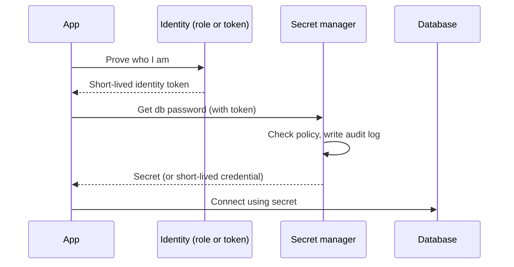

# 🔐 02 · Secrets Management: Vault and Cloud Secret Stores

> **In one line:** Keep passwords, tokens, and keys out of code and Git, store them in a dedicated secret manager, and give apps short-lived access only when they need it.

## 🧠 Simple explanation

A secret is anything that proves identity or unlocks something: database passwords, API keys, TLS private keys, cloud access keys. Writing them in your code is like taping your house key to the front door. Anyone who sees the repo sees the key, and Git remembers it forever, even after you delete the line.

A **secret manager** is like a bank safe-deposit room. You do not carry the valuables around. The app shows an ID at the desk, gets what it needs for a short time, and every visit is logged.



## 🔑 Key concepts

- **Secret sprawl**: secrets scattered in code, CI variables, chat, and laptops.
- **Static secret**: long-lived, such as a fixed password. Risky if leaked.
- **Dynamic secret**: created on demand and expires, such as a database user valid for 1 hour (Vault feature).
- **Rotation**: changing a secret regularly so a leak has a short life.
- **Encryption at rest / in transit**: data is encrypted when stored and when sent.
- **Audit log**: a record of who read which secret and when.
- **HashiCorp Vault**: a popular open-source secret manager.
- **Cloud secret stores**: AWS Secrets Manager, AWS SSM Parameter Store, Azure Key Vault, Google Secret Manager.
- **Workload identity**: letting an app prove who it is using its platform identity (IAM role, Kubernetes service account) instead of a stored password.
- **Kubernetes Secret**: base64-encoded, **not encrypted by default**. Turn on encryption at rest or use an external store.

### Where to keep what

| Option | Good for | Watch out |
|--------|----------|-----------|
| Environment variables | Simple injection at run time | Can leak in logs and crash dumps |
| CI/CD secrets (GitHub Actions) | Pipeline credentials | Scope them to environments |
| Cloud secret store | Apps on that cloud | Cost per secret and API calls |
| Vault | Multi-cloud, dynamic secrets | You must run and secure it |
| Sealed Secrets / SOPS | Secrets stored in Git, encrypted | Protect the decryption key |

## 🛠️ Hands-on

### Find leaked secrets in a repo

```bash
gitleaks detect --source . --verbose          # scan current files and history
```

If a secret leaked: **revoke it first**, then clean the history. Deleting the line is not enough.

### Vault basics (dev mode, for learning only)

```bash
vault server -dev &                           # starts an in-memory dev server
export VAULT_ADDR='http://127.0.0.1:8200'
export VAULT_TOKEN='<root token printed by the server>'

vault kv put -mount=secret app/db user=app pass='S3cr3t!'
vault kv get -mount=secret app/db
vault kv get -field=pass -mount=secret app/db
```

### A least-privilege Vault policy

```hcl
# app-read.hcl
path "secret/data/app/*" {
  capabilities = ["read"]
}
```

```bash
vault policy write app-read app-read.hcl
vault token create -policy=app-read -ttl=1h
```

### AWS Secrets Manager

```bash
aws secretsmanager create-secret \
  --name prod/app/db \
  --secret-string '{"user":"app","pass":"S3cr3t!"}'

aws secretsmanager get-secret-value --secret-id prod/app/db \
  --query SecretString --output text
```

Allow an app role to read only that secret:

```json
{
  "Version": "2012-10-17",
  "Statement": [{
    "Effect": "Allow",
    "Action": "secretsmanager:GetSecretValue",
    "Resource": "arn:aws:secretsmanager:us-east-1:123456789012:secret:prod/app/db-*"
  }]
}
```

### Use secrets in GitHub Actions

```yaml
jobs:
  deploy:
    runs-on: ubuntu-latest
    environment: production        # secrets scoped to this environment
    steps:
      - name: Use the secret
        env:
          DB_PASS: ${{ secrets.DB_PASS }}
        run: ./deploy.sh            # never echo $DB_PASS
```

Better still, use OIDC so there is no stored cloud key at all:

```yaml
permissions:
  id-token: write
  contents: read
steps:
  - uses: aws-actions/configure-aws-credentials@v4
    with:
      role-to-assume: arn:aws:iam::123456789012:role/gha-deploy
      aws-region: us-east-1
```

### Kubernetes: create and mount a secret

```bash
kubectl create secret generic db-cred \
  --from-literal=user=app --from-literal=pass='S3cr3t!'
```

```yaml
apiVersion: v1
kind: Pod
metadata:
  name: demo
spec:
  containers:
    - name: app
      image: nginx:1.27
      envFrom:
        - secretRef:
            name: db-cred
```

### Encrypt secrets so they can live in Git (SOPS)

```bash
sops --encrypt --age <PUBLIC_KEY> secrets.yaml > secrets.enc.yaml
sops --decrypt secrets.enc.yaml
```

## ⚠️ Common mistakes

- **Committing `.env` files.** Add them to `.gitignore` and scan with gitleaks.
- **Thinking a deleted commit is safe.** Git history, forks, and caches keep it. Always rotate.
- **One shared secret for everything.** Use one per app and environment.
- **Printing secrets in logs or `docker history`.** Never pass them as build args.
- **Assuming Kubernetes Secrets are encrypted.** They are only base64 by default.
- **Never rotating.** A key that lives for years will eventually leak.
- **Running Vault `-dev` mode in production.** It is for learning only.

## ✅ Quick recap

- Secrets never go in code, images, or chat.
- Use a secret manager with audit logs and least-privilege policies.
- Prefer short-lived, dynamic credentials and workload identity (OIDC).
- If a secret leaks, revoke and rotate immediately.

➡️ **Next:** [03 · Container and Kubernetes security](03-container-and-kubernetes-security.md)
