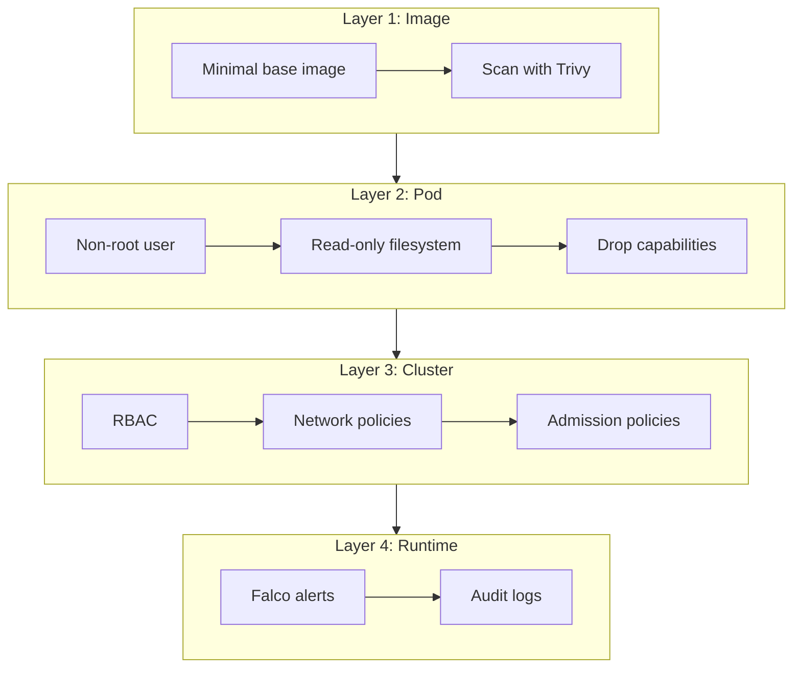
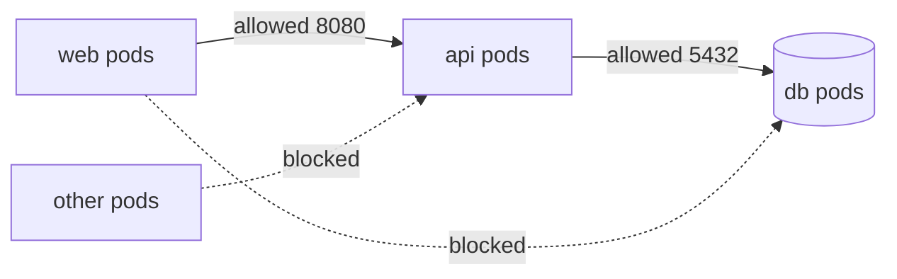

# 🔒 03 · Container and Kubernetes Security

> **In one line:** Use small trusted images, scan them, run containers with the fewest powers possible, and control who can talk to whom inside Kubernetes.

## 🧠 Simple explanation

Think of an apartment building (your cluster). Security has layers: the **lock on each door** (container hardening), the **ID check at the lobby** (RBAC and admission), the **walls between apartments** (network policies), and the **camera system** (runtime monitoring). If only the front door is locked, one burglar in one apartment can wander everywhere.



## 🔑 Key concepts

- **CVE**: a publicly known vulnerability with an ID.
- **Trivy**: free scanner for images, files, IaC, and clusters.
- **Non-root**: run the app as a normal user, not `root`.
- **Linux capabilities**: small slices of root power. Drop all and add back only what you need.
- **seccomp**: filter which system calls a container may use.
- **Pod Security Standards (PSS)**: three built-in levels: `privileged`, `baseline`, `restricted`.
- **Pod Security Admission**: built-in Kubernetes feature that enforces PSS per namespace (replaced PodSecurityPolicy, which was removed in v1.25).
- **securityContext**: pod and container settings that control privileges.
- **NetworkPolicy**: firewall rules for pods. By default, all pods can talk to all pods.
- **RBAC**: Roles define permissions, bindings give them to users or service accounts.
- **Admission controller**: a gate that checks or changes objects before they are saved (OPA Gatekeeper, Kyverno).
- **Falco**: detects strange behavior at runtime, like a shell opening in a container.

## 🛠️ Hands-on

### 1. Scan an image with Trivy

```bash
trivy image --severity HIGH,CRITICAL nginx:1.27
trivy image --exit-code 1 --severity CRITICAL myapp:1.0     # fail CI
trivy config .                                               # scan Dockerfile and K8s YAML
trivy k8s --report summary cluster                           # scan a running cluster
```

### 2. A safer Dockerfile

```dockerfile
FROM python:3.12-slim
WORKDIR /app
COPY requirements.txt .
RUN pip install --no-cache-dir -r requirements.txt
COPY . .
RUN useradd --uid 10001 --no-create-home appuser
USER 10001
CMD ["python", "app.py"]
```

Tips: pin versions, use slim or distroless bases, avoid `latest`, never copy secrets in.

### 3. A hardened pod

```yaml
apiVersion: v1
kind: Pod
metadata:
  name: secure-app
spec:
  automountServiceAccountToken: false
  securityContext:
    runAsNonRoot: true
    runAsUser: 10001
    seccompProfile:
      type: RuntimeDefault
  containers:
    - name: app
      image: myrepo/app:1.0
      securityContext:
        allowPrivilegeEscalation: false
        readOnlyRootFilesystem: true
        capabilities:
          drop: ["ALL"]
      resources:
        limits:
          cpu: "500m"
          memory: "256Mi"
```

### 4. Enforce Pod Security Standards on a namespace

```bash
kubectl label namespace prod \
  pod-security.kubernetes.io/enforce=restricted \
  pod-security.kubernetes.io/warn=restricted
```

### 5. Network policies: deny all, then allow what is needed

```yaml
apiVersion: networking.k8s.io/v1
kind: NetworkPolicy
metadata:
  name: default-deny-all
  namespace: prod
spec:
  podSelector: {}
  policyTypes: ["Ingress", "Egress"]
---
apiVersion: networking.k8s.io/v1
kind: NetworkPolicy
metadata:
  name: allow-web-to-api
  namespace: prod
spec:
  podSelector:
    matchLabels:
      app: api
  policyTypes: ["Ingress"]
  ingress:
    - from:
        - podSelector:
            matchLabels:
              app: web
      ports:
        - port: 8080
```



> Network policies need a network plugin that supports them (Calico, Cilium, and others). Without one, the objects are accepted but do nothing.

### 6. RBAC with least privilege

```yaml
apiVersion: rbac.authorization.k8s.io/v1
kind: Role
metadata:
  name: pod-reader
  namespace: dev
rules:
  - apiGroups: [""]
    resources: ["pods", "pods/log"]
    verbs: ["get", "list", "watch"]
---
apiVersion: rbac.authorization.k8s.io/v1
kind: RoleBinding
metadata:
  name: read-pods
  namespace: dev
subjects:
  - kind: User
    name: akhil
    apiGroup: rbac.authorization.k8s.io
roleRef:
  kind: Role
  name: pod-reader
  apiGroup: rbac.authorization.k8s.io
```

```bash
kubectl auth can-i delete pods --as akhil -n dev      # expect: no
kubectl auth can-i list pods --as akhil -n dev        # expect: yes
```

### 7. Block bad pods with Kyverno (example)

```yaml
apiVersion: kyverno.io/v1
kind: ClusterPolicy
metadata:
  name: disallow-latest-tag
spec:
  validationFailureAction: Enforce
  rules:
    - name: no-latest
      match:
        any:
          - resources:
              kinds: ["Pod"]
      validate:
        message: "Do not use the latest tag."
        pattern:
          spec:
            containers:
              - image: "!*:latest"
```

## ⚠️ Common mistakes

- **Running as root** and with `privileged: true`.
- **Mounting the Docker socket** (`/var/run/docker.sock`) into a container. That is root on the host.
- **Using `latest` or unknown public images** without scanning.
- **Giving `cluster-admin`** to apps or developers for convenience.
- **No network policies**, so one hacked pod can reach everything.
- **Leaving the default service account token mounted** when the pod does not call the API.
- **Scanning once** and never again. New CVEs appear daily; rescan regularly.
- **Storing secrets in plain env vars in YAML** committed to Git.

## ✅ Quick recap

- Secure four layers: image, pod, cluster, runtime.
- Run non-root, read-only, no extra capabilities, with limits.
- Start network policies with deny-all, then allow only needed traffic.
- Use RBAC least privilege and admission policies to enforce rules.

➡️ **Next:** [04 · SAST, DAST and SCA in pipelines](04-sast-dast-sca-in-pipelines.md)
