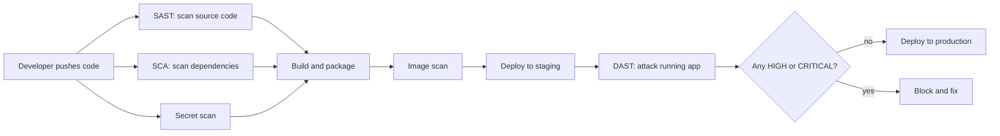

# 🔍 04 · SAST, DAST and SCA in Pipelines

> **In one line:** Use three kinds of automatic scanners: SAST reads your code, SCA checks your libraries, and DAST attacks your running app. Together they catch most common bugs before release.

## 🧠 Simple explanation

Picture checking a new car:

- **SAST** (Static Application Security Testing) is reading the **blueprints** for design mistakes. It looks at source code without running it.
- **SCA** (Software Composition Analysis) is checking every **part from another supplier** for recalls. It looks at your dependencies.
- **DAST** (Dynamic Application Security Testing) is a **crash test**. It attacks the running app from the outside.



## 🔑 Key concepts

| Type | Sees | Finds | Example tools |
|------|------|-------|---------------|
| SAST | Source code | Injection patterns, hard-coded secrets, unsafe functions | SonarQube, Semgrep, CodeQL |
| SCA | Dependency files | Known CVEs in libraries, bad licenses | Snyk, Dependabot, OWASP Dependency-Check, Trivy |
| DAST | Running app | Missing headers, XSS, broken auth, misconfigs | OWASP ZAP, Burp Suite |
| IAST | App during tests | Real data flow bugs | Contrast, others |
| Secret scan | Code and history | API keys, passwords | gitleaks, TruffleHog |

- **False positive**: a warning that is not a real problem. Tune rules to reduce them.
- **False negative**: a real problem the tool missed. No tool finds everything.
- **Quality gate**: pass/fail rule, such as "no new critical issues."
- **Severity**: Low, Medium, High, Critical (often scored with CVSS from 0 to 10).
- **Dependabot**: GitHub feature that opens pull requests to update vulnerable dependencies.

### OWASP Top 10 (2021) in simple words

The OWASP Top 10 is a respected list of the most common web app risks. Check the OWASP site for the latest edition.

| # | Risk | Plain meaning |
|---|------|---------------|
| A01 | Broken Access Control | Users can do things they should not |
| A02 | Cryptographic Failures | Weak or missing encryption |
| A03 | Injection | Attacker data runs as code (SQL, command) |
| A04 | Insecure Design | Security missing from the design |
| A05 | Security Misconfiguration | Defaults, open ports, debug on |
| A06 | Vulnerable and Outdated Components | Old libraries with known bugs |
| A07 | Identification and Authentication Failures | Weak login, session problems |
| A08 | Software and Data Integrity Failures | Unsigned updates, unsafe pipelines |
| A09 | Security Logging and Monitoring Failures | Attacks go unnoticed |
| A10 | Server-Side Request Forgery (SSRF) | Server tricked into calling internal URLs |

## 🛠️ Hands-on

### SQL injection: the classic bug SAST finds

Bad (never do this):

```python
query = f"SELECT * FROM users WHERE name = '{name}'"   # attacker sends: ' OR '1'='1
cursor.execute(query)
```

Good (parameterized query):

```python
cursor.execute("SELECT * FROM users WHERE name = %s", (name,))
```

### SAST with Semgrep

```bash
pip install semgrep
semgrep --config auto .                    # scan with community rules
semgrep --config p/owasp-top-ten --error . # fail on findings
```

### SAST with CodeQL in GitHub Actions

```yaml
name: codeql
on:
  push:
    branches: [main]
  pull_request:
jobs:
  analyze:
    runs-on: ubuntu-latest
    permissions:
      security-events: write
      contents: read
    steps:
      - uses: actions/checkout@v4
      - uses: github/codeql-action/init@v3
        with:
          languages: javascript
      - uses: github/codeql-action/analyze@v3
```

### SonarQube scan (quality gate)

```bash
sonar-scanner \
  -Dsonar.projectKey=myapp \
  -Dsonar.sources=src \
  -Dsonar.host.url=https://sonar.example.com \
  -Dsonar.token=$SONAR_TOKEN
```

In the SonarQube server, set a quality gate such as "no new vulnerabilities" and make the pipeline wait for the result (`sonar.qualitygate.wait=true`).

### SCA with Dependabot

`.github/dependabot.yml`:

```yaml
version: 2
updates:
  - package-ecosystem: "npm"
    directory: "/"
    schedule:
      interval: "weekly"
  - package-ecosystem: "docker"
    directory: "/"
    schedule:
      interval: "weekly"
  - package-ecosystem: "github-actions"
    directory: "/"
    schedule:
      interval: "weekly"
```

### SCA with other tools

```bash
npm audit --audit-level=high              # Node.js
pip install pip-audit && pip-audit        # Python
snyk test                                 # needs a Snyk account and token
trivy fs --scanners vuln .                # any language
```

### DAST with OWASP ZAP (baseline scan)

```bash
docker run --rm -t ghcr.io/zaproxy/zaproxy:stable \
  zap-baseline.py -t https://staging.example.com -r zap-report.html
```

Only scan systems you own or have written permission to test.

### One pipeline with all stages

```yaml
jobs:
  security:
    runs-on: ubuntu-latest
    steps:
      - uses: actions/checkout@v4
      - run: pip install semgrep && semgrep --config auto --error .
      - run: npm audit --audit-level=high
      - uses: aquasecurity/trivy-action@0.24.0
        with:
          scan-type: fs
          severity: HIGH,CRITICAL
          exit-code: "1"
```

## ⚠️ Common mistakes

- **Scanning only at the end.** Run SAST and SCA on every pull request.
- **Blocking on everything.** Start with HIGH and CRITICAL only.
- **Ignoring false positives forever.** Triage, suppress with a comment and reason, and tune rules.
- **Running DAST against production** without care. Use staging.
- **Trusting one tool.** Each type finds different problems.
- **Not updating dependencies.** Old libraries are one of the top risks (A06).
- **Fixing the symptom.** Learn the pattern (for example parameterized queries) to stop the whole class of bug.

## ✅ Quick recap

- SAST = code, SCA = libraries, DAST = running app.
- Put fast scans on pull requests, slower ones (DAST) on staging.
- Use quality gates, and tune them to avoid alert fatigue.
- Know the OWASP Top 10 and fix classes of bugs, not single bugs.

➡️ **Next:** [05 · Supply chain security, SBOM and signing](05-supply-chain-security-sbom-and-signing.md)
