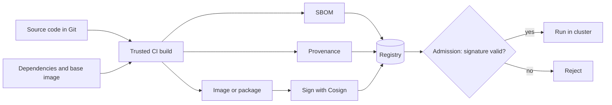
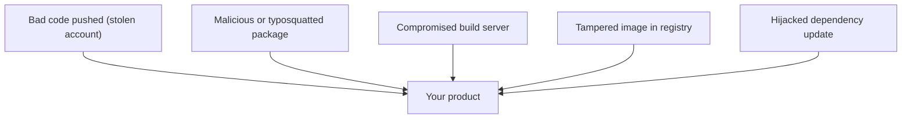

# 🔗 05 · Supply Chain Security: SBOM and Signing

> **In one line:** Know exactly what is inside your software (SBOM), prove who built it (signing and provenance), and only run what you trust.

## 🧠 Simple explanation

When you buy food, the label lists ingredients (so you can check for allergies), and a seal shows nobody tampered with it. Software is the same. Your app is built from hundreds of open-source packages, base images, and build tools. If any one is poisoned, you ship the poison.

- **SBOM** (Software Bill of Materials) is the **ingredient list**.
- **Signing** is the **tamper-proof seal**.
- **Provenance** is the **receipt**: who built it, from which code, on which system.



### Where attacks happen



## 🔑 Key concepts

- **Software supply chain**: everything that touches your software from code to running system.
- **SBOM**: a machine-readable list of components and versions. Common formats: **SPDX** and **CycloneDX**.
- **Why an SBOM helps**: when a new CVE appears (like Log4Shell), you can search SBOMs to see what is affected in minutes.
- **Digital signature**: proof that an artifact came from a specific key or identity and was not changed.
- **Sigstore / Cosign**: open-source tools for signing and verifying containers. Supports **keyless signing** using short-lived certificates tied to an identity (like your GitHub Actions workflow).
- **Provenance**: signed metadata about how an artifact was built.
- **SLSA** (pronounced "salsa"): a framework of levels for build integrity and provenance.
- **Typosquatting**: a fake package with a name close to a real one (`reqeusts` vs `requests`).
- **Dependency confusion**: tricking a build into pulling a public package instead of your private one.
- **Pinning**: locking exact versions, and for images, the **digest** (`image@sha256:...`).
- **Lock file**: records exact dependency versions (`package-lock.json`, `poetry.lock`).
- **Reproducible build**: the same source always makes the same output.

## 🛠️ Hands-on

### Create an SBOM with Syft

```bash
syft myapp:1.0 -o spdx-json > sbom.spdx.json
syft dir:. -o cyclonedx-json > sbom.cdx.json
```

### Scan the SBOM for known vulnerabilities with Grype

```bash
grype sbom:./sbom.spdx.json
grype myapp:1.0 --fail-on high
```

Trivy can also make SBOMs:

```bash
trivy image --format cyclonedx --output sbom.cdx.json myapp:1.0
```

### Sign and verify an image with Cosign (key pair)

```bash
cosign generate-key-pair                       # creates cosign.key and cosign.pub

cosign sign --key cosign.key myrepo/app@sha256:<digest>
cosign verify --key cosign.pub myrepo/app@sha256:<digest>
```

Always sign the **digest**, not a moving tag.

### Keyless signing in GitHub Actions

```yaml
name: build-and-sign
on:
  push:
    tags: ["v*"]
permissions:
  contents: read
  packages: write
  id-token: write          # needed for keyless signing
jobs:
  release:
    runs-on: ubuntu-latest
    steps:
      - uses: actions/checkout@v4
      - uses: sigstore/cosign-installer@v3
      - uses: docker/login-action@v3
        with:
          registry: ghcr.io
          username: ${{ github.actor }}
          password: ${{ secrets.GITHUB_TOKEN }}
      - uses: docker/build-push-action@v6
        id: build
        with:
          push: true
          tags: ghcr.io/${{ github.repository }}:${{ github.ref_name }}
      - name: Sign the image
        run: cosign sign --yes ghcr.io/${{ github.repository }}@${{ steps.build.outputs.digest }}
```

Verify by identity:

```bash
cosign verify ghcr.io/OWNER/REPO@sha256:<digest> \
  --certificate-identity-regexp 'https://github.com/OWNER/REPO/.*' \
  --certificate-oidc-issuer https://token.actions.githubusercontent.com
```

### Attach an SBOM to an image

```bash
cosign attest --yes --key cosign.key --type spdxjson \
  --predicate sbom.spdx.json myrepo/app@sha256:<digest>
```

### Enforce signatures in Kubernetes (Kyverno example)

```yaml
apiVersion: kyverno.io/v1
kind: ClusterPolicy
metadata:
  name: verify-image-signature
spec:
  validationFailureAction: Enforce
  rules:
    - name: check-signature
      match:
        any:
          - resources:
              kinds: ["Pod"]
      verifyImages:
        - imageReferences: ["ghcr.io/OWNER/*"]
          attestors:
            - entries:
                - keys:
                    publicKeys: |-
                      -----BEGIN PUBLIC KEY-----
                      <your cosign.pub content>
                      -----END PUBLIC KEY-----
```

### Reduce supply chain risk day to day

```bash
npm ci                                   # install exactly what the lock file says
pip install --require-hashes -r requirements.txt   # verify package hashes
docker pull nginx:1.27@sha256:<digest>   # pin by digest
```

GitHub Actions tip: pin third-party actions to a full commit SHA and keep default token permissions read-only.

```yaml
- uses: actions/checkout@<full-commit-sha>   # instead of @v4 for high-risk workflows
```

## ⚠️ Common mistakes

- **Generating an SBOM and never using it.** Store it and scan it regularly.
- **Signing tags, not digests.** Tags can move.
- **Keeping the signing key in the repo** or on a laptop. Use keyless signing or a KMS.
- **Signing but never verifying.** The check at deploy time is what gives value.
- **Floating versions** (`latest`, `^1.0.0` without a lock file).
- **Over-permissive CI tokens.** A hacked pipeline can publish anything.
- **Trusting any public package** by name alone. Check owner, age, and downloads.

## ✅ Quick recap

- SBOM = ingredient list. Signature = tamper seal. Provenance = receipt.
- Pin versions and digests, and use lock files.
- Sign in CI (keyless when possible) and verify before running.
- Keep CI permissions minimal and protect the build system itself.

🎉 **You finished this repo.** Back to the [README](../README.md), or explore the other repos in the [DevOps Hub](https://github.com/Akhilgoud01).
