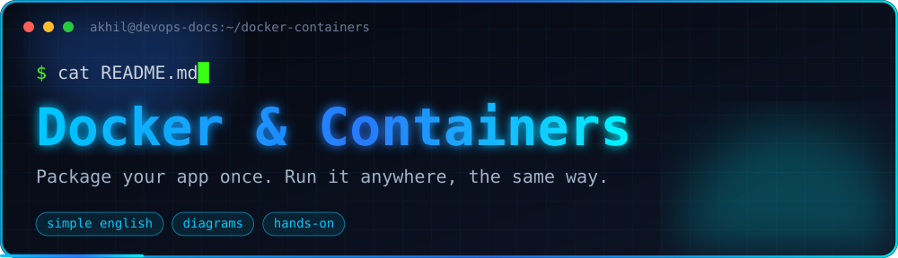
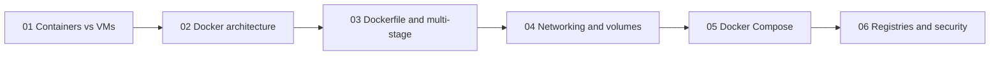

<p align="center"></p>

<p align="center">
  
  
  
  
</p>

---

## 🎯 Why this repo

"It works on my machine" is the oldest problem in software. Containers fix it by packing your app and everything it needs into one portable unit. Docker is the most popular tool for this. This repo explains containers from zero: what they are, how images work, how to write good Dockerfiles, how containers talk to each other, and how to keep them secure.

## 🗺️ Learning path



## 📚 Table of contents

| # | Topic | What you will learn |
|---|-------|---------------------|
| 01 | [Containers vs VMs](docs/01-containers-vs-vms.md) | What a container really is |
| 02 | [Docker architecture, images and layers](docs/02-docker-architecture-images-layers.md) | Client, daemon, images, layers |
| 03 | [Dockerfile best practices](docs/03-dockerfile-best-practices-multistage.md) | Small, fast, safe images with multi-stage builds |
| 04 | [Networking and volumes](docs/04-docker-networking-and-volumes.md) | Connect containers and keep data |
| 05 | [Docker Compose](docs/05-docker-compose.md) | Run multi-container apps with one file |
| 06 | [Registries and image security](docs/06-registries-and-image-security.md) | Push, pull, scan, and harden images |

## ⚡ Quick cheat sheet

```bash
docker build -t myapp:1.0 .            # build an image
docker run -d -p 8080:80 --name web myapp:1.0   # run in background
docker ps                              # running containers
docker ps -a                           # all containers
docker logs -f web                     # follow logs
docker exec -it web sh                 # open a shell inside
docker stop web && docker rm web       # stop and remove
docker images                          # list images
docker image prune -a                  # delete unused images
docker compose up -d                   # start a compose stack
docker compose down                    # stop and remove it
```

---

<p align="center">Part of the DevOps Hub by <a href="https://github.com/Akhilgoud01">@Akhilgoud01</a> — ⭐ star if it helped</p>
