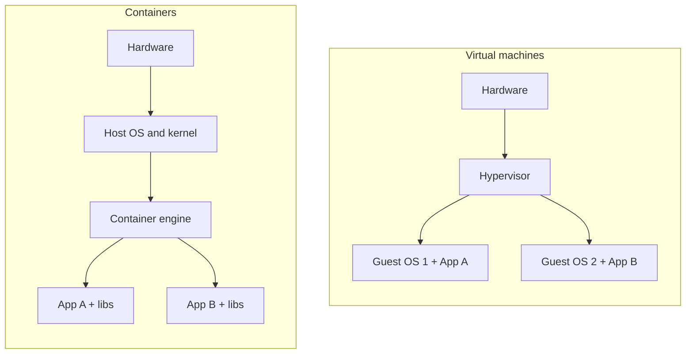
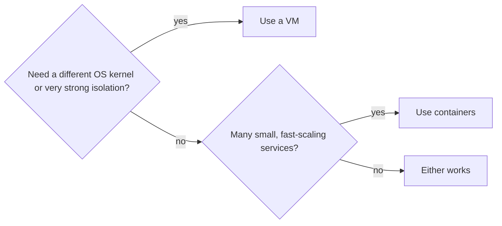

# 📦 01 · Containers vs Virtual Machines

> **In one line:** A container is a light, isolated box for one app that shares the host's operating system kernel, while a VM carries a whole operating system.

## 🧠 Simple explanation

Think of housing. A **virtual machine** is a separate house: its own walls, plumbing, and electricity. It is safe and isolated, but heavy and slow to build. A **container** is an apartment in a big building: it has its own locked door and private space, but all apartments share the building's plumbing and electricity (the **kernel**). Apartments are quick to set up and use fewer resources.



## 🔑 Key concepts

- **Kernel**: the core of the operating system. Containers share the host kernel. VMs each run their own.
- **Hypervisor**: software that creates and runs VMs (KVM, VMware, Hyper-V).
- **Container**: a normal Linux process with extra isolation.
- **Namespaces**: give a container its own view of processes, network, users, and mounts.
- **cgroups (control groups)**: limit how much CPU, memory, and I/O a container can use.
- **Union filesystem**: lets image layers stack into one filesystem.
- **Image**: the read-only template a container starts from.
- **Portability**: the same image runs the same on a laptop, a server, or the cloud.

### Side-by-side

| | Virtual Machine | Container |
|---|---|---|
| Includes | Full guest OS | App and libraries only |
| Size | Gigabytes | Megabytes to a few hundred MB |
| Start time | Minutes | Seconds or less |
| Isolation | Strong (hardware level) | Good (process level) |
| Density per server | Low | High |
| Best for | Different OSes, strong isolation | Microservices, CI, fast scaling |

## 🛠️ Hands-on

### See that a container is just a process

```bash
docker run -d --name demo nginx:alpine
docker top demo                       # processes inside the container
ps aux | grep nginx                   # you also see them on the host!
```

### Different view inside vs outside

```bash
docker exec demo ps                   # inside: few processes, PID 1 is nginx
docker exec demo hostname             # inside: its own hostname
hostname                              # outside: your host's name
```

### Limit resources (cgroups in action)

```bash
docker run -d --name limited \
  --memory=256m --cpus=0.5 \
  nginx:alpine

docker stats --no-stream limited
```

### Compare startup time

```bash
time docker run --rm alpine echo "hello"      # typically around a second
```

### Check the kernel is shared

```bash
uname -r                                       # host kernel
docker run --rm alpine uname -r                # same kernel version on Linux hosts
```

> On Docker Desktop for Mac or Windows, Docker runs a small Linux VM behind the scenes, so the kernel shown is that VM's kernel.

### Clean up

```bash
docker rm -f demo limited
```

### Where each one fits



In real life they are combined: containers often run **inside** VMs in the cloud.

## ⚠️ Common mistakes

- **Thinking containers are tiny VMs.** They share the kernel, so a kernel bug affects all.
- **Putting many apps in one container.** One main process per container is the norm.
- **Storing data inside the container.** It disappears when the container is removed.
- **Running as root inside the container** without need.
- **No resource limits.** One noisy container can starve others.
- **Expecting a Linux container to run natively on Windows or macOS** without a Linux VM layer.

## ✅ Quick recap

- A container is an isolated process that shares the host kernel.
- VMs are heavier and more isolated. Containers are light and fast.
- Namespaces isolate, cgroups limit.
- Containers and VMs are often used together.

➡️ **Next:** [02 · Docker architecture, images and layers](02-docker-architecture-images-layers.md)
