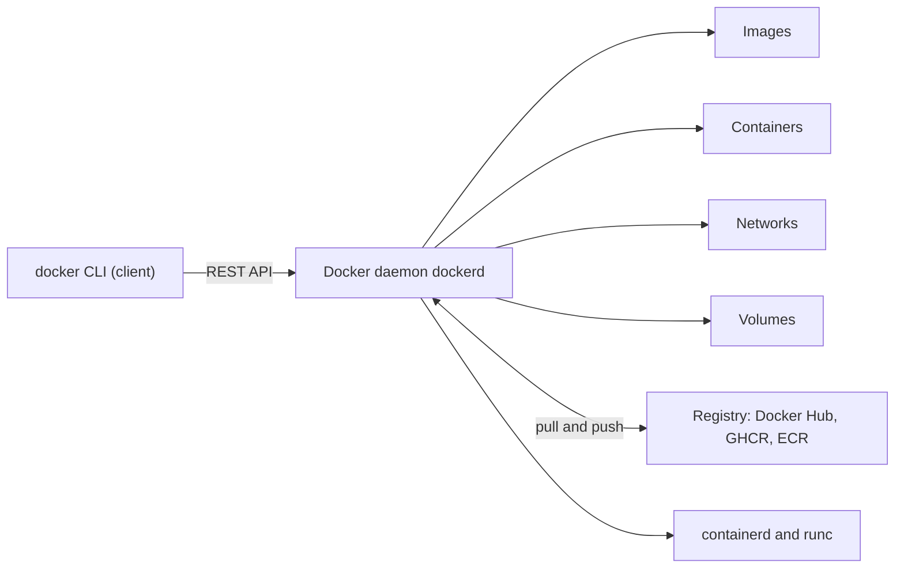
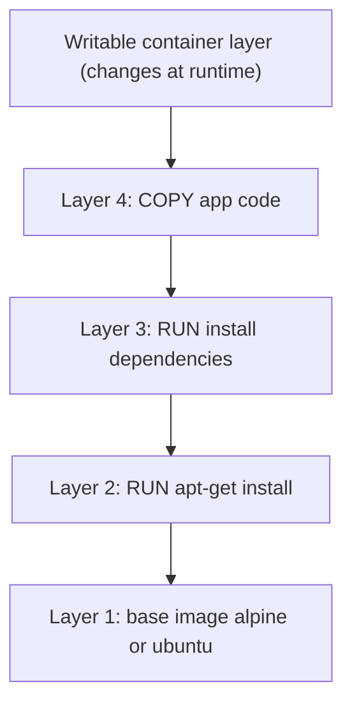
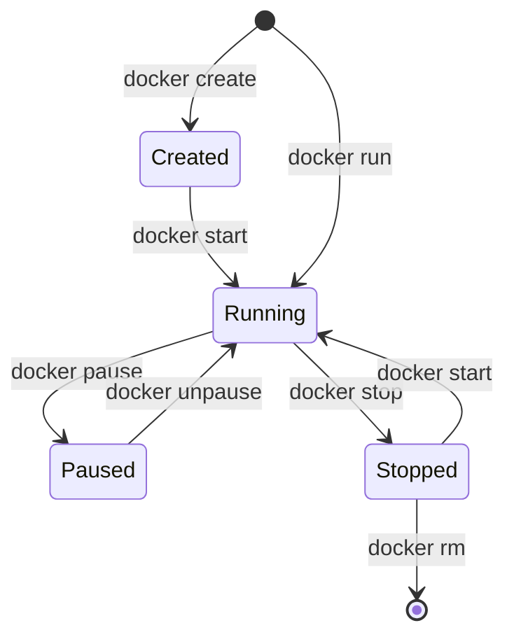

# 🏗️ 02 · Docker Architecture, Images and Layers

> **In one line:** The Docker client talks to the Docker daemon, which builds images made of stacked layers and runs them as containers.

## 🧠 Simple explanation

Think of a restaurant. You (the **client**) give your order to a waiter. The kitchen (the **daemon**) does the cooking. The **recipe** is the **image**: a fixed set of steps and ingredients. The **dish** on your table is the **container**: a live, running copy made from the recipe. You can make many dishes from one recipe.

An image is built in **layers**, like a stack of transparent sheets. Each instruction adds one sheet. If a sheet did not change, Docker reuses it from the **cache**. This is why second builds are fast.



## 🔑 Key concepts

- **Docker client (CLI)**: the `docker` command you type.
- **Docker daemon (`dockerd`)**: the background service that does the work.
- **containerd / runc**: lower-level tools that actually create and run containers.
- **Image**: a read-only template with your app, libraries, and settings.
- **Container**: a running (or stopped) instance of an image, with a thin writable layer on top.
- **Layer**: one filesystem change created by an instruction. Layers are shared between images.
- **Tag**: a label for an image version, like `nginx:1.27`. Without a tag you get `latest`.
- **Digest**: a unique fingerprint (`sha256:...`) that always points to the exact same image.
- **Registry**: a place to store and share images.
- **Build cache**: reuses unchanged layers.

### How layers stack



Only the top layer is writable. Everything below is read-only and shared.

## 🛠️ Hands-on

### Install check

```bash
docker version
docker info
```

### Image commands

```bash
docker pull nginx:1.27-alpine          # download an image
docker images                          # list local images
docker history nginx:1.27-alpine       # see the layers
docker inspect nginx:1.27-alpine       # full details as JSON
docker rmi nginx:1.27-alpine           # remove an image
```

### Container life cycle



```bash
docker run -d --name web -p 8080:80 nginx:1.27-alpine   # create and start
curl -s localhost:8080 | head -5

docker ps                       # running
docker logs web                 # output
docker exec -it web sh          # shell inside
docker stop web                 # graceful stop
docker start web                # start again
docker rm -f web                # force remove
```

### Useful `docker run` flags

| Flag | Meaning |
|------|---------|
| `-d` | run in the background |
| `-p 8080:80` | map host port 8080 to container port 80 |
| `--name web` | give it a name |
| `-e KEY=value` | set an environment variable |
| `-v data:/var/lib/x` | mount a volume |
| `--rm` | auto-delete when it stops |
| `-it` | interactive terminal |
| `--restart unless-stopped` | restart on crash or reboot |

### Watch layers and caching

```bash
mkdir demo && cd demo
cat > Dockerfile <<'EOF'
FROM alpine:3.20
RUN echo "layer one" > /one.txt
RUN echo "layer two" > /two.txt
EOF

docker build -t layers-demo .          # builds each layer
docker build -t layers-demo .          # second time: "CACHED" for every step
docker history layers-demo
```

### Disk usage and cleanup

```bash
docker system df                       # how much space Docker uses
docker container prune                 # remove stopped containers
docker image prune                     # remove dangling images
docker system prune                    # remove unused data (asks first)
```

## ⚠️ Common mistakes

- **Relying on `latest`.** It changes over time. Pin a version.
- **Confusing image and container.** Image is the template. Container is the running copy.
- **Expecting changes in a container to stay.** Deleting the container deletes its writable layer.
- **Forgetting `-p`.** Without port mapping, the host cannot reach the container.
- **Never cleaning up.** Old images and containers eat disk space.
- **Running the daemon access as a normal user without thinking.** Access to the Docker socket is effectively root access.

## ✅ Quick recap

- Client sends commands, daemon does the work.
- Images are read-only layered templates. Containers are running instances.
- Layers are cached and shared, which speeds up builds.
- Pin tags and clean up regularly.

➡️ **Next:** [03 · Dockerfile best practices and multi-stage builds](03-dockerfile-best-practices-multistage.md)
