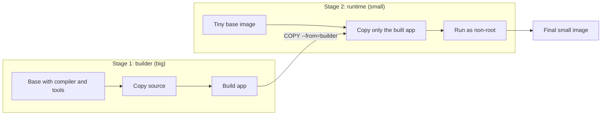

# 📝 03 · Dockerfile Best Practices and Multi-Stage Builds

> **In one line:** A Dockerfile is a recipe for an image, and a good one is small, fast to build, and safe to run.

## 🧠 Simple explanation

Packing a suitcase: you want only what you need, packed in a smart order so you can reopen it quickly. A Dockerfile lists the steps to build your image. A **multi-stage build** is like using a big workshop to build a chair, then shipping only the finished chair, not the saws and sawdust.



## 🔑 Key concepts

| Instruction | What it does |
|-------------|--------------|
| `FROM` | starts from a base image |
| `WORKDIR` | sets the working folder |
| `COPY` | copies files from your machine into the image |
| `ADD` | like COPY, plus URLs and tar extraction (prefer COPY) |
| `RUN` | runs a command at build time and creates a layer |
| `ENV` | sets an environment variable |
| `ARG` | build-time variable |
| `EXPOSE` | documents the port (does not publish it) |
| `USER` | switches to a non-root user |
| `CMD` | default command when the container starts |
| `ENTRYPOINT` | fixed program the container runs, `CMD` gives it default arguments |
| `HEALTHCHECK` | tells Docker how to test if the app is healthy |

- **Layer cache rule:** a changed layer invalidates every layer after it. Put things that change rarely **first**.
- **`.dockerignore`**: lists files that must not be sent to the build (like `.git`, `node_modules`, secrets).
- **Exec form vs shell form:** `CMD ["node","app.js"]` (exec form, preferred) vs `CMD node app.js`.

## 🛠️ Hands-on

### A basic Dockerfile (Node.js)

```dockerfile
FROM node:20-alpine
WORKDIR /app

# 1) copy only dependency files first, so this layer is cached
COPY package*.json ./
RUN npm ci --omit=dev

# 2) then copy the code, which changes often
COPY . .

USER node
EXPOSE 3000
CMD ["node", "server.js"]
```

### `.dockerignore`

```text
.git
node_modules
npm-debug.log
.env
Dockerfile
README.md
```

### Multi-stage build (Go example)

```dockerfile
# ---- build stage ----
FROM golang:1.23 AS builder
WORKDIR /src
COPY go.mod go.sum ./
RUN go mod download
COPY . .
RUN CGO_ENABLED=0 go build -o /out/app ./cmd/app

# ---- runtime stage ----
FROM gcr.io/distroless/static-debian12:nonroot
COPY --from=builder /out/app /app
USER nonroot:nonroot
EXPOSE 8080
ENTRYPOINT ["/app"]
```

The final image has just one binary, no compiler, no shell, and is only a few megabytes.

### Multi-stage build (Python example)

```dockerfile
FROM python:3.12-slim AS builder
WORKDIR /app
COPY requirements.txt .
RUN pip install --no-cache-dir --prefix=/install -r requirements.txt

FROM python:3.12-slim
WORKDIR /app
COPY --from=builder /install /usr/local
COPY . .
RUN useradd -m appuser
USER appuser
HEALTHCHECK --interval=30s --timeout=3s \
  CMD python -c "import urllib.request; urllib.request.urlopen('http://localhost:8000/health')" || exit 1
CMD ["gunicorn", "-b", "0.0.0.0:8000", "app:app"]
```

### Build and compare sizes

```bash
docker build -t myapp:1.0 .
docker images myapp
docker history myapp:1.0

# build a specific stage only
docker build --target builder -t myapp:builder .

# pass a build argument
docker build --build-arg APP_VERSION=1.0.0 -t myapp:1.0 .
```

### CMD vs ENTRYPOINT

```dockerfile
ENTRYPOINT ["ping"]
CMD ["localhost"]
```

```bash
docker run myimage              # runs: ping localhost
docker run myimage google.com   # runs: ping google.com
```

### Lint your Dockerfile

```bash
docker run --rm -i hadolint/hadolint < Dockerfile
```

### Best practices checklist

- Use a small, trusted base image (`alpine`, `slim`, `distroless`).
- Pin versions: `node:20.11-alpine`, not `node:latest`.
- Order instructions from least to most frequently changing.
- Combine related `RUN` commands and clean caches in the same layer:

```dockerfile
RUN apt-get update \
 && apt-get install -y --no-install-recommends curl \
 && rm -rf /var/lib/apt/lists/*
```

- Run as a **non-root** user.
- One main process per container.
- Never put secrets in the image (not in `ENV`, `ARG`, or `COPY`).
- Add a `HEALTHCHECK`.
- Use BuildKit secrets when a build needs a secret:

```dockerfile
RUN --mount=type=secret,id=npm_token \
    NPM_TOKEN=$(cat /run/secrets/npm_token) npm ci
```

```bash
docker build --secret id=npm_token,src=./npm_token.txt -t myapp .
```

## ⚠️ Common mistakes

- **`COPY . .` before installing dependencies.** Every code change reinstalls everything.
- **Forgetting `.dockerignore`.** Huge build context and leaked secrets.
- **Secrets in `ENV` or `ARG`.** They stay in image history.
- **Running as root.**
- **Using `latest` as the base.** Builds are not repeatable.
- **Shell form `CMD`.** The process does not receive stop signals properly. Use exec form.
- **Leaving build tools in the final image.** Use multi-stage.

## ✅ Quick recap

- Order layers so rarely-changing steps come first.
- Use multi-stage builds to ship only what you need.
- Run as non-root, pin versions, add `.dockerignore`.
- Never bake secrets into images.

➡️ **Next:** [04 · Docker networking and volumes](04-docker-networking-and-volumes.md)
