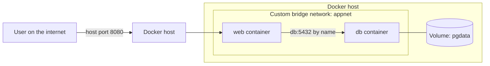
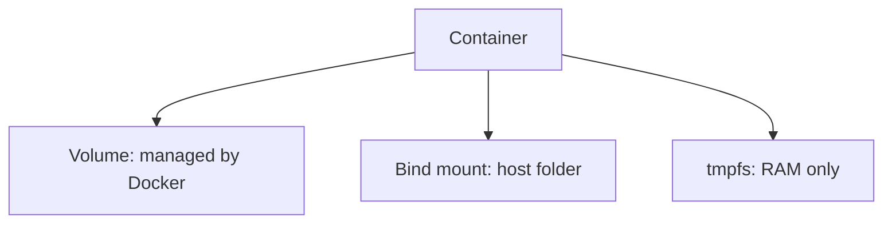

# 🌐 04 · Docker Networking and Volumes

> **In one line:** Networks let containers talk to each other and the world, and volumes keep your data safe after a container is gone.

## 🧠 Simple explanation

Imagine an office. **Networks** are the phone system: employees (containers) on the same floor can call each other by name, and the front desk (port mapping) lets outside visitors reach the right person. **Volumes** are filing cabinets: if an employee leaves, the paperwork stays in the cabinet.

Without a volume, data inside a container disappears when the container is deleted.



## 🔑 Key concepts

### Network drivers

| Driver | What it does | Use for |
|--------|--------------|---------|
| `bridge` | private network on one host (default) | most single-host apps |
| `host` | container shares the host's network | max performance, Linux only |
| `none` | no network | fully isolated jobs |
| `overlay` | spans multiple hosts | Swarm and multi-host setups |

- **Default bridge** has no name-based DNS. **Custom bridge** networks do. Always create your own.
- **Port publishing** (`-p host:container`) opens a container port to the outside.
- **Service discovery**: on a custom network, containers reach each other by **container name**.

### Storage options

| Type | Where data lives | Use for |
|------|------------------|---------|
| **Volume** | managed by Docker (`/var/lib/docker/volumes`) | databases, persistent data (recommended) |
| **Bind mount** | a folder you choose on the host | live code editing in development |
| **tmpfs** | memory only | temporary or sensitive data |



## 🛠️ Hands-on

### Networking

```bash
# create a custom network
docker network create appnet

# run two containers on it
docker run -d --name db --network appnet \
  -e POSTGRES_PASSWORD=secret postgres:16-alpine

docker run -d --name web --network appnet -p 8080:80 nginx:alpine

# web can reach db by NAME
docker exec web ping -c 2 db

# inspect
docker network ls
docker network inspect appnet
```

Port mapping variants:

```bash
docker run -d -p 8080:80 nginx          # all interfaces
docker run -d -p 127.0.0.1:8080:80 nginx   # only localhost (safer)
docker run -d -P nginx                  # random host ports for exposed ports
docker port web                         # show mappings
```

Connect or disconnect a running container:

```bash
docker network connect appnet other-container
docker network disconnect appnet other-container
```

### Volumes

```bash
# create and use a named volume
docker volume create pgdata
docker run -d --name pg \
  -e POSTGRES_PASSWORD=secret \
  -v pgdata:/var/lib/postgresql/data \
  postgres:16-alpine

# prove data survives
docker rm -f pg
docker run -d --name pg2 \
  -e POSTGRES_PASSWORD=secret \
  -v pgdata:/var/lib/postgresql/data \
  postgres:16-alpine            # data is still there

docker volume ls
docker volume inspect pgdata
docker volume rm pgdata         # only when no container uses it
```

### Bind mounts (great for development)

```bash
docker run -d --name devweb -p 8080:80 \
  -v "$(pwd)/site:/usr/share/nginx/html:ro" \
  nginx:alpine
# edit files in ./site and refresh the browser
```

`:ro` makes the mount read-only inside the container.

### tmpfs

```bash
docker run -d --tmpfs /tmp:rw,size=64m alpine sleep 3600
```

### Back up a volume

```bash
docker run --rm \
  -v pgdata:/data:ro \
  -v "$(pwd)":/backup \
  alpine tar czf /backup/pgdata-backup.tar.gz -C /data .
```

### Debug networking

```bash
docker run --rm --network appnet nicolaka/netshoot dig db
docker exec web cat /etc/resolv.conf
docker logs web
```

## ⚠️ Common mistakes

- **Using the default bridge** and then wondering why names do not resolve. Make a custom network.
- **Publishing database ports to the world** (`-p 5432:5432`). Keep them internal or bind to `127.0.0.1`.
- **Using `localhost` to reach another container.** `localhost` inside a container is itself. Use the other container's name.
- **No volume for databases.** Data is lost with the container.
- **Bind mount permission problems.** The container user may not match the host folder owner.
- **Deleting volumes by accident** with `docker system prune --volumes`.

## ✅ Quick recap

- Create custom bridge networks so containers can find each other by name.
- Publish only the ports the outside really needs.
- Use volumes for important data, bind mounts for development.
- Back up your volumes.

➡️ **Next:** [05 · Docker Compose](05-docker-compose.md)
