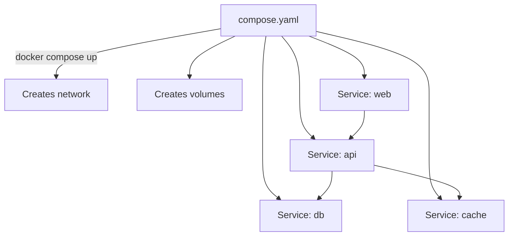

# 🎼 05 · Docker Compose

> **In one line:** Docker Compose lets you describe a whole multi-container app in one YAML file and start it with one command.

## 🧠 Simple explanation

Running a web app with a database, a cache, and a worker means many long `docker run` commands. That is like conducting an orchestra by shouting at each musician one by one. **Compose** is the sheet music: one file that says who plays what, and then you press play.



## 🔑 Key concepts

- **Compose file**: `compose.yaml` (or `docker-compose.yml`). It defines `services`, `networks`, and `volumes`.
- **Service**: one container definition (image or build, ports, env, and more). Can be scaled to many copies.
- **Project**: all resources from one Compose file, named after the folder.
- **Default network**: Compose creates one so services reach each other by **service name**.
- **`depends_on`**: start order. With `condition: service_healthy` it waits for health checks.
- **`.env` file**: Compose reads it automatically for `${VARIABLES}` in the file.
- **Profiles**: turn optional services on or off.
- **`docker compose`** (with a space) is the modern command. The old `docker-compose` is deprecated.

## 🛠️ Hands-on

### A full example: web app, database, and cache

Create `compose.yaml`:

```yaml
services:
  api:
    build:
      context: ./api
    ports:
      - "8000:8000"
    environment:
      DATABASE_URL: postgres://app:${DB_PASSWORD}@db:5432/appdb
      REDIS_URL: redis://cache:6379
    depends_on:
      db:
        condition: service_healthy
      cache:
        condition: service_started
    restart: unless-stopped
    networks:
      - backend

  db:
    image: postgres:16-alpine
    environment:
      POSTGRES_USER: app
      POSTGRES_PASSWORD: ${DB_PASSWORD}
      POSTGRES_DB: appdb
    volumes:
      - pgdata:/var/lib/postgresql/data
    healthcheck:
      test: ["CMD-SHELL", "pg_isready -U app -d appdb"]
      interval: 5s
      timeout: 3s
      retries: 10
    networks:
      - backend

  cache:
    image: redis:7-alpine
    networks:
      - backend

  web:
    image: nginx:1.27-alpine
    ports:
      - "8080:80"
    volumes:
      - ./nginx.conf:/etc/nginx/conf.d/default.conf:ro
    depends_on:
      - api
    networks:
      - backend

volumes:
  pgdata:

networks:
  backend:
```

Create `.env` next to it (and add it to `.gitignore`):

```bash
DB_PASSWORD=change-me-please
```

### Everyday commands

```bash
docker compose up -d                 # create and start everything
docker compose ps                    # status
docker compose logs -f api           # follow one service's logs
docker compose exec db psql -U app appdb   # run a command in a service
docker compose build                 # rebuild images
docker compose up -d --build         # rebuild and restart
docker compose stop                  # stop, keep containers
docker compose down                  # stop and remove containers and networks
docker compose down -v               # ALSO remove volumes (deletes data!)
docker compose config                # validate and show the final config
```

### Development override file

`compose.yaml` is the base. `compose.override.yaml` is merged automatically for local work:

```yaml
# compose.override.yaml
services:
  api:
    volumes:
      - ./api:/app          # live code reload
    environment:
      DEBUG: "true"
```

Use a separate file for production:

```bash
docker compose -f compose.yaml -f compose.prod.yaml up -d
```

### Scale a service

```bash
docker compose up -d --scale api=3
```

(Remove fixed host `ports:` for a scaled service, or ports will clash.)

### Profiles for optional tools

```yaml
services:
  adminer:
    image: adminer
    ports: ["8081:8080"]
    profiles: ["debug"]
```

```bash
docker compose --profile debug up -d
```

### Secrets and resource limits

```yaml
services:
  api:
    secrets:
      - db_password
    deploy:
      resources:
        limits:
          cpus: "0.50"
          memory: 256M

secrets:
  db_password:
    file: ./secrets/db_password.txt
```

## ⚠️ Common mistakes

- **Using `depends_on` without a health check.** The container starts, but the database may not be ready yet.
- **Using `localhost` between services.** Use the service name, like `db`.
- **`docker compose down -v` by habit.** It deletes your volumes.
- **Committing `.env` with real passwords.**
- **YAML indentation errors.** Run `docker compose config` to catch them.
- **Treating Compose as a production orchestrator.** It is great for local dev and small hosts. For scale and self-healing, look at Kubernetes.

## ✅ Quick recap

- One `compose.yaml` describes services, networks, and volumes.
- Services find each other by name on the Compose network.
- Use health checks with `depends_on`, and `.env` for settings.
- `up -d` to start, `down` to clean up.

➡️ **Next:** [06 · Registries and image security](06-registries-and-image-security.md)
