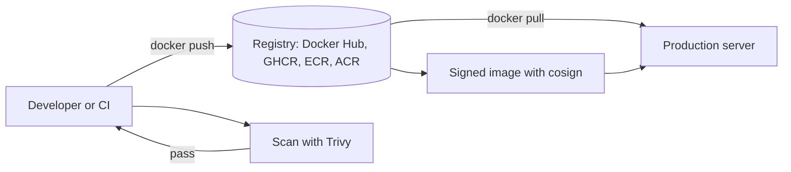
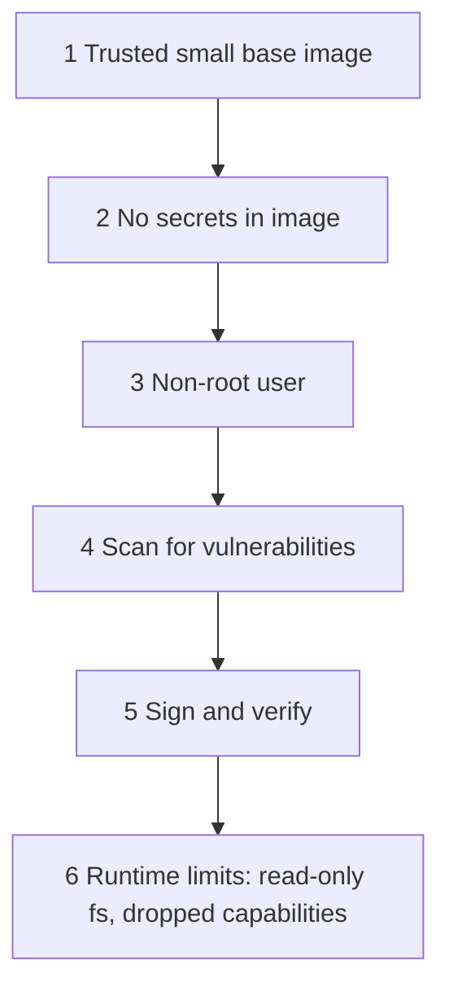

# 🔐 06 · Registries and Image Security

> **In one line:** A registry stores and shares your images, and good security habits make sure those images are safe to run.

## 🧠 Simple explanation

A **registry** is like an app store for container images. You **push** your image up, and servers **pull** it down. Just like you would check an app before installing it, you should check images before running them: Who made it? Does it have known problems? Does it run with too many powers?



## 🔑 Key concepts

- **Registry**: a server that stores images. **Repository**: a named collection of versions of one image.
- **Image name format**: `registry/namespace/name:tag`, e.g. `ghcr.io/akhilgoud01/myapp:1.0`.
- **Public vs private**: private registries need login.
- **Common registries**: Docker Hub, GitHub Container Registry (GHCR), Amazon ECR, Azure ACR, Google Artifact Registry, self-hosted Harbor.
- **Tag vs digest**: tags can move. A digest (`@sha256:...`) is permanent.
- **Vulnerability scan**: compares packages in the image with known CVE databases.
- **SBOM** (Software Bill of Materials): a list of everything inside an image.
- **Image signing**: proves who built an image and that it was not changed.
- **Least privilege**: give a container only the permissions it needs.
- **Rootless / non-root**: the app process does not run as the root user.
- **Capabilities**: split-up root powers. Drop what you do not need.

### The security layers



## 🛠️ Hands-on

### Push to a registry

```bash
# Docker Hub
docker login
docker tag myapp:1.0 myuser/myapp:1.0
docker push myuser/myapp:1.0

# GitHub Container Registry (use a personal access token with write:packages)
echo "$GITHUB_TOKEN" | docker login ghcr.io -u Akhilgoud01 --password-stdin
docker tag myapp:1.0 ghcr.io/akhilgoud01/myapp:1.0
docker push ghcr.io/akhilgoud01/myapp:1.0

# Pull
docker pull ghcr.io/akhilgoud01/myapp:1.0
```

### Amazon ECR example

```bash
aws ecr get-login-password --region us-east-1 \
 | docker login --username AWS --password-stdin 123456789012.dkr.ecr.us-east-1.amazonaws.com

docker tag myapp:1.0 123456789012.dkr.ecr.us-east-1.amazonaws.com/myapp:1.0
docker push 123456789012.dkr.ecr.us-east-1.amazonaws.com/myapp:1.0
```

### Run a local private registry

```bash
docker run -d -p 5000:5000 --name registry registry:2
docker tag myapp:1.0 localhost:5000/myapp:1.0
docker push localhost:5000/myapp:1.0
curl http://localhost:5000/v2/_catalog
```

### Pin by digest

```bash
docker pull nginx:1.27-alpine
docker inspect --format '{{index .RepoDigests 0}}' nginx:1.27-alpine
# use that value in your Dockerfile: FROM nginx@sha256:...
```

### Scan for vulnerabilities

```bash
# Trivy
trivy image myapp:1.0
trivy image --severity HIGH,CRITICAL --exit-code 1 myapp:1.0   # fail CI

# Docker's own tools (if available)
docker scout quickview myapp:1.0
```

### Create an SBOM

```bash
trivy image --format cyclonedx -o sbom.json myapp:1.0
```

### Sign and verify with cosign

```bash
cosign generate-key-pair
cosign sign --key cosign.key ghcr.io/akhilgoud01/myapp:1.0
cosign verify --key cosign.pub ghcr.io/akhilgoud01/myapp:1.0
```

### Harden at runtime

```bash
docker run -d --name safe \
  --user 10001:10001 \
  --read-only \
  --tmpfs /tmp \
  --cap-drop ALL \
  --security-opt no-new-privileges:true \
  --pids-limit 200 \
  --memory 256m \
  -p 127.0.0.1:8080:8080 \
  ghcr.io/akhilgoud01/myapp:1.0
```

What each flag does:

| Flag | Benefit |
|------|---------|
| `--user` | not root |
| `--read-only` | attacker cannot write to the filesystem |
| `--cap-drop ALL` | removes extra Linux powers |
| `no-new-privileges` | blocks privilege escalation |
| `--pids-limit`, `--memory` | limit damage from runaway processes |

### Never do these

```bash
docker run --privileged ...                       # almost full host access
docker run -v /var/run/docker.sock:/var/run/docker.sock ...   # host control
docker run -v /:/host ...                         # mounts the whole host
```

### Check what leaked into image history

```bash
docker history --no-trunc myapp:1.0 | grep -i -E "password|secret|token"
```

## ⚠️ Common mistakes

- **Pulling random images from the internet.** Prefer official, verified, or your own.
- **Never scanning.** New vulnerabilities appear every day. Scan in CI and on a schedule.
- **Secrets in image layers.** Deleting them in a later layer does not remove them from history.
- **Using `--privileged` or mounting the Docker socket** for convenience.
- **Large base images** with many unused packages. Use slim or distroless.
- **Public registry for private code.** Check repository visibility.
- **Never rebuilding.** Base images get security patches. Rebuild regularly.

## ✅ Quick recap

- Registries store images: tag them clearly and push from CI.
- Scan every image, generate an SBOM, and sign what you ship.
- Run as non-root with dropped capabilities and a read-only filesystem.
- Keep secrets out of images and rebuild often.

🎉 **You finished this repo.** Next, learn to run containers at scale: see the **kubernetes-guide** repo.
