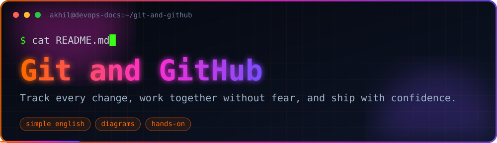
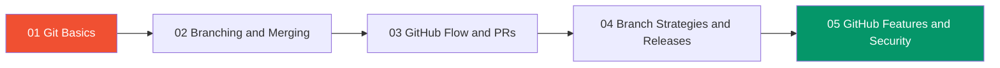

  
  
  
  

---

## 💡 Why this repo

Git is the base of modern DevOps. Pipelines, infrastructure code, and GitOps all start from a Git repository. This repo explains how Git really works, how teams use branches and pull requests, and which GitHub features keep your code safe.

## 🗺️ Learning path

## 📚 Table of contents

| # | Doc | What you will learn |
|---|-----|---------------------|
| 01 | [Git Basics and How It Works](docs/01-git-basics-and-how-it-works.md) | Working directory, staging area, repository, commits |
| 02 | [Branching, Merging, Rebasing](docs/02-branching-merging-rebasing.md) | Work in parallel and combine changes |
| 03 | [GitHub Flow, PRs, Code Review](docs/03-github-flow-prs-code-review.md) | The everyday team workflow |
| 04 | [GitFlow, Trunk-Based, Tags, Releases](docs/04-gitflow-trunk-based-and-tags-releases.md) | Choose a branching strategy and version your releases |
| 05 | [GitHub Features and Security](docs/05-github-features-issues-projects-actions-security.md) | Issues, Projects, Actions, branch protection, CODEOWNERS, secrets |

## 🧾 Quick cheat sheet

| Task | Command |
|------|---------|
| Start a repo / clone one | `git init` / `git clone <url>` |
| See changes | `git status`, `git diff` |
| Stage and commit | `git add .` then `git commit -m "message"` |
| New branch and switch | `git switch -c feature/login` |
| Update from remote | `git pull` (or `git fetch` then merge) |
| Push | `git push -u origin feature/login` |
| History | `git log --oneline --graph --decorate` |
| Undo last commit, keep changes | `git reset --soft HEAD~1` |
| Safely undo a pushed commit | `git revert <commit>` |
| Save work temporarily | `git stash` / `git stash pop` |

---

Part of the DevOps Hub by <a href="https://github.com/Akhilgoud01">@Akhilgoud01</a> — ⭐ star if it helped

