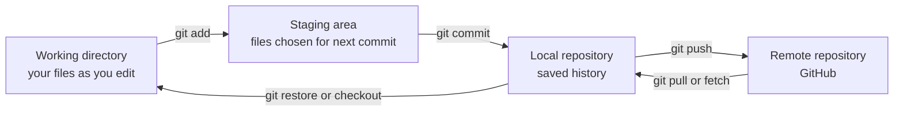
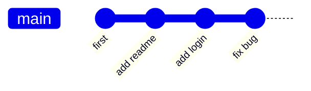

# 🌱 Git Basics and How It Works

> **In one line:** Git is a tool that saves snapshots of your project over time, so you can go back, compare, and work with others without overwriting each other.

## 🧠 Simple explanation

Imagine writing a book. Instead of saving `book_final`, `book_final2`, `book_REALLY_final`, you press a "save point" button with a short note. Each save point is a **commit**. You can jump back to any save point, and you can see who changed what.

Git is **distributed**: every developer has the full history on their own computer, not only on a central server.

## 🏗️ The three areas



- **Working directory:** the files you see and edit.
- **Staging area (index):** a waiting room. You choose exactly which changes go into the next commit.
- **Repository (.git folder):** the database of all commits.

## 🔑 Key concepts

- **Commit:** a snapshot with an ID (hash), author, date, message, and a link to its parent.
- **Branch:** a movable label pointing to a commit.
- **HEAD:** a pointer to where you are now.
- **Remote:** a copy of the repo on a server, usually named `origin`.
- **Hash:** a unique ID like `a1b2c3d`, calculated from the commit contents.



Every commit points back to its parent, making a chain. That chain is your history.

## 🛠️ Hands-on

### One-time setup

```bash
git config --global user.name  "Your Name"
git config --global user.email "you@example.com"
git config --global init.defaultBranch main
git config --global core.editor "code --wait"   # optional
git config --list
```

### Your first repository

```bash
mkdir my-project && cd my-project
git init                              # create a repo
echo "# My Project" > README.md
git status                            # see what Git sees
git add README.md                     # stage
git commit -m "Add README"            # save a snapshot
git log --oneline                     # view history
```

### The daily loop

```bash
# edit files...
git status                  # what changed?
git diff                    # exact changes (not staged)
git diff --staged           # exact changes (staged)
git add file1.py file2.py   # stage chosen files
git add -p                  # stage piece by piece (very useful)
git commit -m "Fix login timeout"
```

### Connect to GitHub

```bash
git remote add origin https://github.com/<your-user>/my-project.git
git push -u origin main     # -u remembers origin/main for future 'git push'
```

Or clone an existing repo:

```bash
git clone https://github.com/<user>/<repo>.git
```

### Ignore files you should not track

Create `.gitignore`:

```gitignore
node_modules/
*.log
.env
.DS_Store
dist/
```

### Undo things safely

```bash
git restore file.txt                 # discard unstaged changes in a file
git restore --staged file.txt        # unstage a file
git commit --amend -m "Better msg"   # fix the last commit message (before pushing)
git reset --soft HEAD~1              # undo last commit, keep changes staged
git revert <hash>                    # new commit that undoes an older commit (safe for shared history)
```

### Write good commit messages

```text
Short summary in 50 characters or less (imperative mood)

Optional longer explanation of WHY the change was made,
not just what changed.
```

## ⚠️ Common mistakes

- **Committing secrets** (`.env`, API keys, private keys). Removing them later does not erase history. Rotate the secret.
- **`git add .` without checking `git status`**, adding junk files.
- **Huge commits** with unrelated changes. Keep commits small and focused.
- **Vague messages** like "fix" or "update".
- **Using `git reset --hard`** without knowing it deletes uncommitted work.
- **Forgetting `.gitignore`** at the start of a project.

## ✅ Quick recap

- Files move: working directory, staging area, repository, remote.
- A commit is a snapshot linked to its parent.
- Daily loop: `status`, `diff`, `add`, `commit`, `push`.
- Use `revert` to undo shared history; use `restore` and `reset` for local work.

➡️ Next: [02 - Branching, Merging, Rebasing](02-branching-merging-rebasing.md)
