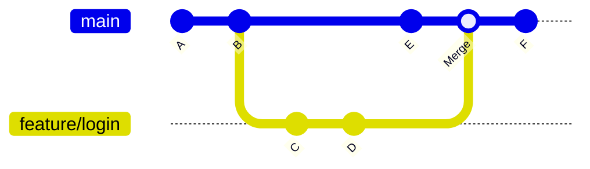
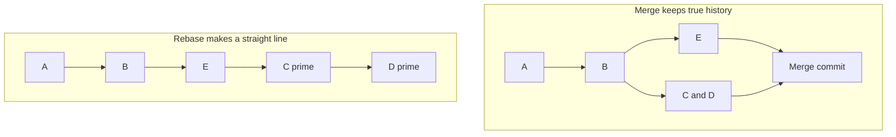

# 🔀 Branching, Merging, and Rebasing

> **In one line:** Branches let you work on changes in parallel, and merging or rebasing brings them back together.

## 🧠 Simple explanation

Think of a road. The main road is `main`. When you want to build a new feature, you build a **side road** (a branch) so traffic on the main road is not disturbed. When the side road is ready and tested, you **connect it** back to the main road (a merge).

Branches in Git are cheap. They are only small labels, so make one for every task.

## 🌿 Branch and merge picture



## 🔑 Key concepts

- **Fast-forward merge:** `main` has not moved, so Git just moves the label forward. No merge commit.
- **Three-way merge:** both branches have new commits, so Git creates a **merge commit** with two parents.
- **Merge conflict:** both branches changed the same lines. A human must choose.
- **Rebase:** replay your commits on top of another branch to make a straight history.
- **Cherry-pick:** copy one specific commit to another branch.
- **Stash:** shelf for unfinished changes.

### Merge vs rebase



| | Merge | Rebase |
|---|-------|--------|
| History | Shows branches and merge commits | Clean straight line |
| Commit IDs | Stay the same | Rewritten (new IDs) |
| Safe on shared branches? | Yes | **No** (never rebase commits others use) |
| Best for | Bringing a finished feature into `main` | Updating your own branch with latest `main` |

**Golden rule:** never rebase a branch that other people have pulled.

## 🛠️ Hands-on

### Branch basics

```bash
git branch                       # list local branches
git branch -a                    # include remote branches
git switch -c feature/login      # create and switch (modern)
git checkout -b feature/login    # older equivalent
git switch main                  # go back
git branch -d feature/login      # delete a merged branch
git branch -D feature/login      # force delete
git push origin --delete feature/login   # delete remote branch
```

### Merge a feature

```bash
git switch main
git pull                          # get the newest main
git merge feature/login           # bring the feature in
git push
```

Force a merge commit even if fast-forward is possible:

```bash
git merge --no-ff feature/login
```

### Resolve a merge conflict

Git marks the file like this:

```text
<<<<<<< HEAD
timeout = 30
=======
timeout = 60
>>>>>>> feature/login
```

Steps:

```bash
# 1. Open the file, pick the right lines, and remove the markers
# 2. Mark as resolved
git add path/to/file
# 3. Finish
git commit            # for a merge
# or: git rebase --continue   # if you were rebasing
# Abort if you panic:
git merge --abort     # or: git rebase --abort
```

### Rebase your branch onto the latest main

```bash
git switch feature/login
git fetch origin
git rebase origin/main
git push --force-with-lease       # needed after a rebase of a branch you already pushed
```

`--force-with-lease` is safer than `--force`: it refuses to overwrite work you have not seen.

### Clean up your commits (interactive rebase)

```bash
git rebase -i HEAD~3
# change 'pick' to 'squash' or 'fixup' to combine commits
```

### Cherry-pick and stash

```bash
git cherry-pick a1b2c3d           # copy one commit onto the current branch

git stash                         # hide uncommitted changes
git stash list
git stash pop                     # bring them back
```

### Look at history

```bash
git log --oneline --graph --decorate --all
git diff main..feature/login
git blame file.py                 # who changed each line
```

## ⚠️ Common mistakes

- **Working directly on `main`.** Use a branch per change.
- **Long-lived branches** that drift far from `main` and cause giant conflicts. Merge or rebase often.
- **Rebasing shared branches** and rewriting other people's history.
- **Using `git push --force`** instead of `--force-with-lease`.
- **Resolving conflicts without understanding** both sides. Talk to the other author when unsure.
- **Forgetting to pull** before starting new work.

## ✅ Quick recap

- A branch is just a label; make many.
- Merge keeps the true history; rebase makes it neat but rewrites it.
- Never rebase commits that others use.
- Conflicts are normal: edit, `git add`, continue.

⬅️ Previous: [01 - Git Basics](01-git-basics-and-how-it-works.md) | ➡️ Next: [03 - GitHub Flow, PRs, Code Review](03-github-flow-prs-code-review.md)
