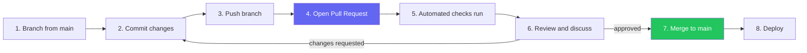
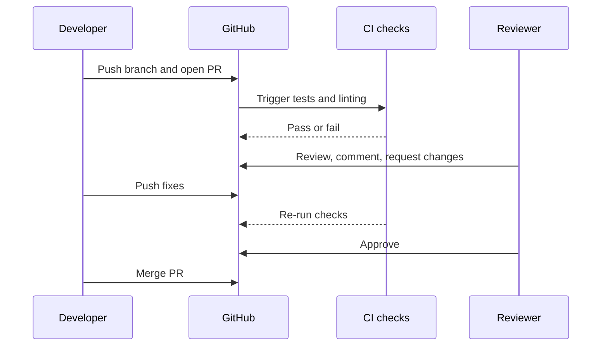
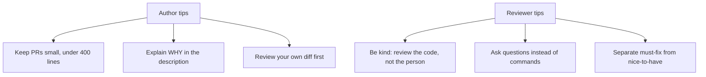

# 🤝 GitHub Flow, Pull Requests, and Code Review

> **In one line:** GitHub Flow is a simple routine: branch, commit, open a pull request, get a review, merge, and deploy.

## 🧠 Simple explanation

Think of a shared Google Doc where nobody edits the final version directly. Instead, you make a **copy**, change it, and then **ask your teammates to review** your changes. When they say "looks good", your changes are merged into the final version.

A **pull request (PR)** is that request: "Please pull my changes into `main`."

## 🔄 The flow



Main rule of GitHub Flow: **`main` is always deployable**.

## 📬 Sequence of a PR



## 🔑 Key concepts

- **Fork:** your own copy of someone else's repo (common in open source).
- **Pull request:** a proposal to merge one branch into another, with discussion.
- **Review states:** Comment, Approve, Request changes.
- **Status checks:** automated tests that must pass.
- **Draft PR:** a work in progress that is not ready for review.
- **Merge methods:**

| Method | Result | Use when |
|--------|--------|----------|
| Merge commit | Keeps all commits plus a merge commit | You want full history |
| Squash and merge | One commit on `main` | Many messy commits in the branch (very common) |
| Rebase and merge | Commits replayed in a line | You want linear history with all commits |

## 🛠️ Hands-on

### Full routine with Git and the GitHub CLI

```bash
git switch main && git pull
git switch -c fix/login-timeout

# ... edit code ...
git add -A
git commit -m "Increase login timeout to 60 seconds"
git push -u origin fix/login-timeout

# Open a PR from the terminal
gh pr create --title "Increase login timeout" \
             --body "Fixes #42. Users on slow networks were logged out." \
             --reviewer teammate

gh pr status                 # your PRs
gh pr checks                 # see CI results
gh pr view --web             # open in browser
gh pr merge --squash --delete-branch
```

### Review someone else's PR

```bash
gh pr list
gh pr checkout 57            # test the PR locally
gh pr review 57 --approve -b "Looks good, tests pass."
gh pr review 57 --request-changes -b "Please add a test for the empty case."
```

### Fork workflow (open source)

```bash
gh repo fork owner/project --clone
cd project
git remote add upstream https://github.com/owner/project.git
git fetch upstream
git switch -c docs/fix-typo
# edit, commit, push to your fork, then open a PR to upstream
git push -u origin docs/fix-typo
gh pr create --repo owner/project
```

### A PR template

Create `.github/pull_request_template.md`:

```markdown
## What does this change?
<!-- A short summary -->

## Why?
<!-- Link the issue: Closes #123 -->

## How was it tested?
- [ ] Unit tests
- [ ] Manually checked

## Checklist
- [ ] Documentation updated
- [ ] No secrets in the diff
```

### Code review tips



## ⚠️ Common mistakes

- **Giant PRs.** Nobody can review 3,000 lines well. Split them.
- **Merging with failing checks** "just this once".
- **Approving without reading** (rubber stamping).
- **No description.** Reviewers then guess the purpose.
- **Pushing to `main` directly**, bypassing review.
- **Letting PRs sit for days.** Review quickly to keep the flow fast.

## ✅ Quick recap

- GitHub Flow: branch, commit, PR, review, merge, deploy.
- `main` is always deployable; PRs protect it.
- Squash merge keeps history tidy.
- Small PRs with clear descriptions get faster, better reviews.

⬅️ Previous: [02 - Branching, Merging, Rebasing](02-branching-merging-rebasing.md) | ➡️ Next: [04 - GitFlow, Trunk-Based, Tags, Releases](04-gitflow-trunk-based-and-tags-releases.md)
