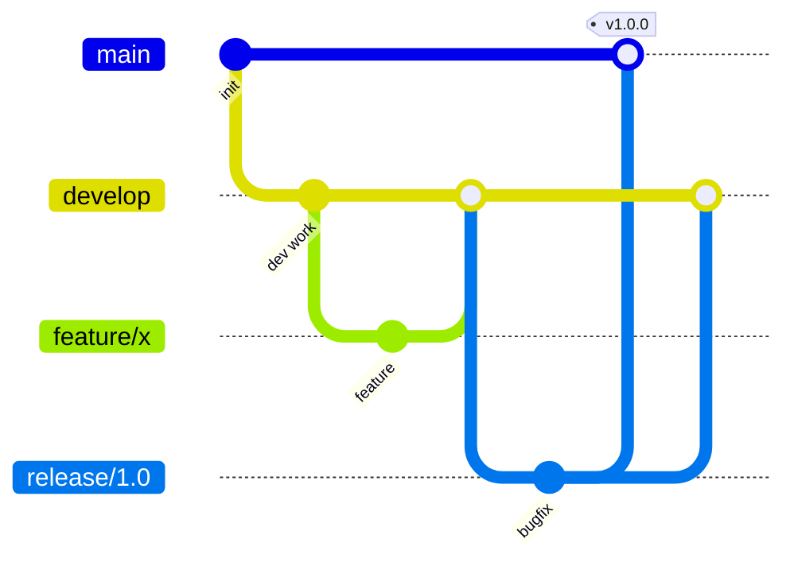
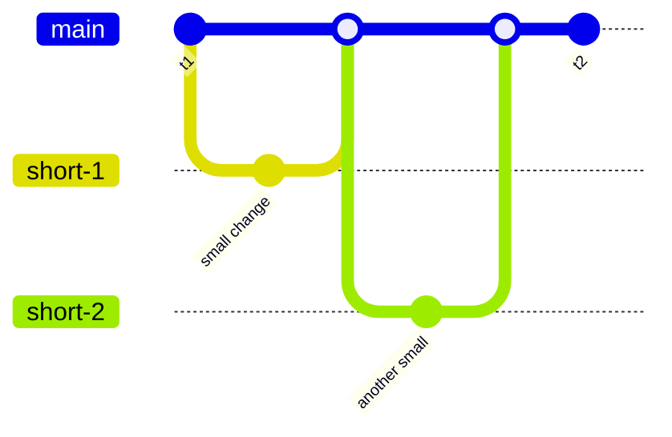

# 🏷️ GitFlow, Trunk-Based Development, Tags, and Releases

> **In one line:** A branching strategy is the team's agreement on how branches are used, and tags mark exact versions you release.

## 🧠 Simple explanation

A branching strategy is like **traffic rules**. Without rules, everyone drives anywhere and crashes happen. Some cities use many lanes and signals (GitFlow). Some use one fast lane with strict discipline (trunk-based).

A **tag** is a permanent sticky note on one commit, such as `v1.2.0`, saying "this exact code was released".

## 🧭 Strategy 1: GitFlow

GitFlow uses several long-lived branches. It fits software with scheduled, versioned releases (like desktop apps or libraries that support multiple versions).



| Branch | Purpose | Lives |
|--------|---------|-------|
| `main` | Production code only | forever |
| `develop` | Integration of finished features | forever |
| `feature/*` | One feature each | short |
| `release/*` | Final polish before a release | short |
| `hotfix/*` | Urgent production fix from `main` | short |

Pros: clear structure, supports many versions. Cons: heavy, long merges, slower delivery.

## 🧭 Strategy 2: Trunk-based development

Everyone works close to one branch (`main`, the "trunk"). Branches live for hours or at most a day or two. Unfinished work is hidden with **feature flags**. This fits CI/CD and DevOps well, and DORA research links it to high performance.



## ⚖️ Compare the strategies

| | GitHub Flow | GitFlow | Trunk-based |
|---|-------------|---------|-------------|
| Long-lived branches | `main` only | `main` and `develop` | `main` only |
| Branch lifetime | Days | Days to weeks | Hours to 1-2 days |
| Release style | Deploy often | Scheduled releases | Deploy continuously |
| Complexity | Low | High | Low (needs good tests and flags) |
| Best for | Web apps, SaaS | Versioned products | High-speed CI/CD teams |

## 🔑 Key concepts

- **Semantic Versioning (SemVer):** `MAJOR.MINOR.PATCH`, for example `2.4.1`.
  - MAJOR: breaking changes.
  - MINOR: new features, backward compatible.
  - PATCH: bug fixes.
- **Lightweight tag:** just a label. **Annotated tag:** includes author, date, and message (preferred for releases).
- **Release:** a GitHub page for a tag with notes and downloadable files.
- **Hotfix:** an urgent fix for production.
- **Changelog:** a human-readable list of changes per version.

## 🛠️ Hands-on

### Tags

```bash
git tag                                   # list tags
git tag -a v1.0.0 -m "First stable release"   # annotated tag
git show v1.0.0                           # view tag details
git push origin v1.0.0                    # push one tag
git push origin --tags                    # push all tags
git checkout v1.0.0                       # look at that exact version
git tag -d v1.0.0                         # delete locally
git push origin --delete v1.0.0           # delete on remote
```

### GitHub Releases

```bash
gh release create v1.0.0 \
  --title "v1.0.0" \
  --notes "First stable release" \
  ./dist/app.tar.gz

gh release create v1.1.0 --generate-notes   # auto-write notes from merged PRs
gh release list
```

### Use a tag to trigger a release pipeline

```yaml
# .github/workflows/release.yml
name: Release
on:
  push:
    tags:
      - "v*.*.*"
jobs:
  release:
    runs-on: ubuntu-latest
    permissions:
      contents: write
    steps:
      - uses: actions/checkout@v4
      - name: Build
        run: |
          mkdir -p dist
          tar -czf dist/app.tar.gz --exclude=.git .
      - name: Create GitHub release
        uses: softprops/action-gh-release@v2
        with:
          files: dist/app.tar.gz
          generate_release_notes: true
```

### A hotfix in GitFlow style

```bash
git switch main && git pull
git switch -c hotfix/payment-crash
# fix, commit
git switch main && git merge --no-ff hotfix/payment-crash
git tag -a v1.0.1 -m "Fix payment crash"
git switch develop && git merge --no-ff hotfix/payment-crash
git push origin main develop --tags
```

### Feature flag idea (trunk-based)

```python
import os

if os.getenv("FEATURE_NEW_CHECKOUT", "false") == "true":
    show_new_checkout()
else:
    show_old_checkout()
```

## ⚠️ Common mistakes

- **Choosing GitFlow because it looks professional**, even for a small web app that deploys daily.
- **Trunk-based without automated tests.** Speed without safety breaks production.
- **Moving or reusing tags.** A tag should point to one commit forever.
- **Not following SemVer**, so users cannot tell if an upgrade is safe.
- **Forgetting to merge a hotfix back** to `develop`.
- **Branches that live for weeks.** They become painful to merge.

## ✅ Quick recap

- GitFlow: structured, many branches, scheduled releases.
- Trunk-based: tiny branches, feature flags, continuous delivery.
- Tag every release with SemVer; use annotated tags.
- Pick the simplest strategy that fits how you release.

⬅️ Previous: [03 - GitHub Flow, PRs, Code Review](03-github-flow-prs-code-review.md) | ➡️ Next: [05 - GitHub Features and Security](05-github-features-issues-projects-actions-security.md)
