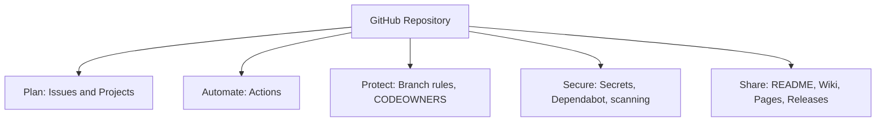
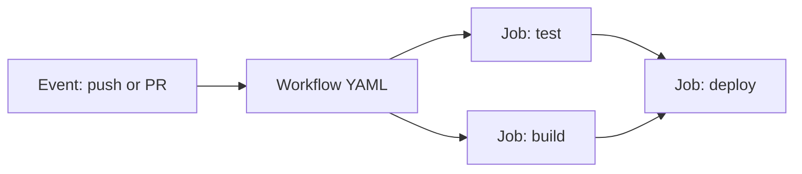

# 🛡️ GitHub Features: Issues, Projects, Actions, and Security

> **In one line:** GitHub is more than hosting code: it also plans work (Issues, Projects), automates builds (Actions), and protects your code (branch protection, CODEOWNERS, secrets, scanning).

## 🧠 Simple explanation

If Git is the engine, GitHub is the whole garage: a notice board for tasks, a robot assistant that runs your checks, and a security guard that decides who can change what.



## 🔑 Key concepts

### 1. Issues and Projects
- **Issue:** a trackable task, bug, or idea. Close it from a PR with "Closes #12".
- **Labels, milestones, assignees:** organize issues.
- **Projects:** a board or table (Kanban) that groups issues and PRs.
- **Issue templates:** forms that guide people to give the right details.

### 2. GitHub Actions
- **Workflow:** a YAML file in `.github/workflows/`.
- **Event:** what starts it (`push`, `pull_request`, `schedule`).
- **Job:** a group of steps on one runner. **Step:** one command or action.
- **Runner:** the machine that runs jobs.



### 3. Branch protection (rulesets)
Rules that protect important branches such as `main`:
- Require a pull request before merging.
- Require approvals (for example 1 or 2).
- Require status checks to pass.
- Block force pushes and deletion.
- Require signed commits or linear history (optional).

### 4. CODEOWNERS
A file that says who must review which paths. Place it at `.github/CODEOWNERS`.

### 5. Secrets
Encrypted values (tokens, passwords) stored in GitHub and used by Actions. They are masked in logs. Never commit them.

### 6. Security tools
- **Dependabot:** opens PRs to update vulnerable dependencies.
- **Secret scanning:** detects accidentally committed keys (push protection can block them).
- **Code scanning (CodeQL):** finds bugs and vulnerabilities in code.

Availability of some security features depends on your repo visibility and plan.

## 🛠️ Hands-on

### Issues from the CLI

```bash
gh issue create --title "Bug: login fails on Safari" --label bug --assignee @me
gh issue list --label bug
gh issue close 12
```

### Issue template: `.github/ISSUE_TEMPLATE/bug_report.md`

```markdown
---
name: Bug report
about: Something is broken
labels: bug
---

**What happened?**

**Steps to reproduce**
1.
2.

**Expected behavior**
```

### A real workflow: test on every PR

```yaml
# .github/workflows/test.yml
name: Test
on:
  pull_request:
  push:
    branches: [main]

permissions:
  contents: read          # least privilege

jobs:
  test:
    runs-on: ubuntu-latest
    strategy:
      matrix:
        python: ["3.11", "3.12"]
    steps:
      - uses: actions/checkout@v4
      - uses: actions/setup-python@v5
        with:
          python-version: ${{ matrix.python }}
      - run: pip install -r requirements.txt
      - run: pytest
```

### Use a secret in a workflow

```bash
# Store a secret (you will be prompted for the value)
gh secret set DEPLOY_TOKEN
```

```yaml
      - name: Deploy
        env:
          DEPLOY_TOKEN: ${{ secrets.DEPLOY_TOKEN }}
        run: ./deploy.sh
```

### CODEOWNERS

```text
# .github/CODEOWNERS
*                    @your-team/maintainers
/docs/               @your-team/writers
/infra/              @your-team/platform
*.tf                 @your-team/platform
/.github/workflows/  @your-team/devops
```

### Protect `main` with a ruleset (UI path)

1. Open the repo, then **Settings**, then **Rules**, then **Rulesets**.
2. Create a **branch ruleset** targeting `main`.
3. Enable: require a pull request, require approvals, require status checks, block force pushes.
4. Save and set enforcement to **Active**.

### Dependabot config: `.github/dependabot.yml`

```yaml
version: 2
updates:
  - package-ecosystem: "npm"
    directory: "/"
    schedule:
      interval: "weekly"
  - package-ecosystem: "github-actions"
    directory: "/"
    schedule:
      interval: "weekly"
```

### Other handy features
- **GitHub Pages:** free static site hosting from a repo.
- **Environments:** add approvals and secrets per stage (staging, production).
- **Discussions:** Q&A for your community.
- **Codespaces:** a cloud dev environment.

## ⚠️ Common mistakes

- **Committing secrets** instead of using GitHub Secrets. If it happened, revoke and rotate the secret immediately.
- **Over-broad `GITHUB_TOKEN` permissions.** Set `permissions:` to the minimum.
- **Using third-party actions without pinning.** Prefer a full commit SHA for unknown actions, and trust only reputable ones.
- **No branch protection** on `main`.
- **Secrets visible to untrusted PRs** (for example `pull_request_target` misuse on forks). Be careful with workflows triggered by outside contributors.
- **Ignoring Dependabot PRs** until they pile up.

## ✅ Quick recap

- Issues and Projects plan work; Actions automate it.
- Protect `main` with required PRs, reviews, and checks.
- CODEOWNERS routes reviews to the right people.
- Keep secrets in GitHub Secrets and turn on Dependabot and secret scanning.

🎉 You finished Git and GitHub. Next, explore [networking-for-devops](../../networking-for-devops/README.md).

⬅️ Previous: [04 - GitFlow, Trunk-Based, Tags, Releases](04-gitflow-trunk-based-and-tags-releases.md)
