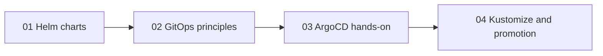

<h1 align="center">⎈ Helm & GitOps</h1>

<p align="center"><b>Package Kubernetes apps with Helm, and let Git be the single source of truth.</b></p>

<p align="center">
  
  
  
</p>

## 💡 Why this repo

Kubernetes YAML files pile up fast. Helm packages them so you can install an app with one command. GitOps goes one step further: you store the wanted state in Git, and a tool such as ArgoCD makes the cluster match it. These docs explain each idea in plain English, with diagrams and commands you can try.

## 🗺️ Learning path



## 📚 Table of contents

| # | Doc | What you will learn |
|---|-----|---------------------|
| 01 | [Helm charts explained](docs/01-helm-charts-explained.md) | Chart layout, values, templates, install, upgrade, rollback |
| 02 | [GitOps principles](docs/02-gitops-principles.md) | Pull vs push, drift, the four principles |
| 03 | [ArgoCD hands-on](docs/03-argocd-hands-on.md) | Install ArgoCD, write an Application, sync, fix drift |
| 04 | [Kustomize and environment promotion](docs/04-kustomize-and-environment-promotion.md) | Bases, overlays, dev to prod flow |

## ⚡ Quick cheat sheet

```bash
helm repo add bitnami https://charts.bitnami.com/bitnami
helm install web bitnami/nginx -n demo --create-namespace
helm upgrade web bitnami/nginx -f values.yaml -n demo
helm rollback web 1 -n demo
helm template web ./mychart          # render YAML locally
kubectl apply -k overlays/prod       # Kustomize
argocd app sync my-app               # ArgoCD
```

---
Part of the DevOps Hub by [@Akhilgoud01](https://github.com/Akhilgoud01) — ⭐ star if it helped
