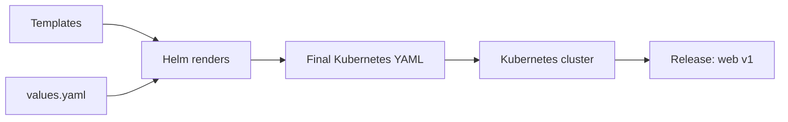
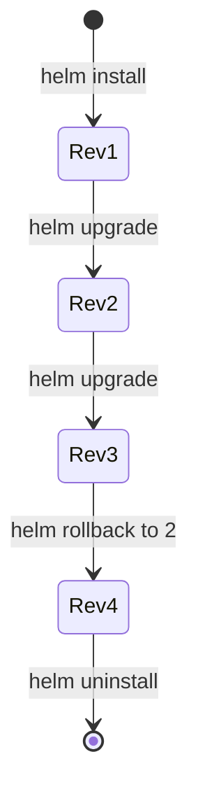

# ⎈ Helm Charts Explained

> In one line: Helm is the package manager for Kubernetes. A *chart* is a package, and a *release* is one installed copy of it.

## 🧠 Simple explanation

Think of installing an app on your phone. You do not copy every file by hand. You tap "Install" and the app store does the work. Helm is the app store for Kubernetes.

Without Helm you write many YAML files (Deployment, Service, Ingress, ConfigMap) and copy them for each environment. With Helm you write them once as *templates*. Then you give different *values* for dev and prod.



## 🔑 Key concepts

- **Chart**: a folder with templates and default values. It is the package.
- **Release**: one installed instance of a chart in a cluster. You can install the same chart many times with different names.
- **Values**: settings you can change, such as image tag or replica count.
- **Template**: a YAML file with placeholders like `{{ .Values.replicaCount }}`.
- **Repository**: a place that hosts charts (for example Bitnami, or an OCI registry).
- **Revision**: every install or upgrade creates a new numbered revision. This makes rollback possible.

### Chart folder layout

```text
mychart/
├── Chart.yaml          # name, version, description
├── values.yaml         # default values
├── charts/             # sub-charts (dependencies)
└── templates/
    ├── deployment.yaml
    ├── service.yaml
    ├── _helpers.tpl    # reusable template snippets
    └── NOTES.txt       # text shown after install
```

## 🛠️ Hands-on

### 1. Install Helm and use a public chart

```bash
# install (Linux/macOS)
curl -fsSL https://raw.githubusercontent.com/helm/helm/main/scripts/get-helm-3 | bash

helm repo add bitnami https://charts.bitnami.com/bitnami
helm repo update
helm search repo nginx
helm install web bitnami/nginx --namespace demo --create-namespace
helm list -n demo
```

### 2. Create your own chart

```bash
helm create mychart
```

Edit `values.yaml`:

```yaml
replicaCount: 2
image:
  repository: nginx
  tag: "1.27"
service:
  type: ClusterIP
  port: 80
```

A template that uses those values (`templates/deployment.yaml`, shortened):

```yaml
apiVersion: apps/v1
kind: Deployment
metadata:
  name: {{ .Release.Name }}-app
spec:
  replicas: {{ .Values.replicaCount }}
  selector:
    matchLabels:
      app: {{ .Release.Name }}
  template:
    metadata:
      labels:
        app: {{ .Release.Name }}
    spec:
      containers:
        - name: app
          image: "{{ .Values.image.repository }}:{{ .Values.image.tag }}"
          ports:
            - containerPort: 80
```

### 3. Check before you install

```bash
helm lint ./mychart                 # find mistakes
helm template demo ./mychart        # see the final YAML, no cluster needed
helm install demo ./mychart --dry-run --debug
```

### 4. Install, upgrade, roll back

```bash
helm install demo ./mychart -n demo --create-namespace

# change a value on the command line or with a file
helm upgrade demo ./mychart -n demo --set replicaCount=4
helm upgrade demo ./mychart -n demo -f prod-values.yaml

helm history demo -n demo           # list revisions
helm rollback demo 1 -n demo        # go back to revision 1
helm uninstall demo -n demo
```



Note: a rollback creates a *new* revision. It does not delete the old ones.

### 5. Use `upgrade --install`

This one command works for both first install and later updates. It is common in CI/CD.

```bash
helm upgrade --install demo ./mychart -n demo --create-namespace \
  -f values-prod.yaml --atomic --timeout 5m
```

`--atomic` rolls back automatically if the upgrade fails.

## ⚠️ Common mistakes

- **Putting secrets in `values.yaml` in Git.** Use a secret manager or sealed secrets instead.
- **Forgetting `helm repo update`.** You may install an old chart version.
- **Not pinning the chart version.** Use `--version 15.1.0` so installs are repeatable.
- **Editing resources with `kubectl edit` after a Helm install.** Helm does not know, and the next upgrade can undo or conflict with your change.
- **Wrong YAML indentation in templates.** Use `{{ toYaml .Values.x | nindent 6 }}` and always check with `helm template`.

## ✅ Quick recap

- A chart is a package. A release is an installed copy.
- Templates plus values give the final YAML.
- Every upgrade makes a revision, so you can roll back.
- Use `helm lint` and `helm template` before installing.

➡️ Next: [02 - GitOps principles](02-gitops-principles.md)
