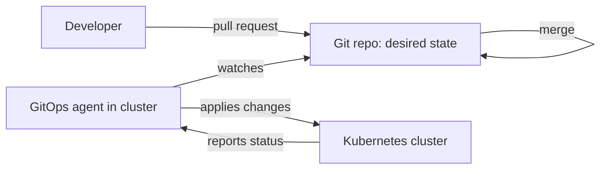
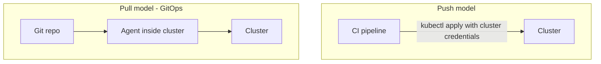
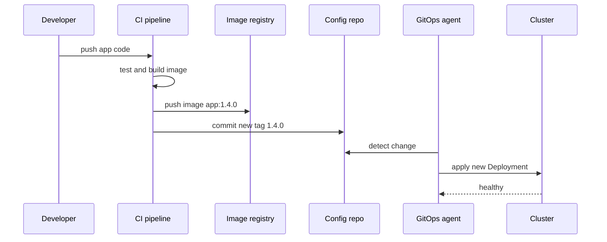

# 🔄 GitOps Principles

> In one line: GitOps means Git holds the wanted state of your system, and an automatic agent keeps the real system equal to it.

## 🧠 Simple explanation

Imagine a restaurant with a printed menu board on the wall. The board is the truth. If someone sticks a new dish on the kitchen wall by hand, a manager removes it, because it is not on the board. Git is the board. The cluster is the kitchen. The agent is the manager.

In old-style CI/CD, the pipeline *pushes* changes to the cluster. In GitOps, an agent *inside* the cluster *pulls* the changes from Git. This is safer, because the cluster does not need to expose credentials to the outside world.



## 🔑 Key concepts

The four OpenGitOps principles:

1. **Declarative**: you describe *what* you want (YAML), not the steps.
2. **Versioned and immutable**: state is stored in Git, so every change has history, an author, and a way to go back.
3. **Pulled automatically**: agents pull the approved state from Git.
4. **Continuously reconciled**: agents compare real state with wanted state all the time and fix differences.

Other words you will hear:

- **Desired state**: what Git says should exist.
- **Live state**: what is really running.
- **Drift**: when live state and desired state are different (for example, someone ran `kubectl scale`).
- **Reconciliation**: the loop that removes drift.
- **Two repos pattern**: one repo for app code, one repo for deployment config.

### Push vs pull



| Point | Push | Pull (GitOps) |
|-------|------|---------------|
| Cluster credentials | Stored in CI system | Stay inside the cluster |
| Drift fix | None, until next run | Automatic |
| Audit trail | Pipeline logs | Git history |
| Rollback | Re-run old pipeline | `git revert` |

## 🛠️ Hands-on

A typical GitOps flow, step by step:



Example config repo layout:

```text
config-repo/
├── apps/
│   └── web/
│       ├── deployment.yaml
│       └── service.yaml
└── clusters/
    ├── dev/
    └── prod/
```

CI updates the image tag (this is the only "deploy" step CI does):

```bash
cd config-repo
sed -i 's|image: myorg/web:.*|image: myorg/web:1.4.0|' apps/web/deployment.yaml
git commit -am "web: deploy 1.4.0"
git push
```

Roll back by reverting the commit:

```bash
git revert HEAD
git push
```

Popular GitOps tools:

| Tool | Notes |
|------|-------|
| ArgoCD | Web UI, many features, very common |
| Flux | Lightweight, runs as controllers, CLI-first |

## ⚠️ Common mistakes

- **Still using `kubectl apply` by hand.** It makes drift. Let the agent do it.
- **Secrets in plain text in Git.** Use Sealed Secrets, SOPS, or External Secrets Operator.
- **One giant repo with no structure.** Split by app and by environment.
- **Auto-sync to production with no review.** Use pull requests and approvals for prod.
- **Mixing app source and deploy config.** A config change then triggers a full build.

## ✅ Quick recap

- Git is the source of truth for what runs.
- An agent in the cluster pulls and reconciles.
- Drift is detected and can be corrected automatically.
- Rollback is a `git revert`.

➡️ Next: [03 - ArgoCD hands-on](03-argocd-hands-on.md)
