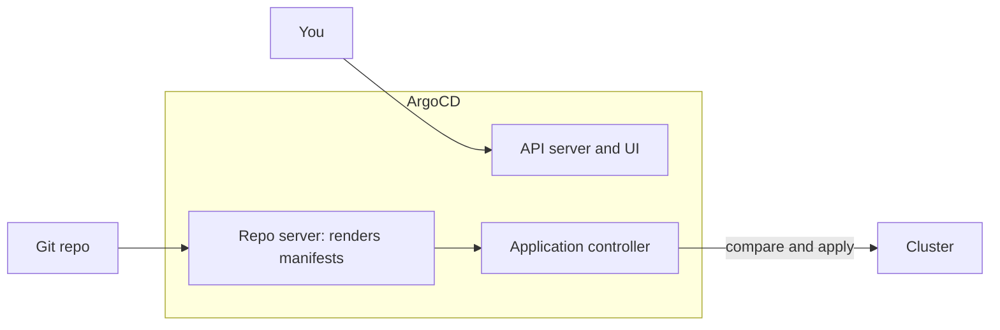
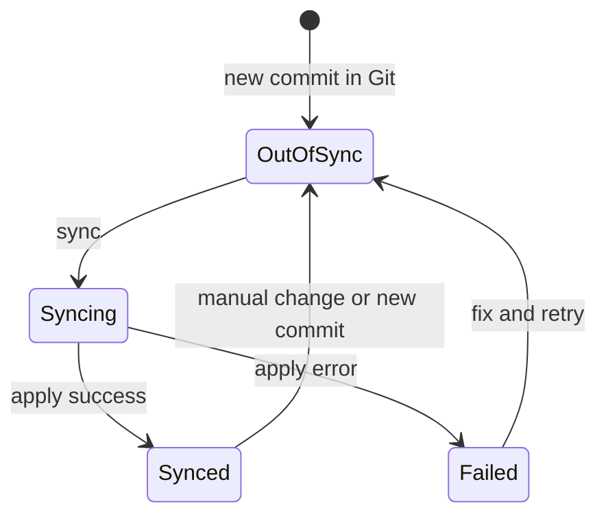
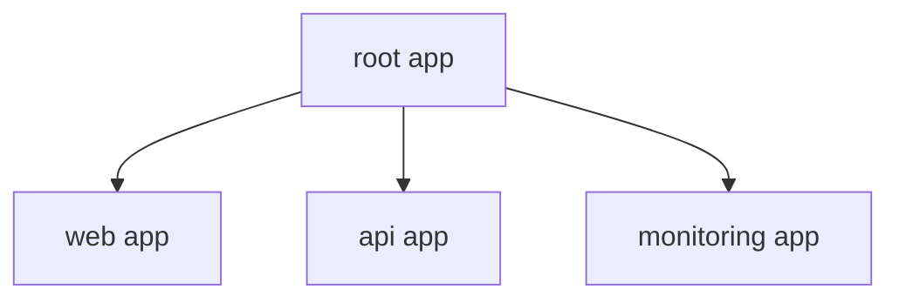

# 🐙 ArgoCD Hands-on

> In one line: ArgoCD watches a Git repo and keeps your Kubernetes cluster equal to what is in it.

## 🧠 Simple explanation

ArgoCD is like a very careful photocopier. It looks at the "original" in Git, looks at the "copy" in the cluster, and tells you if they differ. If you turn on auto-sync, it also fixes the copy for you.



## 🔑 Key concepts

- **Application**: an ArgoCD object that says "take manifests from this repo path and deploy them to this cluster and namespace".
- **Project (AppProject)**: groups apps and limits which repos and clusters they may use.
- **Sync status**: `Synced` means live equals Git. `OutOfSync` means they differ.
- **Health status**: `Healthy`, `Progressing`, `Degraded`, `Missing`.
- **Auto-sync**: ArgoCD applies changes by itself.
- **Self-heal**: ArgoCD reverts manual changes made in the cluster.
- **Prune**: ArgoCD deletes resources that were removed from Git.



## 🛠️ Hands-on

### 1. Install ArgoCD

```bash
kubectl create namespace argocd
kubectl apply -n argocd -f https://raw.githubusercontent.com/argoproj/argo-cd/stable/manifests/install.yaml
kubectl get pods -n argocd
```

### 2. Open the UI

```bash
kubectl port-forward svc/argocd-server -n argocd 8080:443
# first admin password
kubectl -n argocd get secret argocd-initial-admin-secret \
  -o jsonpath="{.data.password}" | base64 -d; echo
```

Open `https://localhost:8080`, user `admin`. Change the password after the first login.

### 3. Write an Application manifest

Save as `application.yaml`:

```yaml
apiVersion: argoproj.io/v1alpha1
kind: Application
metadata:
  name: web
  namespace: argocd
spec:
  project: default
  source:
    repoURL: https://github.com/YOUR-USER/config-repo.git
    targetRevision: main
    path: apps/web
  destination:
    server: https://kubernetes.default.svc
    namespace: web
  syncPolicy:
    automated:
      prune: true
      selfHeal: true
    syncOptions:
      - CreateNamespace=true
```

```bash
kubectl apply -f application.yaml
```

You can also use a Helm chart as the source:

```yaml
  source:
    repoURL: https://github.com/YOUR-USER/config-repo.git
    path: charts/web
    helm:
      valueFiles:
        - values-prod.yaml
```

### 4. Use the CLI

```bash
argocd login localhost:8080 --username admin --insecure
argocd app list
argocd app get web
argocd app diff web         # show what differs
argocd app sync web         # apply now
argocd app history web
argocd app rollback web 3   # needs auto-sync turned off
```

### 5. See drift and self-heal in action

```bash
kubectl scale deployment web -n web --replicas=10
# Git says 2 replicas. With selfHeal: true, ArgoCD puts it back to 2 within moments.
```

### 6. App of Apps pattern

One "root" Application points to a folder full of Application manifests. This lets you bootstrap a whole cluster from Git.



## ⚠️ Common mistakes

- **Using `latest` image tags.** Git shows no change, so ArgoCD cannot see a new version. Use fixed tags.
- **Turning on `prune` without care.** It may delete things you forgot to put in Git. Test in dev first.
- **Leaving the default admin password.** Change it, and set up SSO for teams.
- **Confusing Helm hooks with ArgoCD hooks.** ArgoCD renders Helm with `helm template`, so it does not run `helm install` and `helm list` will not show the release.
- **Giving every team the `default` project.** Create AppProjects to limit access.

## ✅ Quick recap

- An Application connects a Git path to a cluster namespace.
- Synced and Healthy are the two statuses to watch.
- `selfHeal` fixes manual drift. `prune` removes deleted resources.
- App of Apps lets Git define the whole cluster.

➡️ Next: [04 - Kustomize and environment promotion](04-kustomize-and-environment-promotion.md)
