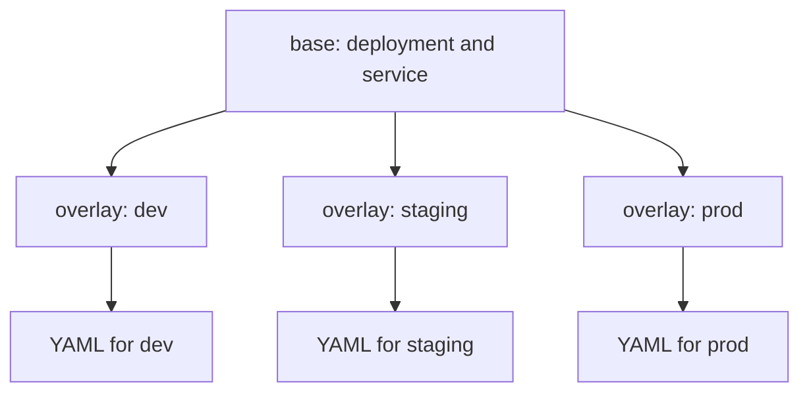

# 🧩 Kustomize and Environment Promotion

> In one line: Kustomize lets you keep one base set of YAML and apply small changes (patches) for dev, staging, and prod without copying files.

## 🧠 Simple explanation

Think of a school uniform. Everyone gets the same base shirt (the *base*). Each class adds a badge (the *overlay*). You do not sew a new shirt for each class. You just add something small on top.

Kustomize works the same way. It is built into `kubectl`, and it needs no template language.



## 🔑 Key concepts

- **Base**: common YAML shared by all environments.
- **Overlay**: a folder that points to the base and changes parts of it.
- **Patch**: a small edit (for example, change replicas to 5).
- **`kustomization.yaml`**: the file that lists resources, patches, images, and labels.
- **Promotion**: moving a tested version from one environment to the next (dev, then staging, then prod).

Helm vs Kustomize:

| Point | Helm | Kustomize |
|-------|------|-----------|
| Style | Templates plus values | Plain YAML plus patches |
| Learning curve | Higher | Lower |
| Packaging and sharing | Strong (charts, repos) | Weak |
| Good for | Third-party apps | Your own apps across environments |

Many teams use both: Helm for vendor charts, Kustomize for their own overlays.

## 🛠️ Hands-on

### 1. Folder layout

```text
app/
├── base/
│   ├── deployment.yaml
│   ├── service.yaml
│   └── kustomization.yaml
└── overlays/
    ├── dev/
    │   └── kustomization.yaml
    └── prod/
        ├── kustomization.yaml
        └── replica-patch.yaml
```

### 2. The base

`base/kustomization.yaml`:

```yaml
apiVersion: kustomize.config.k8s.io/v1beta1
kind: Kustomization
resources:
  - deployment.yaml
  - service.yaml
```

### 3. The overlays

`overlays/dev/kustomization.yaml`:

```yaml
apiVersion: kustomize.config.k8s.io/v1beta1
kind: Kustomization
namespace: web-dev
resources:
  - ../../base
images:
  - name: myorg/web
    newTag: "1.5.0-rc1"
```

`overlays/prod/kustomization.yaml`:

```yaml
apiVersion: kustomize.config.k8s.io/v1beta1
kind: Kustomization
namespace: web-prod
resources:
  - ../../base
images:
  - name: myorg/web
    newTag: "1.4.0"
patches:
  - path: replica-patch.yaml
```

`overlays/prod/replica-patch.yaml`:

```yaml
apiVersion: apps/v1
kind: Deployment
metadata:
  name: web
spec:
  replicas: 5
```

### 4. Preview and apply

```bash
kubectl kustomize overlays/prod        # see the final YAML
kubectl apply -k overlays/prod         # apply it
kubectl diff -k overlays/prod          # what would change?
```

Set an image tag from CI:

```bash
cd overlays/dev
kustomize edit set image myorg/web=myorg/web:1.5.0
```

### 5. Promote through environments with Git

```mermaid
flowchart LR
    CI["CI builds image 1.5.0"] --> D["PR: update dev overlay"]
    D --> DT["ArgoCD deploys to dev"]
    DT --> T["Tests pass"]
    T --> S["PR: update staging overlay"]
    S --> ST["Deploys to staging"]
    ST --> A["Manual approval"]
    A --> P["PR: update prod overlay"]
    P --> PT["Deploys to prod"]
```



Each step is just a Git commit that changes one `newTag` line. The same image is promoted, so you test exactly what you ship.

ArgoCD Application for prod:

```yaml
apiVersion: argoproj.io/v1alpha1
kind: Application
metadata:
  name: web-prod
  namespace: argocd
spec:
  project: default
  source:
    repoURL: https://github.com/YOUR-USER/config-repo.git
    targetRevision: main
    path: app/overlays/prod
  destination:
    server: https://kubernetes.default.svc
    namespace: web-prod
  syncPolicy:
    automated:
      selfHeal: true
```

Tip: use auto-sync for dev, and require a pull request approval (or manual sync) for prod.

## ⚠️ Common mistakes

- **Rebuilding the image for each environment.** Build once, promote the same image.
- **Copy-pasting full YAML into every overlay.** Then you lose the benefit. Keep overlays small.
- **Wrong relative path to the base.** `../../base` must match your folder depth.
- **Patching with the wrong `name` or `kind`.** The patch must match the target resource exactly.
- **Branch-per-environment.** Folders per environment are easier to compare and review than long-lived branches.

## ✅ Quick recap

- Base plus overlays means no copied YAML.
- `kubectl apply -k` builds and applies an overlay.
- Promotion is a small Git change to the next environment.
- Build once, promote the same artifact.

🎉 You finished this repo. Go back to the [README](../README.md).
